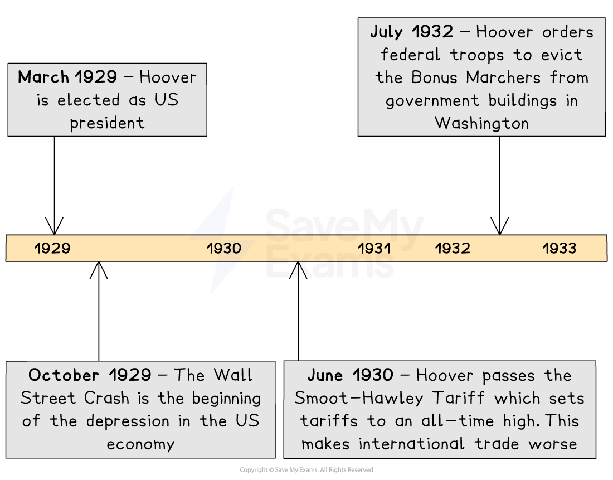
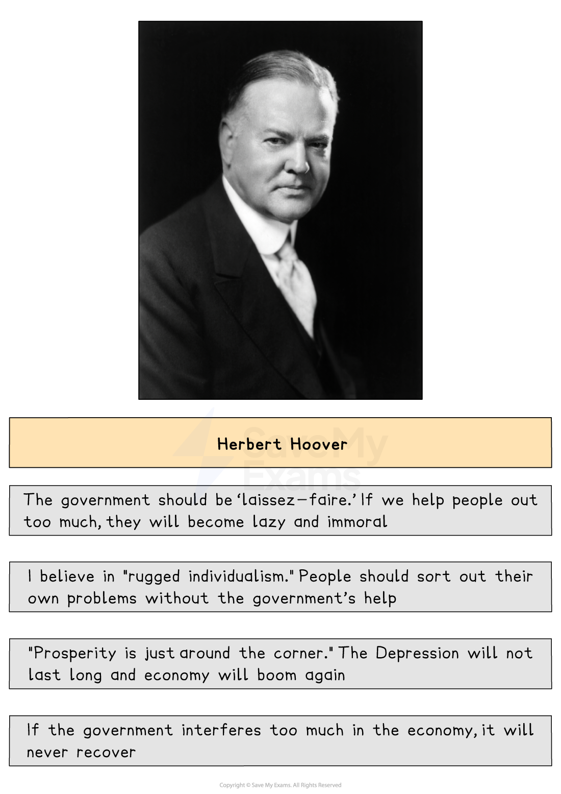
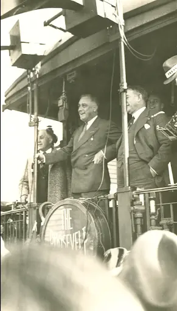
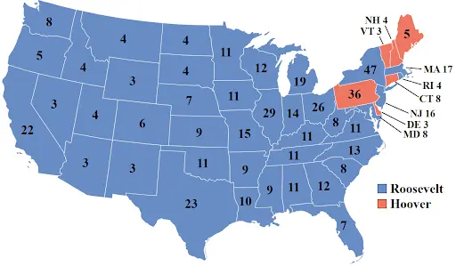

# Why Did Roosevelt Win the Election of 1932?

## Timeline & Summary

**President Herbert Hoover** believed that every American should be free to succeed — or fail — on their own merits. The US was the land of *the “American Dream”*, where anyone could become rich through hard work. Hoover believed that the government should stay out of people’s lives and let them get on with it.

This was a very popular policy in the 1920s when things were booming. People didn’t need the government's help, and they appreciated the** low taxes**. However, when disaster struck and the ***stock market *****crashed** in October 1929, people’s attitudes changed. Unfortunately, President Hoover’s didn’t.

Hoover believed that people should look to themselves to solve their problems, not the government. He eventually changed his mind and introduced a series of measures to help people, but it was too late to stop him from becoming very unpopular with the American people. When he used force against some Army *veterans *campaigning for financial help, he became even more unpopular.

Hoover’s opponent in the 1932 presidential election was** Franklin D. Roosevelt**. He was a great public speaker and promised to help people out of the **Great Depression**. The result was a defeat for Herbert Hoover and the election of Roosevelt as president.

## Hoover’s beliefs

> **Spec point** — `spcpt_MnQ79BkHBTFbFHpQ`

## Hoover’s beliefs

*An illustration showing some of Hoover’s core beliefs*

## The reaction of President Hoover to the Crash

> **Spec point** — `spcpt_9HP7sfgGHm52bxDr`

## The reaction of President Hoover to the Crash

- Initially, Hoover did very little in reaction to the Crash

  - He believed it was wrong for the government to step in to help and thought that self-reliance or “**rugged individualism**” would pull America through
  - In January 1930, he declared to the American people that “we have now passed the worst”
- It soon became clear that things were getting much worse and that Hoover had misread the situation terribly
- Between 1930 and 1932, Hoover introduced a number of measures and initiatives to improve the US economy
- These included:

  - A **tax cut of \$130million**, which allowed people to keep more of the money they earned
  - A **road- and dam-building programme** to create employment for construction workers
  - The **Smoot-Hawley tariff**, which increased the price of foreign imports
  - This was intended to make Americans buy more US goods, but it caused foreign countries to introduce tariffs on US goods
  - As a result, **US exports collapsed**,** **and companies went bust
  - He made** \$300 million** available to help unemployed people
- These actions were **not enough** to mend the damage done by his early inaction

  - Many Americans saw him as being **out of touch** with the reality of the situation and **uncaring** about their suffering

## The Bonus Marchers

> **Spec point** — `spcpt_C9dVwBdJDSrb6p64`

## The Bonus Marchers

- Hoover’s attitude and actions towards the **Bonus Marchers** damaged his reputation even further
- The Bonus Marchers were a group of 25,000 First World War veterans who wanted their war *pension* (or bonus) paid immediately rather than in 1945

  - When this was refused, they marched to Washington, DC, and set up a *Hooverville *directly outside the White House in March 1932
- Hoover decided to remove the Bonus Marchers by force
- The Army used* ****tear gas*** and** tanks** to move the Bonus Marchers

  - The US army killed two protestors and a baby
  - More than 1,000 people were injured
- Hoover’s approach shocked many US citizens because:

  - US society treated veterans with the utmost respect due to their service
  - People believed this proved that Hoover did not care about US citizens
  - He was unwilling to give support to ex-soldiers who served to protect the US
- The incident made people **determined to vote against Hoover** in the next election

  - 1932 was an election year
  - Hoover’s actions against patriotic Americans made him even more unpopular with the public

## Roosevelt’s campaign

> **Spec point** — `spcpt_6M4FmSx945NwKfXQ`

## Roosevelt’s campaign

- Hoover’s opponent in 1932 was the **Democratic **presidential candidate **Franklin D. Roosevelt **
- Unlike Hoover, Roosevelt ran an election campaign that won the hearts and minds of millions of struggling Americans

### Roosevelt’s tactics and why they were effective

- Roosevelt was an excellent* ***orator **
- He travelled 20,000 km by train across the country, making speeches

  - People listened to Roosevelt’s vision for the US; he seemed like he cared about the American people
- Roosevelt promised that his government would help the “**forgotten man**”

  - Many people in the US felt like the “forgotten man” — they trusted that Roosevelt would help them recover from the economic crisis
- Roosevelt highlighted his own struggles

  - He was disabled after suffering from *polio *at the age of 39
  - The US public believed that Roosevelt understood what it was like to go through suffering
  
    - Hoover’s backstory as a self-made millionaire was unrelatable to most people in the US
- Roosevelt promised a “**New Deal**”** **to resolve the Depression

  - He promised to create government schemes to provide more jobs and revive industry and farming
  - He wanted to provide help for those on low incomes and without jobs and to improve worker protection; he promised to end Prohibition
- The American people liked Roosevelt’s ideas
- They recognised that Roosevelt had listened to the concerns of the people and knew how to resolve them

*A photograph of Roosevelt delivering a speech from the back of a train in New Albany, Indiana (22nd October 1932)*

## The 1932 presidential election

> **Spec point** — `spcpt_jVkFzhTwHyCnVr37`

## The 1932 presidential election

- The result was victory for Roosevelt in the biggest* landslide** *in US history

  - Roosevelt won about 7 million more votes than Hoover
  - Roosevelt won the vote in 42 states
  - Hoover won in just six

*A map showing the results of the 1932 presidential election. The numbers represent the number of electoral college votes. Hoover only won Delaware (DE), Pennsylvania (PA), Connecticut (CT), Maine (ME), New Hampshire (NH) and Vermont (VT)*

> **Worked Example**
> **Describe the attempts made by Hoover to deal with the effects of the Depression. **
> 
> **[4 marks]**
> 
> **Final answer:** **Answer:**
> 
> One attempt made by Hoover to deal with the effects of the Depression was the introduction of an enormous road- and dam-building programme. This required the employment of large numbers of construction workers who would probably otherwise have been unemployed.
> 
> Another attempt made by Hoover to deal with the effects of the Depression was the introduction of the Smoot–Hawley Tariff. This placed a tariff on imported foreign goods, making them more expensive and making US-made goods more appealing to American shoppers. However, other countries introduced tariffs on US goods in response, which caused US exports to collapse
