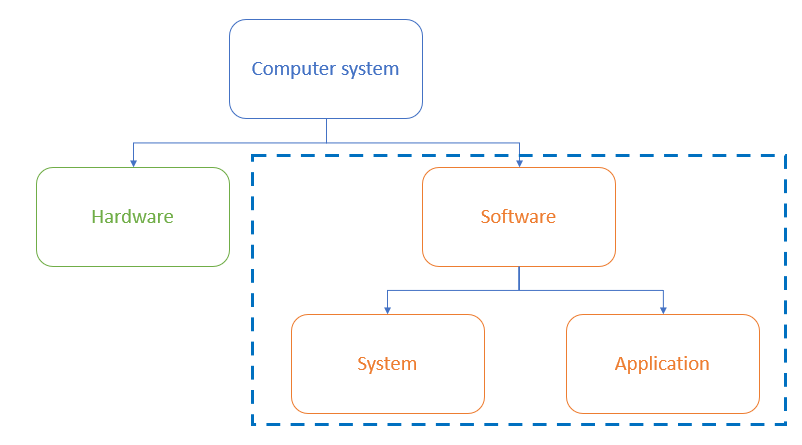

# Software

## Software

> **Spec point** — `spcpt_xstfSqGwnxXzRMz4`

## Software

### What is software?

- Software is the set of programs that **control the hardware**; they live on the computer system but **cannot be physically touched**
- Software can be broken down in to two categories:

  - **Application **software
  - **System  **software

### What is application software?

- Application software (abbreviated 'apps') is software **chosen by a user** to help them **carry out a specific task**
- Application software is **installed on top of system software** and is user-chosen to best suit **industry requirements**
- Common categories of application software include:

  - **Word processing**: creating and editing text documents
  - **Spreadsheet**: organising and analysing data in a grid format
  - **Database management systems**: storing, retrieving and managing data in databases
  - **Control/measurement**: uses sensors to measure and control a system
  - **Video editing**: creating and modifying video files
  - **Graphics editing**: creating and modifying images
  - **Audio editing**: creating and modifying sound files
  - **Computer-Aided Design (CAD)**: designing and modelling objects in 2D or 3D

### What is system software?

- System software is software **essential for the operation of a computer system**
- Without system software, a user has** no starting point** for giving a computer instructions
- System software gives users** a platform to run applications** and carry out tasks
- Essential services carried out by system software include:

  - **Compilers**: translating high-level programming languages into machine code
  - **Linkers**: combining object files into a single executable program
  - **Device drivers**: controlling hardware components and peripherals
  - **Operating systems**: managing the computer's resources and providing a user interface
  - **Utilities**: tools for maintaining and optimising the computer's performance

> **Exam Hint**
> A common misconception is that control software is system software—it's actually application software!

## Operating Systems

> **Spec point** — `spcpt_4xpGB5G57Rjqy8xJ`

## Operating Systems

### What is an operating system?

- An operating system (**OS**) is software that **provides an interface between the user and the hardware** in a computer system
- An operating system enables a system to function by:

  - **Controlling input/output devices**
  - **Oversees loading, running and storage of application software**
  - **Deals with errors**
  - **Maintains security**
  - **Keeps a log of events**

#### What is a user interface?

- A user interface is **how the user interacts with the operating system**
- Examples of user interfaces include:

  - **Command Line Interface (CLI)**
  - **Graphical User Interface (GUI)**
  - **Dialogue-based**
  - **Gesture-based**

| Feature | **CLI** | **GUI** | **Dialogue-based** | Gesture-based |
|---|---|---|---|---|
| **How do users interact?** | Text-based commands | Visual elements (*WIMP*) | Spoken word | Human interaction (hands, fingers, head or feet) |
| **Examples** | MSDOS, Raspbian | Windows and Mac OS | Amazon Alexa, Siri | Smartphones (swiping, pinching, and zooming) |

#### Advantages and disadvantages of user interfaces

| **Interface** | **Advantages** | **Disadvantages** |
|---|---|---|
| Command line (**CLI**) | - Uses fewer system resources - Useful for automation of tasks - Commands are often faster to type than navigating menus | - Requires users to remember commands - Typing errors are common - Less intuitive than GUI |
| Graphical (**GUI**) | - Intuitive and user-friendly - Requires no previous knowledge to use - Information is visual, making it easier to understand | - Uses more system resources - It can be slower to find and execute commands - Can be frustrating when doing repetitive tasks |
| Dialogue-based | - Can be used by people with disabilities - Intuitive | - Not always reliable - Privacy concerns |
| Gesture-based | - Intuitive - Can be used by people with disabilities - Immersive - Faster for certain tasks | - Precision - Recognition errors - Can lead to discomfort - Limited support |

> **Worked Example**
> Tick whether the following are examples of **applications software** or **system software**
> 
> **[2]**
> 
> |   | **Applications ** | **Systems ** |
> |---|---|---|
> | Control software |   |   |
> | Compiler |   |   |
> | Word processor |   |   |
> | Device driver |   |   |
> 
> **Answers**
> 
> |   | **Applications (✓)** | **System (✓)** |
> |---|---|---|
> | Control software | **Final answer:** **✓** |   |
> | Compiler |   | **Final answer:** **✓** |
> | Word processing | **Final answer:** **✓** |   |
> | Device drivers |   | **Final answer:** **✓** |
> 
> **Final answer:** **2 marks for 4 correct ticks**
> **1 mark for 2 or 3 correct ticks**
> **0 marks for 0 or 1 tick**
