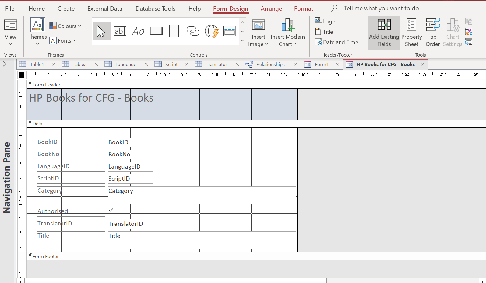

# Form Design

## Form Design

> **Spec point** — `spcpt_GDjH8fnFdWJcDgk9`

## Form design

### What is a database form?

- Forms of a tool used to **capture data** to be **stored in a database**
- Examples of forms include:

  - Online form to **sign up to a website**
  - Filling in personal details on a mobile device to** join a gym**
- Database forms follow **set design principles** to ensure they include particular features

## Characteristics of good form design

- **Simplicity** - The design should be clean and straightforward, not cluttered
- **Ease of use** - Users should be able to understand how to fill out the form quickly
- **Intuitive layout** - Related fields should be grouped together, and the sequence of fields should follow a logical order
- **Clear labels** - Each field should have a clear, concise label indicating what information is expected
- **Appropriate controls** - Use controls such as:

  - radio buttons
  - checkboxes
  - drop-down menus
  - Submit button
  - Save button
  - Next/previous records

## Creating a Data Entry Form

- You need to specify the fields required for data input
- Choose the appropriate font styles and sizes. Aim for consistency and readability
- Keep adequate spacing between fields for clarity and ease of use

## Fine-Tuning Form Design

### Appropriate Spacing

- The spacing between individual characters in fields should be adjusted for readability
- The use of white space is crucial - it improves readability and reduces cognitive load

### Control Elements

- **Radio Buttons** - Used when there is a list of two or more options that are mutually exclusive
- **Check Boxes** - Used when the user can select multiple options from a list
- **Drop Down Menus** - Used when you want to provide many options but conserve space

> **Exam Hint**
> - Always focus on simplicity and user-friendliness in form design
> - Make sure your form uses clear labels, logical field grouping, and intuitive sequence

> **Worked Example**
> A school is setting up a new computerised system to manage many aspects of the school administration. The data from the registration system is saved in the school administration database. The headteacher will need to check the attendance records for any student for any semester. She will type in the Student_ID and the Semester (Autumn, Spring or Summer). After she has done this the following data will appear on the same screen.
> 
> | **Field name** |
> |---|
> | Student_name |
> | Days_present |
> | Number_of_lates |
> | Number_absences |
> | Parents_phone_number |
> | Tutor_group |
> 
> Design a suitable screen layout to display one record. It must have appropriate spacing for each field, navigation aids and a space to type in search data. 
> 
> Do not include examples of student data. **[6]**
> 
> **Final answer:** **Answer**
> 
> > *Include 4 of:*
> 
> **Appropriate spacing for each field ****[1]**
> **Forward/backward buttons  ****[1]**
> **Submit/search button  ****[1]**
> **Information attempts to fill the page AND the design looks appropriate to scenario  ****[1]**
> **Box/boxes to enter Semester or Student_ID  ****[1]**
> **Drop down for the Semester or Student_ID // radio button for semester  ****[1]**
> **Suitable title  ****[1]**
> **Instructions/help  ****[1]**
> 
> > *2 marks for all six fields*
> *1 mark for three to five fields*
> *0 marks for less than three fields*
