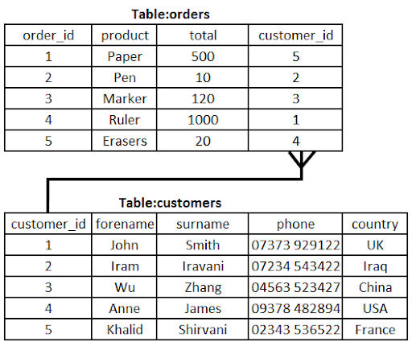

# Primary & Foreign Keys

## Fields & data types

> **Spec point** — `spcpt_rSkJfVzQXSGMpFMV`

## Fields & data types

### What is a field?

- A field is a **single piece** of data in a table (**column**)
- '**Make**' is an example of a **field **in the 'cars' table** **below

***cars***

| **car_id** | **Final answer:** **make** | **model** | **colour** | **price** |
|---|---|---|---|---|
| 1 | Peugeot | 2008 | Red | 24950 |
| 2 | Mazda | MX5 | Blue | 17995 |
| 3 | Citroen | DS4 | Black | 21450 |
| 4 | Ford | Puma | White | 19500 |

### What is a data type?

- A data type is the **type of data** that can be held **in a field** and is defined when designing a table
- Examples of common datatypes are:

  - **Numeric** - whole/decimal
  - **Character/string **- text data
  - **Date/Time **
  - **Boolean **- true or false values
- In the car table above, the following datatypes would be used:

  - **car_id**: numeric
  - **make**: string
  - **model**: string
  - **colour**: string
  - **price**: numeric

## Primary Keys & Foreign Keys

> **Spec point** — `spcpt_fpyb6tR3DDjvhSVW`

## Primary Keys & Foreign Keys

### What is a primary key?

- A primary key is a **unique field** that can be used to **identify a record** in a **table**
- order_id is the **primary key** for the orders **table**

- customer_id is the **primary key** for the customers **table**

### What is a foreign key?

- A foreign key is a **field in a table** that refers to the **primary key in another table**.
- A foreign key is used to **link tables** and **create relationships**
- In the **orders **table customer_id is a **foreign key** - it links an order back to the customer that made the order in the **customer **table

### Key database terminology

| **Term** | **Definition** |
|---|---|
| **Table** | A collection of records with a similar structure |
| **Record** | A group of related fields, representing one data entry |
| **Field** | A single piece of data in a record |
| **Data type** | Type of data held in a field |
| **Primary key** | A unique identifier for each record in a table. Usually an ID number |
| **Foreign key** | A field in a table that refers to the primary key in another table. Used to link tables and create relationships |

> **Worked Example**
> A relational database has been developed for a dance club to store information about their members and the styles of dance they practice.
> 
> The database contains two tables: **Members **and **Styles**
> 
> **Figure A **shows some data from the tables.
> 
> ***Members***
> 
> | **MemberID** | **FirstName** | **LastName** | **DateJoined** |
> |---|---|---|---|
> | 1 | Zarmeen | Hussain | 2024-01-19 |
> | 2 | Fyn | Ball | 2024-02-01 |
> | 3 | George | Johnson | 2024-02-25 |
> | 4 | Ella | Franks | 2024-03-04 |
> 
> ***Styles***
> 
> | **StyleID** | **MemberID** | **Style** | **DateStarted** |
> |---|---|---|---|
> | 1 | 1 | Hip Hop | 2024-01-22 |
> | 2 | 1 | Ballroom | 2024-02-13 |
> | 3 | 3 | Contemporary | 2024-03-01 |
> | 4 | 2 | Street | 2024-03-07 |
> 
> (a) State one benefit of using relational databases **[1]**
> 
> (b) State the name of the field from the **Members **table that is the most suitable to use as the primary key **[1]**
> 
> (c) State the name of the field from the **Styles** table that is a foreign key** [1]**
> 
> **Final answer:** **Answers**
> 
> - **(a) reduces data redundancy // reduces data inconsistency ****[1]**
> - **(b) ****MemberID ****[1]**
> - **(c)**** MemberID ****[1]**
> 
> > *Guidance*
> 
> - *Ignore case (for example: memberid)*
> - *No mark if inside quotation marks (for example: "MemberID")*
> - *No mark if there is an obvious space in response (Member  ID)*
