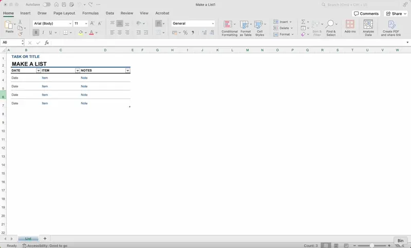
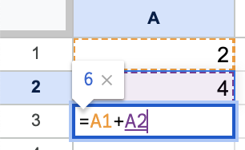
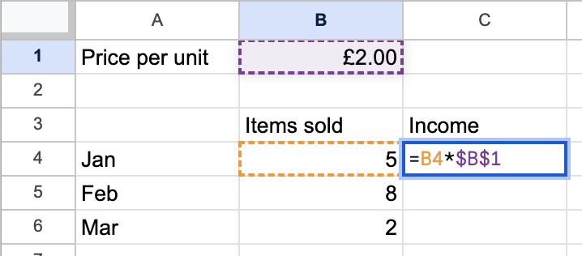
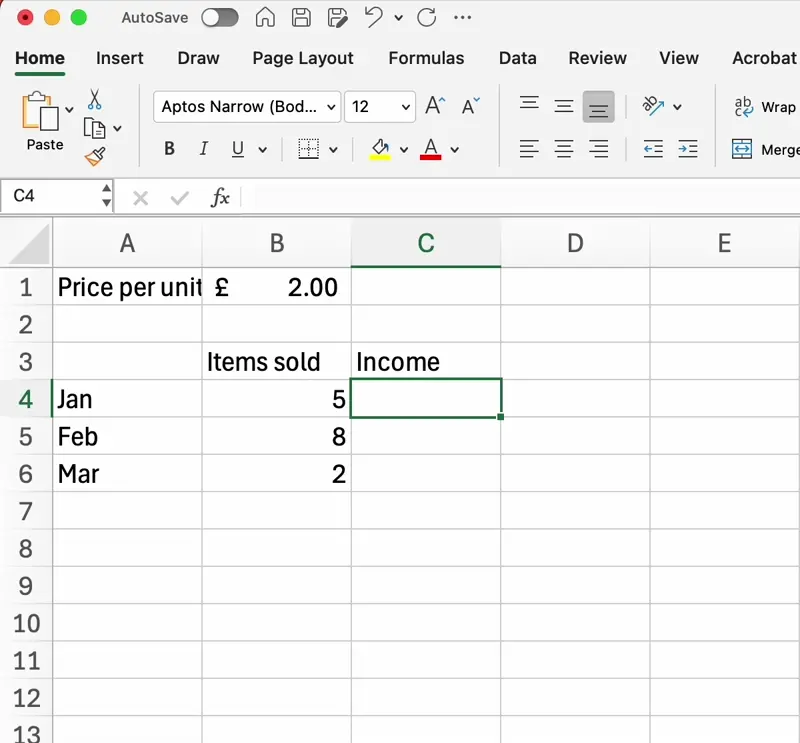
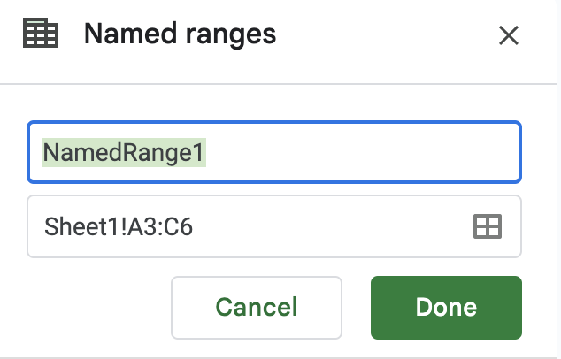

# Create & Edit a Spreadsheet

## Create and edit a spreadsheet

> **Spec point** — `spcpt_ZhZW4NsfZb9MTX2v`

## Create and edit a spreadsheet

### What is a spreadsheet?

- A spreadsheet is a piece of software used to **analyse**, **visualise** and **manipulate** data
- A spreadsheet is made up of **cells, rows** and **columns**
- A cell is **one box** on the spreadsheet and is referenced using its cell reference (e.g. A1)
- A **row goes across** and is referenced using the number down the side
- A **column goes down** and is referenced using the letter at the top

#### Inserting and deleting cells, rows, and columns

- You can alter the structure of a spreadsheet by inserting or deleting cells, rows, and columns
- This flexibility allows you to manage and organise your data effectively

#### Merging cells

- Merging cells combines two or more cells into one larger cell
- This is useful for creating headers or titles that span across multiple columns

#### Creating formulae using cell references

- Formulae allow you to perform calculations on your data
- You can reference specific cells in your formulae to make them dynamic and adaptable

#### Replicating formulae using absolute and relative cell references

- Absolute cell references (\$A\$1) stay constant, while relative cell references (A1) change when you copy or drag a formula

- Use absolute references when you want the same cell referenced and use relative references when you want the reference to change

#### Use of arithmetic operators in formulae

- Arithmetic operators allow you to perform basic mathematical operations in your formulae: add (+), subtract (-), multiply (*), divide (/), and indices (^)
- More information about formulae can be found on the [formulae revision note](https://www.savemyexams.com/igcse/ict/edexcel/17/revision-notes/5-software-skills/spreadsheet/formulae-and-functions/)

#### Using named cells and named ranges

- Named cells:

  - Easily refer to a group of adjoining cells
  - Shortens/simplifies formulae
  - Enables referring to a group of cells without having to lookup cell references
  - Don’t have to re-set the absolute referencing manually

> **Worked Example**
> Tawara school has a shop that sells items needed by pupils in school. Part of a spreadsheet with details of the items is shown.
> 
> 
> 
> a. Write down the number of rows that are shown in the spreadsheet that contain text.
> 
> **[1]**
> 
> **Final answer:** **6 rows [1]**
> 
> b. Write down the number of columns that are shown in the spreadsheet that contain text.
> 
> **[1]**
> 
> **Final answer:** **8 columns [1]**

> **Exam Hint**
> - Make sure you know which way round rows and columns are - rows go across and columns go down
