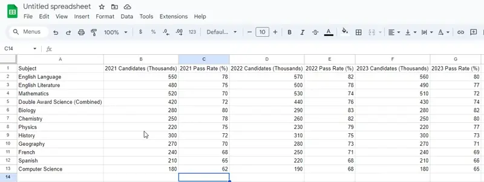

# Search & Select Data

## Search & Select Data in Spreadsheets

> **Spec point** — `spcpt_6cWYq7s8VbT8FZ3R`

## Search & Select Data in Spreadsheets

### What is data selection?

- Data selection allows you to focus on a **specific subset** of your data based on certain criteria
- This is useful for analysing parts of a larger dataset
- You can select data using a single criterion or multiple criteria

#### Searching for data

- Specific data in spreadsheets can found by using various operators, these include:

  - **AND**
  - **OR**
  - **NOT**
  - Greater than **>**
  - Less than **<**
  - Equal to **=**
  - Greater than or equal to **>=**
  - Less than or equal to**<=**
  - Not equal to **<>**
- For example, you might search for all students who scored above 85 (**>**) **AND** are in Year 11

#### Wildcards

- wildcards can be used when you're **unsure of the exact data** you're looking for
- The most common wildcards are the asterisk (*****) and the question mark (**?**)
- An asterisk represents any number of characters

  - For example, "A*" would find "Alex", "Aaron", etc.
- A question mark represents a single character

  - For example, "A?e" would find "Abe", but not "Alex"

Consider the following example spreadsheet:

|   | **A** | **B** | **C** |
|---|---|---|---|
| **1** | Name | Mark | Year |
| **2** | Alex | 85 | 11 |
| **3** | Ben | 90 | 12 |
| **4** | Chloe | 80 | 11 |
| **5** | Dave | 88 | 12 |
| **6** | Eve | 82 | 11 |

- To select all students in Year 11, you could use the criterion "Year = 11"
- To search for students who are in Year 11 AND scored above 85, you could use the criteria "Year = 11" AND "Grade > 85"

> **Exam Hint**
> Remember that you can use operators and wildcards in your searches to find data more efficiently. Wildcards are especially useful when you're unsure of the exact value you're looking for.

## Sorting data in a spreadsheet

> **Spec point** — `spcpt_j3qbn54SDBDZvwrd`

## Sorting data in a spreadsheet

### Why do we need to sort data in a spreadsheet?

- Sorting data is a powerful feature in spreadsheets
- It **arranges your data** based on **specific criteria**
- You can sort in **ascending **or **descending **order
- You can sort data using a **single criterion**

  - For example, you could sort a list of names alphabetically
- In Excel, select the column you want to sort and then choose 'Sort A to Z' for ascending order or 'Sort Z to A' for descending order

You can also sort data using **multiple criteria**

- For example, you could sort a list of students first by grade, and then alphabetically by name within each grade
- In Excel, select your data and then choose 'Sort'. Add levels for each of your criteria

Consider the following example spreadsheet:

|   | **A** | **B** |
|---|---|---|
| **1** | Name | Age |
| **2** | Alex | 15 |
| **3** | Ben | 17 |
| **4** | Alex | 16 |

- If you sort by 'Name'  (A to Z), the spreadsheet might look like this:

|   | **A** | **B** |
|---|---|---|
| **1** | Name | Age |
| **2** | Alex | 16 |
| **3** | Alex | 15 |
| **4** | Ben | 17 |

- If you sort by 'Name' (A to Z) and then 'Age' (Smallest to Largest), the spreadsheet would look like this:

|   | **A** | **B** |
|---|---|---|
| **1** | Name | Age |
| **2** | Alex | 15 |
| **3** | Alex | 16 |
| **4** | Ben | 17 |

> **Exam Hint**
> - Be sure to select all relevant columns before sorting, especially when dealing with multiple criteria. Failure to do so may result in misalignment of your data!
