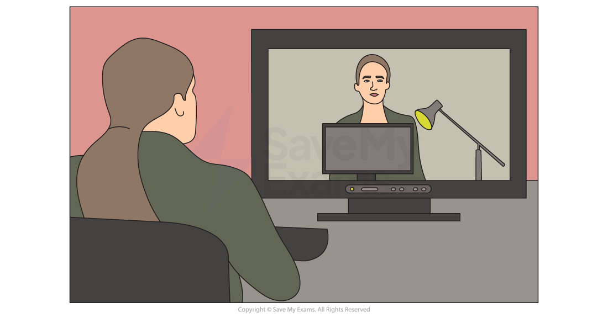
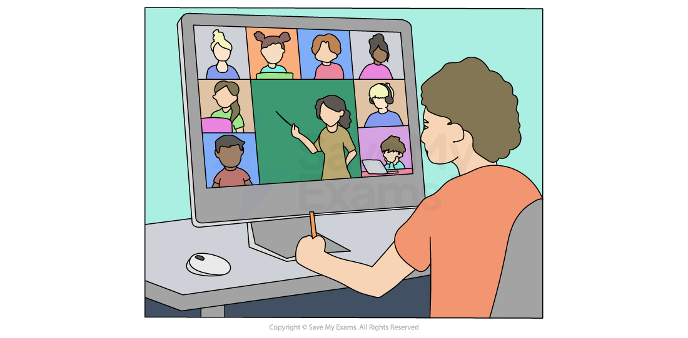

# Electronic Conferencing

## Video-Conferencing

> **Spec point** — `spcpt_68Zjxd88nfD553pZ`

## Video-Conferencing

### What is video-conferencing?

- Video-conferencing is a way of enabling **real-time audio **and **visual communication **between **geographically separated parties**
- Video-conferencing** **is ideal for** small groups of users** to create an **engaging meeting experience**
- Video-conferencing is typically used for:

  - **Staff meetings**
  - **Presentations**
- To successfully host a video-conference, the following **hardware is required**:

  - **Webcam**
  - **Large output display** (projector, screen, TV etc.)
  - **Microphone**
  - **Speakers**
- Specialist** software is also required**, such as:

  - ***Drivers ***to control the output of the webcam
  - A **codec **to encode (compress) and decode (decompress) data being transmitted

#### Advantages and disadvantages of video-conferencing

| Advantages | Disadvantages |
|---|---|
| - Convenience  - Cost saving  - Better for the environment  - Attendees do not have to travel to the event  - Anyone within the company can attend regardless of location - Events can be held at short notice as travel is not required - Allows other members outside of the organisation to attend easily without having to visit on premises - Some video conferencing software allows record and playback to allow members to review the meeting | - The initial purchase of equipment can be costly - Possible issues amongst employees when working across different time zones - Those using the system may need to be trained to use it effectively which can:    - Take time   - Be costly - Video-conferencing systems require a strong and stable network connection - Poor picture/sound quality caused by the speed of connection/quality of the hardware - Delays (audio & visual) can disrupt the flow of the meeting |
|   |   |
|   |   |
|   |   |
|   |   |
|   |   |

## Audio-Conferencing

> **Spec point** — `spcpt_mVRX3R3pHx9G6rxK`

## Audio-Conferencing

### What is audio-conferencing?

- Audio-conferencing is a way of enabling real-time **audio only** communication** **between **geographically separated parties**
- Audio-conferencing uses standard** phone lines**
- To host an audio-conference, the host must be given a **personal PIN** and a **participant PIN** by the phone company
- The host starts the conference using their personal PIN and participants** dial in **and join using their participant PIN
- Voice over Internet Protocol (**VoIP**) can be used on computers to hold audio-conferences

#### Advantages and disadvantages of audio-conferencing

| Advantages | Disadvantages |
|---|---|
| - Cheaper than video-conferencing as less hardware is required - More accessible as less training is needed for participants - Gives participants the ability to focus only on voice and not get distracted by video | - participants can lose focus due to lack of visual interaction - A lack of visual clues may lead to miscommunication - Audio quality can be poor - Does not suit collaboration |
|   |   |
|   |   |
|   |   |
|   |   |
|   |   |

## Web-Conferencing

> **Spec point** — `spcpt_kqRp5Jn5K7F6F8C9`

## Web-Conferencing

### What is web-conferencing?

- Web-conferencing is a way of enabling real-time audio and visual communication between geographically separated parties** on the internet**
- Web-conferencing** **is ideal for** large groups of users** to create an **engaging meeting experience**
- Web-conferencing is typically used for:

  - **Webinars**
  - **Lectures**
  - **Presentations**
- To host a web-conference the emphasis is placed on a** high-speed**, **stable internet connection**

| Advantages | Disadvantages |
|---|---|
| - Pre-shared/downloadable presentation notes/slides - Participants can use instant messaging within conference to ask questions - Collaboration via virtual 'whiteboards' - Screen sharing/annotations | - Technical issues usually relating to participant internet connections - Security concerns, risk of data interception - Distractions - Some users may feel overloaded with information which can lead to a lack of focus |
|   |   |
|   |   |
|   |   |
|   |   |
|   |   |

> **Exam Hint**
> Web-conferencing and video-conferencing are very similar however, the key differences are:
> 
> - Video conferencing has a focus on face to face communication
> - Web conferencing has a focus on interaction and collaboration such as document sharing, whiteboards etc

> **Worked Example**
> A motor car company has some designers based in London and some in Beijing.
> 
> The cost of travel between the two cities is very high, so when they wish to meet to discuss new products they use video-conferencing.
> 
> The designers all have PCs with a keyboard and a mouse in order to take part in video-conferencing.
> 
> **a.** Name three other devices used to input or output data which would be needed to take part in the video-conference.
> 
> **[3]**
> 
> **b.** Describe three potential problems of the designers using video-conferencing systems rather than meeting in either London or Beijing.
> 
> **[3]**
> 
> **Answers**
> 
> **a. **Three of:
> 
> **Final answer:** **Webcam / video camera [1]**
> **Speakers / headset / headphones [1]**
> **Large monitor / television / data projector [1]**
> **Microphone [1]**
> 
> **b. **Three from:
> 
> **Final answer:** **Time lag / lip sync caused by the image not being synchronised with the sound [1]**
> **Poor picture quality caused by the speed of connection / quality of the hardware [1]**
> **More likely to have poorer sound quality caused by the quality of the hardware / connection [1]**
> **Confidential material about the new cars may have to be signed / viewed in person [1]**
> **The new car may have to be viewed in person [1]**
> **Hardware breakdown stops the conference taking place [1]**
> **Communication breakdown stops the conference taking place [1]**
> **Different time zones will mean the conference has to take place at inconvenient times [1]**
