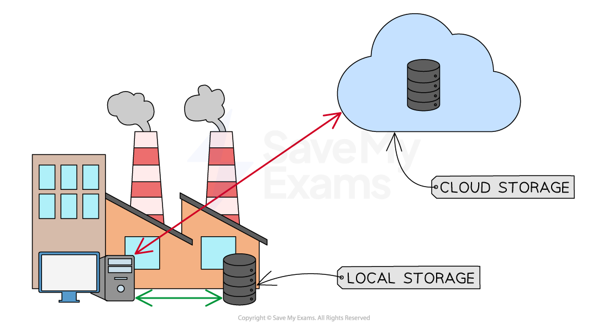

# Cloud Computing

## Cloud Computing

> **Spec point** — `spcpt_Q5Ww5v5pSBPrjsGz`

## Cloud Computing

### What is cloud storage?

- Cloud storage is a term to describe **long-term (secondary) storage of data** that resides in a **remote location**, accessible only** via a wide area network** (Internet)
- Data is stored on **remote servers**, typically using magnetic storage (**HDD**), but increasingly using solid state (**SSD**)
- The three types of cloud storage are:

  - **Public cloud** - The customer and the cloud storage provider are different companies
  - **Private cloud** - The customer and the cloud storage provider are a single organisation
  - **Hybrid cloud** - Combines both public and private cloud options and allows for sensitive data to remain private whilst providing public cloud services for less sensitive information

#### Advantages and disadvantages of cloud storage

| Advantages | Disadvantages |
|---|---|
| Data can be **accessed from anywhere** | A **stable internet** connection is required to use cloud storage |
| Data can be accessed by anyone with the **relevant permissions,** making it **quick to share files **and collaborate with others | Storing data in the cloud may be **vulnerable **to ***security breaches*** |
| Data can be **accessed on any device **with an internet connection | The user is **dependent **on the storage provider for the **availability **and reliability of its services |
| Allows customers to **increase **or decrease their **storage capacity** as needed | Should the company dissolve or cease to exist, all cloud **data may be lost** |
| Providers often use **multiple servers** to store and **backup data**, reducing the risk of data loss due to hardware failure | As the amount of storage or ***bandwidth*** required increases, the service may become expensive over time |
| Providers offer **advanced security features**, such as data ***encryption***** **and ***multi-factor authentication*** **multi-factor authentication**, to protect user data from unauthorised access |   |
| There is **no need to hire specialist staff **as IT services being provided by the cloud storage provider |   |

> **Worked Example**
> Explain the difference between cloud storage and local storage
> 
> **[2]**
> 
> **Answer**
> 
> **Final answer:** **Cloud storage involves storing data on remote servers accessed via the internet [1]**
> 
> **Final answer:** **While local storage refers to storing data on physical devices like hard drives or flash drives [1]**
