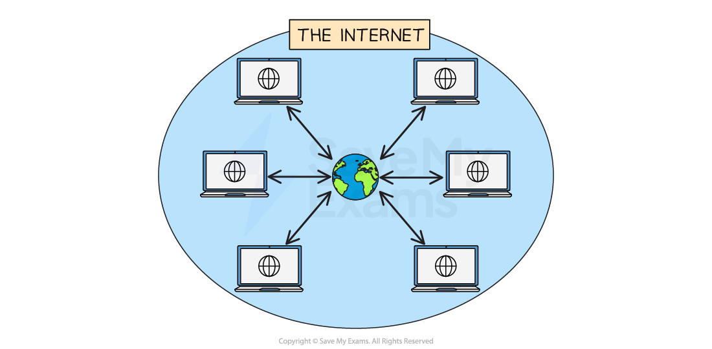
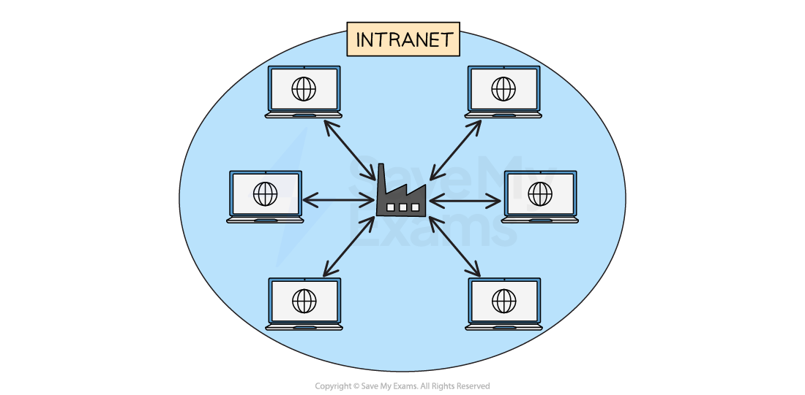
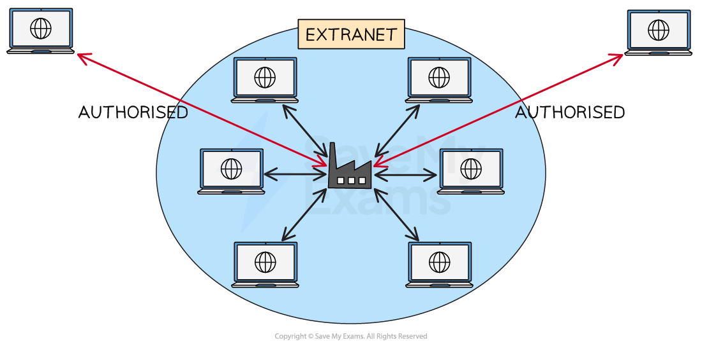

# Network Environments

## Internet

> **Spec point** — `spcpt_dz6pYTFHX4Tk8wc5`

## Internet

### What is the Internet?

- The Internet is a** global network **of** networks**
- Internet, short for** INTER**connected **NET**works is multiple local area networks (LANs) connected to form a large wide area network (WAN)
- The Internet is the most well-known wide area network (**WAN**)
- The Internet is used to** provide connectivity** to the World Wide Web

### What is the World Wide Web?

- The world wide web, or simply **the web**, is a** collection of websites** and **web pages **that are **accessed using the internet**
- It was created in 1989 by** Tim Berners-Lee**, who envisioned it as a way to **share **and **access **information **on a global scale**
- The web consists of** interconnected documents** and** multimedia files** that are stored on **web servers** around the world
- **Web pages** are accessed using a web *browser*, which communicates with web *servers* to retrieve and display the content

## Intranet

> **Spec point** — `spcpt_H9WGfdx2Gm8rrSht`

## Intranet

### What is an intranet?

- An intranet is a network designed to work much like the internet, but **operate only within a local area network** (LAN)
- Intranets provide companies with **a secure platform** to share information and resources **exclusively with their employees**
- An intranet is a **private **network
- Intranets sit behind a ***firewall***** **to ensure security and that** only authorised users** can access it

#### Advantages of intranet over internet

- Better ***bandwidth*** than the internet
- Data is kept** within the organisation**
- Less chance of **hacking** and attacks
- Administrators can **manage access **to external sites and links

## Extranet

> **Spec point** — `spcpt_GDhXntkmKzMSNNQJ`

## Extranet

### What is an extranet?

- An extranet is **an extension to an intranet** that allows **authorised access** from **outside **of the local area network
- Once authenticated, users will have **managed access **to network resources and/or information
- An extranet is useful for companies who want to provide access to:

  - **Customers**
  - **Clients**
  - **Key stakeholders**

- Similarities between the internet, intranet and extranet are as:

  - They are all **web based technologies**
  - They allow users to access information **remotely**
  - They all use ***client server architecture***
  - They all use security measures such as ***authentication*** and **encryption**
  - They all promote and facilitate **information and resource sharing**

> **Worked Example**
> A company uses an Intranet. Explain what is meant by an Intranet
> 
> **[2]**
> 
> **Answer**
> 
> **Final answer:** **An Intranet is a private network that is accessible to employees of the organisation and not to members of the public [1]**
> 
> **Final answer:** **It provides employees access to company information and to share resources internally [1]**
