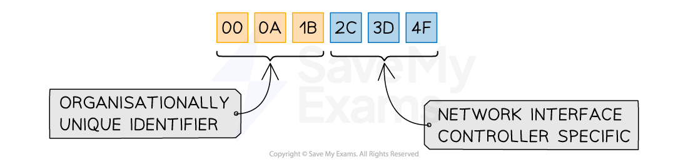
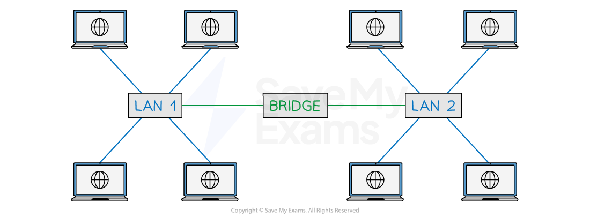

# Network Hardware

## Router

> **Spec point** — `spcpt_jVrPJ55vQYWCSCqk`

## Router

### What is a router?

- The router is responsible for routing** data** **packets** between **different networks**
- An example of data the router can direct is, sending internet traffic to the correct destination/devices in your home network
- The router **connects networks together**, local area networks (LAN) to the wider internet which is a type of wide area network (WAN)
- The router can **manage **and **prioritise data traffic**, which can help to keep connections stable
- The router will **assign IP addresses** to the devices on the network

### What are data packets?

- Data packets are **small 'chunks' of data** that make up a larger piece of data that has been **broken down** so that is can **transmitted **over the internet
- Data can include anything from text, images, audio, video, animations, etc, or any combination of these
- A data packet consists of:

| **Header** | **Payload** | **Trailer** |
|---|---|---|
| Source IP address | Actual data being transported | Additional security information  (less common) |
| Destination IP address |   | End of packet notification |
| Packet number  (1 of 5 etc.) |   |   |
| Error checking (*checksums*) |   |   |

### What is an IP address?

- An IP (Internet Protocol) address is a **unique identifier** given to devices which communicate over the Internet (**WAN**)
- IP addresses are **dynamic**, they can change
- IP addresses make it possible to **deliver data to the right device**
- A device connecting to a network will be given an IP address, if it moves to a different network then the IP address will change

#### IPv4

- Internet Protocol version 4 is represented as **4 blocks of denary numbers** between **0 **and **255**, separated by **full stops**
- Each block is **one byte **(8 bits), each address is** 4 bytes** (32 bits)

- IPv4 provides over** 4 billion unique addresses **(232), however, with over **7 billion** people and **countless devices per person**, a solution was needed

#### IPv6

- Internet Protocol version 6 is represented as **8 blocks of 4 hexadecimal digits**, separated by **colons**
- Each block is **2 bytes** (16 bits), each address is **16 bytes** (128 bits)

- IPv6 could provide over **one** **billion unique addresses** for **every person** on the planet (2128)

## Network Interface Card (NIC)

> **Spec point** — `spcpt_MTCxRjxWFJmvHFzV`

## Network Interface Card (NIC)

### What is a network interface card (NIC)?

- The Network Interface Card (**NIC**) is required for** a computer to connect to a network**
- A NIC can be both **wired and wireless** and allows your computer to send and receive data over a network

## Hub

> **Spec point** — `spcpt_gGDqYgMrhHt3rhFc`

## Hub

### What is a hub?

- A hub is a networking device which is used to **connect multiple devices** in a network
- Hubs are "**dumb**" devices that pass on anything received on one connection to all other connections
- **All data is sent to all devices**, this can lead to network inefficiencies and security issues

## Switch

> **Spec point** — `spcpt_sF8QsrT3WZrTGH99`

## Switch

### What is a switch?

- A network switch is a device that** connects multiple devices** on a network together
- Unlike a hub, a switch **only sends data to the device it was intended for**, which improves network efficiency
- This is done by a switch** **having a **lookup table**
- When a switch receives a** **data packet, it examines the destination** MAC address** of the packet and looks up that address in the** **lookup table
- Once it has found the matching MAC address it will then **forward the data packet** to the corresponding device

### What is a MAC address?

- A MAC (Media Access Control) address is a **unique identifier** given to devices which communicate over a local area network (**LAN**)
- MAC addresses are **static**, they can never change
- MAC addresses make it possible for **switches **to efficiently **forward data** to the intended **recipient**
- Any device that contains a Network Interface Card (**NIC**) has a MAC address **assigned during manufacturing**
- A device connecting to a local network already has a MAC address, if it moves to a different network then the MAC address will stay the same

- A MAC address is represented as **12 hexadecimal digits** (48 bits), usually **grouped in pairs**
- The first three pairs are the **manufacturer ID number** (OUI) and the last three pairs are the **serial number **of the network interface card (**NIC**)
- There are enough unique MAC addresses for roughly **281 trillion devices**

## Bridge

> **Spec point** — `spcpt_PWvqGrwx2ZyNFtFd`

## Bridge

### What is a bridge?

- A network bridge is a device used to **connect two local area networks **(LANs) together to create one larger network
- Unlike a switch/hub, bridges **only connect local area networks** together

> **Worked Example**
> Explain the difference between a switch and a hub regarding data forwarding capabilities.
> 
> **[2]**
> 
> **Answer**
> 
> **Final answer:** **A switch forwards data packets based on the destination MAC address and only sends data to the intended device [1]**
> 
> **Final answer:** **A hub broadcasts incoming data packets to all connected devices [1]**
