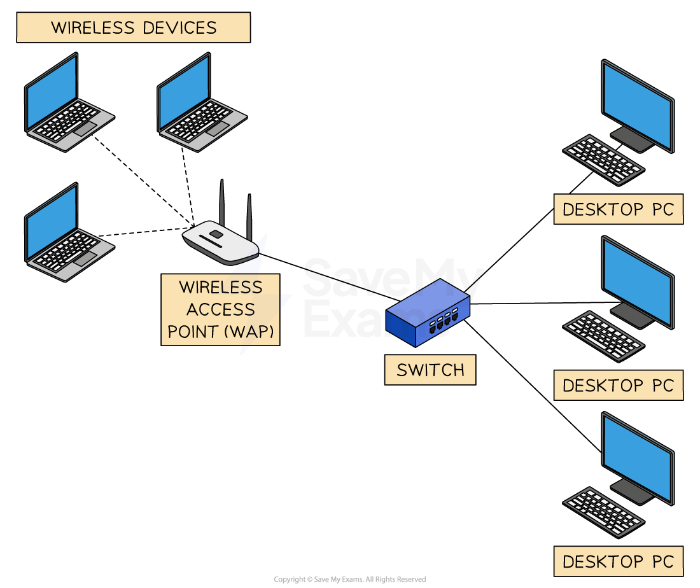

# Network Types

### What are the different types of networks?

- A network is** two of more devices connected together **with the purpose of sharing resources
- There are three types of networks

  - **Local Area Networks (LANs)**
  - **Wireless Local Area Networks (WLAN)**
  - **Wide Area Networks (WANs)**

## Local Area Network (LAN)

> **Spec point** — `spcpt_fxw79fYvZgpP7nTt`

## Local Area Network (LAN)

### What is a local area network?

- A local area network (LAN) is a network which has a **small geographical area** (under 1 mile)
- All of the hardware is **owned by the company/organisation/household using it**
- LANs will use unshielded twisted pair (UTP) cable, fibre optic cable or wireless connections (Wi-Fi)

#### Advantages and disadvantages of LANs

| Advantages | Disadvantages |
|---|---|
| Allows **centralised **management of updates, backups and software installations | If **hardware fails**, the network may not function properly or even at all |
| Can **secure **its devices with the use of firewalls, antivirus software and other security features to prevent unauthorised access | Networks are more **prone to attacks** than standalone computers |
| Allows users on the network to **share resources **such as printers and other peripherals | Access to data and peripherals can be slow depending on **network traffic** |
| Allows the users of the network to **collaborate **and** share files and folders** | Require maintenance to ensure that software is up to date, upgrades and backups which can be costly |

## Wireless Local Area Network (WLAN)

> **Spec point** — `spcpt_NvG8mt6rwfvwjQQ6`

## Wireless Local Area Network (WLAN)

### What is a wireless local area network?

- A wireless local area network is a local area network where devices connect to the network **wirelessly **instead of using cables
- Extra hardware,** wireless access points** (WAPs) or **hotspots** are connected to the network so that users can connect using Wi-Fi

#### Advantages and disadvantages of WLANs

| Advantages | Disadvantages |
|---|---|
| Allows users to connect anywhere that is in the range of a **Wireless Access Point (WAP)** without the need for additional hardware or wiring. | **Limited **in their coverage and can be further affected by walls and other structures |
| Can be used in a** variety of environments **both indoors and out making them highly flexible | **Bandwidth** speeds can become an issue in high traffic areas |
| Additional wireless access points can be added relatively easily resulting in additional users being able to use the network or **increased network coverage** | **Interference** from other devices which can affect performance and connectivity |
| Access to **peripherals **such as printers | Vulnerable to **security threats **due to wireless signals being intercepted |

## Wide Area Network (WAN)

> **Spec point** — `spcpt_3vTgfYPxMg4YYvJt`

## Wide Area Network (WAN)

### What is a wide area network?

- A wide area network (WAN) is a network which has a **large geographical area** (over 1 mile)
- They are a** collection of LANs joined together**
- The computers on a WAN are **connected via routers**
- The hardware used to connect the networks together is **not all owned by the company/organisation/household using it**.
- For example, telephone lines **owned by telecommunication companies**
- WANs will use fibre optic cable, telephone lines and satellite to connect the LANs together

> **Worked Example**
> Give 2 reasons why a fitness centre may want to install a WLAN
> 
> **[4]**
> 
> **Answer**
> 
> The fitness centre may wish to install a WLAN for several reasons such as :
> 
> **Final answer:** **Customers can connect to their Wi-Fi and search for information such as class times etc [1]**
> 
> **Final answer:** **will improve customer services [1]**
> 
> **Final answer:** **Staff at the fitness centre will be able to access resources wirelessly such as printers [1]**
> 
> **Final answer:** **allowing them to move freely around the centre [1]**
