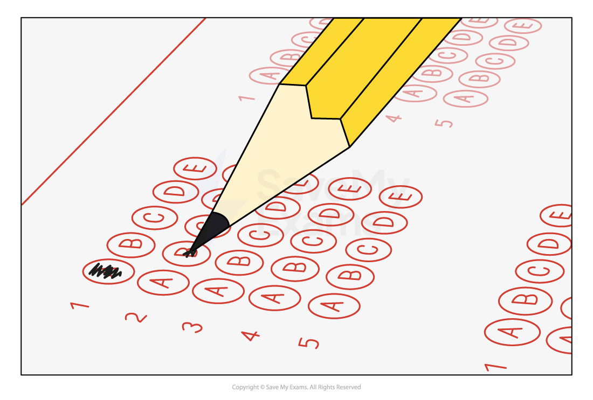

# Recognition Systems

## What is a recognition system?

- A recognition system is a way of using** computer technology to automatically identify** something
- Common examples of recognition systems include:

  - **Facial recognition**
  - **Speech recognition**
  - **Optical character recognition**

## OMR & OCR

> **Spec point** — `spcpt_FP85smjwWWt6kPPd`

## OMR & OCR

### What is OMR?

- Optical Mark Recognition (**OMR**)  **detects marked areas on paper** by using a special machine to read the marks
- Examples include:

  - **Multiple-choice examination**
  - **Barcodes**
  - **QR codes**
- **Automates data collection** and **entry**

***An OMR form being filled in***

| Advantages | Disadvantages |
|---|---|
| - Fast and efficient data collection - Reduces manual entry errors | - Limited to predetermined responses - Sensitive to poor marking or smudging |

### What is OCR?

- Optical Character Recognition (**OCR**) **converts printed** or **handwritten **text **into digital format**
- Useful for digitising documents
- Assists in searching and editing text
- Automated Number Plate Recognition (**ANPR**) is an example of OCR

  - For example, reading number plates and controlled entry and exit at airport parking

| Advantages | Disadvantages |
|---|---|
| - No staff required - Faster, no need to stop and take tickets etc - Stops cars parking illegally, cannot enter without authorisation | - Privacy concerns as number plates are recorded - Number plates can be cloned - Dirty or broken number plates can not be read - Lack of staff could lead to vandalism |

## RFID & NFC

> **Spec point** — `spcpt_gx874NhcWzvz49PW`

## RFID & NFC

### What is RFID?

- Radio Frequency Identification Devices (**RFIDs**) use **radio waves to identify and track objects**
- Examples of where RFID can be used is:

  - **Stock tracking**
  - **Passports**
  - **Vehicles**
  - **Contactless payment**
- RFID tags are made of **a microchip and antenna** and can be either:

  - **Passive **- uses energy from the reader
  - **Active **- has it's own power source

| Stock tracking | - Livestock tracking on a farm - Keeping track of animals    - Location   - Medical data - Active tags would be used due to the distance involved |
|---|---|
| Passports | - Passive chips in passports - Read by a reader to decrypt data stored on the chip    - Personal details   - Photo   - Fingerprints |
| Vehicles | - Track progress on assembly line - Used on toll roads to automate payment and raise barriers - Entry and exit to carparks |

### What is NFC?

- Near field communication (**NFC**) is a subset of RFID which **allows communication between two devices** in very close proximity
- NFC can be either:

  - **Passive **- uses energy from the reader
  - **Active **- has it's own power source
- Smartphones use **active NFC to allow contactless payments **by tapping a smartphone on a reader
- Smartphones can also** exchange data **using NFC** **by tapping together (usually back to back)

> **Worked Example**
> A farmer has purchased a computerised feeding system for her goats. A goat has an RFID tag
> attached to its ear, which is recognised by the computer. The system uses a passive RFID tag.
> a. Describe how the RFID tag can be activated.
> 
> **[3]**
> 
> b. Describe how RFID technology will be used to give the correct feed to the animal.
> 
> **[3]**
> 
> **Answers**
> 
> **a.** three of:
> 
> **Final answer:** **The RFID reader sends radio waves / signals to the RFID antenna in the tag [1]**
> **The tag sends radio wave/signal back to the reader [1]**
> **The radio waves move from the tag’s antenna to the microchip [1]**
> **A signal is generated and sent back to the RF system [1]**
> **The RF wave is detected by the reader which interprets the data [1]**
> 
> **b.** three of:
> 
> **Final answer:** **The goat passes the RFID reader [1]**
> **The RFID reader extracts data from the tag [1]**
> **The ID is compared with data stored in the database [1]**
> **The feed for the goat is then selected/identified / read from the database [1]**
