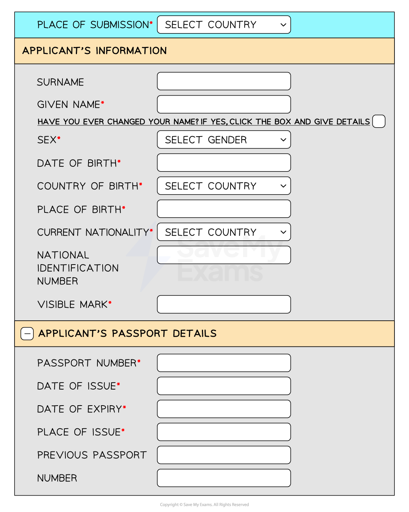

# The Systems Life Cycle: Design

### What is the system life cycle?

- The system life cycle** **is **a structured process** that guides the **planning**, **creation**, **testing**, and **deployment **of an information system
- Ensures systems are** systematically developed**, meeting needs of stakeholders, **minimising **risks and **maximising **efficiency
- The second stage is **design**, the purpose is to:

  - **Develop **architectural **blueprints for the system**, including **database design**, **user interfaces**, and **system interfaces**.

## File/Data Structures

> **Spec point** — `spcpt_VTCrqx8wnRQMgcPZ`

## File/Data Structures

### What are file/data structures?

- File structures are considered during the design stage of the systems life cycle and consist of defining:

  - **Field names**
  - **Filed lengths**
  - **Data types**
  - **Primary keys**
- A file **consists of records** and records are **made up of fields**
- Each record is **identified by its unique primary key** field

#### Data types

| Data type | Description | Examples |
|---|---|---|
| Alphanumeric | Stores a combination of characters (**letters or text**) and numeric data | Usernames, postcodes, product codes, phone numbers |
| Character | A **single letter/symbol** | A, B ,C etc. |
| Text | Stores a combination of characters (**letters, text, symbols, special characters etc**.) and numeric data | This_is_an_example |
| Boolean | Stores data in a **Yes/No or True/False format** | Y or N |
| Numeric | Stores numerical data:  - **Integers** - **Decimals** - **Currency** - **Date/Time** | 100  1.50  £2.99  18/05/2024 or 14:58 |

> **Case Study**
> **A file structure for records containing information about cars**
> 
> | Field name | Field length | Data type | Primary key? |
> |---|---|---|---|
> | Car_ID | 6 | Alphanumeric | Yes |
> | Year | 4 | Numeric: integer | No |
> | Make | 20 | Text | No |
> | Model | 20 | Text | No |
> | Cost | 6 | Numeric: currency | No |
> | Sold | 1 | Character | No |

## Validation Routines

> **Spec point** — `spcpt_NYyhPqF75BZ69rkd`

## Validation Routines

### What are validation routines?

- Validation routines are **checks placed on data being entered** to ensure it matches the design of the system
- Validation routines **prevent errors** and **maintain data integrity**

| Validation routine | Description | Examples |
|---|---|---|
| Range check | Ensures the data entered as a number **falls within a particular range** | For children aged between 5 and 10, checks to make sure numbers <5 and >10 are not accepted |
| Length check | Checks the **length of a string** | Password must be a minimum of 8 characters, checks to make sure the length is >=8 |
| Type check | Check the **data type** of a field | Enter distance in whole miles, checks to make sure decimals are not accepted |
| Format check | Ensures that the data has been entered in the **correct format** | Enter date of birth (DD/MM/YY), check to make sure the format is correct |
| Presence check | Looks to see if **any data has been entered** in a field | Enter your username ,check to make sure the filed has not been left blank |
| Check digit | Check digits are **numerical values** that are the **final digit of a larger code** | Barcodes |

## Input & Output Formats

> **Spec point** — `spcpt_kq7tkfPzP8JC6qRm`

## Input & Output Formats

### What are input and output formats?

- Input and output formats are **design considerations** for **how data is captured** from (**input**) and displayed to (**output**) the users of a system

#### Input formats

- A data capture form is** used to collect data from a user in a structured format**
- Data capture forms should aid the collection of data by:

  - **Having a user-friendly layout** - short, visually appealing, logical flow
  - **Providing clear instructions** - concise instructions at the beginning
  - **Using appropriate question types** - multiple choice, drop downs, checkboxes etc.
  - **Using validation routines**

#### Output formats

- Showing the results of processing either paper-based on on a screen should consider:

  - **Screen layouts**: how information is presented to users on a screen
  - **Report layouts**: how information is organised in a printed or digital report
  - **Readability**, **visual appeal**, and **efficient use of space**

> **Worked Example**
> Carlos is designing a new computer system to replace an existing system.
> 
> Tick four items which will need to be designed.
> 
> **[4]**
> 
> |   | Tick |
> |---|---|
> | Inputs to the current system. |   |
> | Data capture forms. |   |
> | Report layouts. |   |
> | Limitations of the system. |   |
> | Observation methods. |   |
> | Improvements to the system. |   |
> | User and information requirements. |   |
> | Validation routines. |   |
> | Problems with the current system. |   |
> | File structure. |   |
> 
> **Answers**
> 
> |   | Tick |
> |---|---|
> | Inputs to the current system. |   |
> | Data capture forms. | **Final answer:** ** χ** |
> | Report layouts. | **Final answer:** ** χ** |
> | Limitations of the system. | **Final answer:** ** ** |
> | Observation methods. | **Final answer:** ** ** |
> | Improvements to the system. | **Final answer:** ** ** |
> | User and information requirements. | **Final answer:** ** ** |
> | Validation routines. | **Final answer:** ** χ** |
> | Problems with the current system. | **Final answer:** ** ** |
> | File structure. | **Final answer:** ** χ** |
