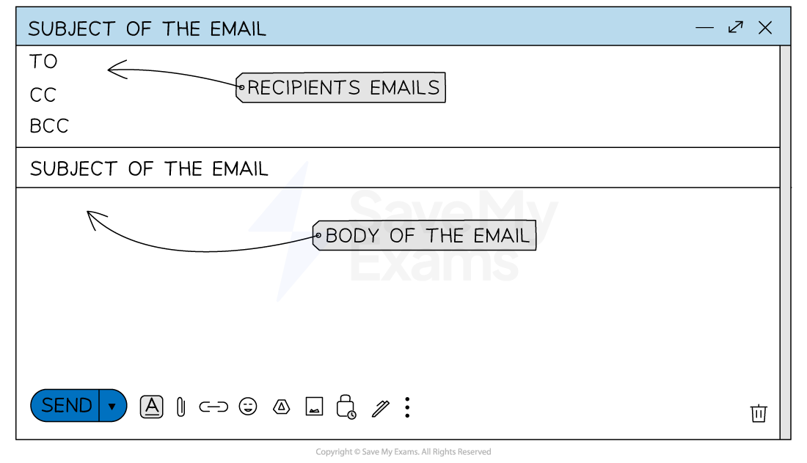

# Email

## Email

> **Spec point** — `spcpt_DRd2GQ2yj8Xchd56`

## Email

### What is email?

- Email is a **method of exchanging messages** and files over the internet
- The main uses of email are:

  - **Personal communication**
  - **Professional correspondence**
  - **Marketing**
- Companies provide **guidelines** about **acceptable use** of emails
- Guidelines about emails from a company include:

  - **Purpose** of the email
  - Using **acceptable language**
  - Email **security**, including anti-virus software

## Email Guidelines & Constraints

> **Spec point** — `spcpt_5Tk33KZMRXkMQnx7`

## Email Guidelines & Constraints

#### Acceptable Language Guidelines

- Acceptable and **appropriate language** must be used depending on the **recipient** and **purpose** of the email
- An example of this includes using a **professional tone** when sending a work-related email
- **No offensive** **or** **obscene** **language** or images should be used
- **No racism or violent content** should be in email messages
- **No illegal material **should be sent
- The **laws within a country **can see that **emails are monitored** and people can be **punished** for what they write
- Some additional rules to follow regarding email language include:

  - Include a **clear subject line**
  - Use a **professional email address**
  - Use **professional *****salutations***
  - **Do not use all capitals** as it implies shouting

#### Need for Security

- Email security is crucial to **protect sensitive information from being accessed** or altered
- Email inboxes should be protected by **strong passwords** which are frequently changed
- **Spam filters and antivirus** **software** should be in place at all times to protect users' inboxes from both ***passive attacks***** **and ***active attacks***

#### Netiquette

- Netiquette (Inter**net **et**iquette**) is the need to respect others online
- It is an agreement to respect the opinion of others in online forums, internet messages and emails
- Some common examples to remember are:

  - Most posts are public and can potentially be read by anyone
  - A clear, inoffensive and succinct language will be used
  - Give a good impression of yourself, considering, the tone of writing, spelling, punctuation and grammar

## Sending Emails

> **Spec point** — `spcpt_cZTjq5GMCtFshrhp`

## Sending Emails

#### Email Groups

- Email groups allow for **mass communication** with a **defined set of recipients**
- It is **easier to send out multiple emails** if the addresses are grouped together
- The benefit of doing this is that it ensures **no one misses out on an email** containing key information
- A drawback of email groups is that **spammers can utilise them** to target a large group of people with ease

#### Email Operations

- There are three key email operations to be aware of:

  - **Carbon Copy (CC)** - this is used when you want to include additional recipients to view the email
  - **Blind Carbon Copy (BCC)** - this is used when you want additional recipients to view the email without other recipients knowing
  - **Forward** - This allows you to send an existing email to a new recipient
  - **Attachments** - These allow files to be sent along with the email message

## Spam

> **Spec point** — `spcpt_FF22Xn9cRV3824v5`

## Spam

### What is spam?

- Spam is **unwanted/unsolicited junk mail** which is sent in **large numbers** to inboxes
- Spam fills the users' inboxes, often with **advertising** content or for **phishing/spreading malware**
- Phishing emails will be used to** act as a reputable company or organisation** in the aim of **getting your personal details **such as usernames and passwords

### How can spam emails be detected?

- Spam emails often has **multiple spelling or grammatical errors**
- They often use **broken English**, though this is now improving with the use of AI
- Spam emails will **not address you by name**
- Often spam emails will ask you to **enter your details by clicking a link**

  - Reputable companies have now stopped doing this to make identifying spam a lot easier

### How can spam emails be prevented?

- Preventing spam emails is becoming easier as email providers' **anti-spam filters **become stronger and more efficient
- Users can ensure they **do not agree to marketing emails** from companies they register with
- Users can also ensure they **do not reply to emails with sensitive data** or complete online forms for websites by **clicking links in an email**

  - Instead, they should visit the website of their own accord and then log in as usual

> **Worked Example**
> Describe the ways that a user can recognise spam and methods to help prevent it. **[6]**
> 
> > *How to answer this question:*
> 
> > *Give a maximum of 4 bullet points on how users can recognise spam content and then a maximum of 4 points on how they can prevent spam content. *
> 
> **Final answer:** **Answers:**
> 
> **Final answer:** **Recognising spam (max 4):**
> 
> - ** **Multiple spelling/grammatical errors
> - Asked to carry out tasks immediately such as click on a link
> - Does not ask for you by name
> - Stored in a SPAM folder
> - Email asks for personal information
> - Large amount of repeated emails from the same user
> - Lots of other similar email addresses in the send-to-box
> 
> **Final answer:** **Prevention methods (max 4): **
> 
> - Use a spam filter
> - Not filling in your details on the online form
> - Not replying to spam emails
> - Not having an auto-reply set
> - Not consenting to marketing when providing details to a company
