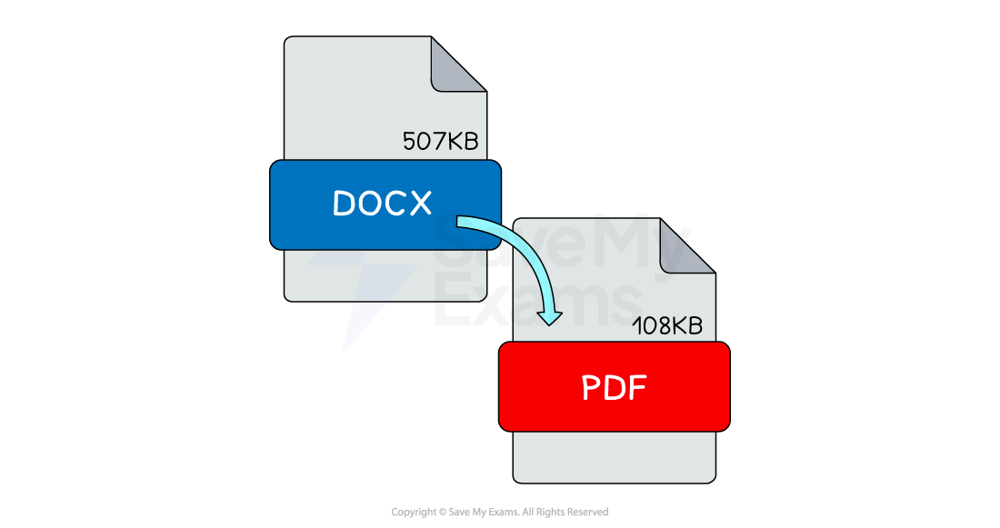

# Compression

## The Need For Compression

> **Spec point** — `spcpt_pqK32pYGgJsQRtbZ`

## The Need For Compression

### What is compression?

- Compression is **reducing the size of a file** so that it **can be transmitted **or **stored in secondary storage**
- There are scenarios where compression may be needed, such as:

  - **Maximise the amount of data** you can store on a digital device such as a mobile phone or tablet
  - **Minimise the transfer time** of data being uploaded, downloaded or streamed across a network such as the Internet
- Reducing the file size of an image can be achieved by **reducing the colour depth** or **resolution **of the image
- Compression can be achieved using two methods, **lossy **and **lossless**

## Lossy Compression

> **Spec point** — `spcpt_sYghjCFYNgDbfC7z`

## Lossy Compression

### What is lossy compression?

- Lossy compression is when** data is lost **in order to **reduce the size** on secondary storage
- Lossy compression is ***irreversible***
- Lossy can** greatly reduce the size** of a file but at the **expense of losing quality**
- Lossy is only suitable for data **where reducing quality is acceptable**, for example images, video and sound
- In photographs, lossy compression will try to group similar colours together, reducing the amount of colours in the image without compromising the overall quality of the image
- Example file types that use lossy compression are:

  - **JPEG** Images
  - **MP3** Audio
  - **MPEG-4** Video

- In the images above, lossy compression is applied to a photograph and **dramatically reduces the file size**
- Data has been **removed **and the overall quality has been **reduced**, however it is acceptable as it is difficult to visually see a difference
- Lossy compressed photographs take up less storage space which means you can store more and they are quicker to share across a network

## Lossless Compression

> **Spec point** — `spcpt_XzbdwHzxKTNz2Xh7`

## Lossless Compression

### What is lossless compression?

- Lossless compression is when data is ***encoded*** in order to **reduce the size on secondary storage**
- Lossless compression is **reversible**, the file** can be returned to its original state**
- Lossless can reduce the size of a file but not as dramatically as lossy
- Lossless can be used on all data but is more suitable for data where **a loss in quality is unacceptable**, for example documents
- In a document, lossless compression uses algorithms to analyse the contents looking for **patterns **and **repetition**. For example, repeating characters are replaced with a single character and the number of occurrences in the document (“EEEEE” becomes “E5”)

- In the image above, lossless compression is **automatically **applied to document formats such as DOCX and PDF with a different rate of success
- When you open a lossless compressed document the **decompression process reverses the algorithms** and returns the data** back to its original state**
- Lossless compressed documents **take up less storage space** which means you can **store more** and they are **quicker to share** across a network
- Example file types that use lossless compression are:

  - **.PNG** Images
  - **.Zip **files
  - **.Rar** files

> **Worked Example**
> Sarah uses her computer to record an audio file of herself narrating a video for work.
> 
> She emails her recording to friend for proofing. She uses lossy compression to produce the sound file.
> 
> Explain two reasons why using **lossy** compression is beneficial. **[4]**
> 
> **How to answer this question**
> 
> - What are the differences between lossy and lossless?
> - Can you state two differences? [2 marks]
> - Can you say why each point is a benefit? [2 marks]
> 
> **Answer**
> 
> - Lossy will decrease the file size **[1]**
> - **...**so it can sent via email quicker **[1]**
> - Lossy means data is lost **[1]**
> - **...**the difference is unlikely to be noticed by humans **[1]**
