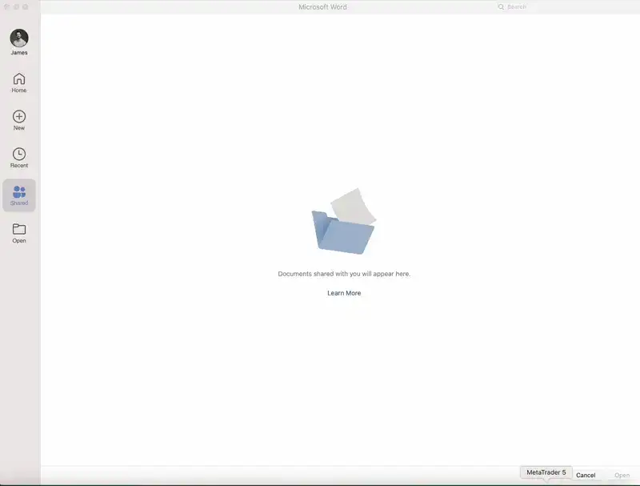
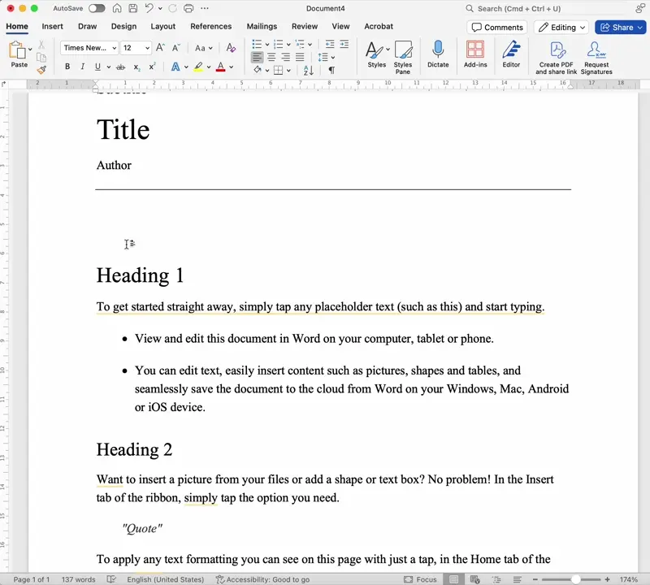

# Create & Edit a Document

## Create & Edit a Document

> **Spec point** — `spcpt_n2cct2brWZXb3RXx`

## Create & Edit a Document

### How do you create a new document?

- To create a new document there are multiple ways of doing it
- When opening a word processing document, the user will be greeted with a window which allows them to click new, then select a blank document or select from a bank of templates

### How do you edit a document?

- To edit a document, depending on the needs of the user, they can simply begin typing or they may wish to change the [layout](https://www.savemyexams.com/igcse/ict/cie/21/revision-notes/9-working-with-documents/document-production/layout/) of the document first before beginning
- There are a range of other editing techniques the user may wish to use, these include:

  - Editing text and numbers
  - Placing objects into the document
  - Wrapping around objects

#### Editing techniques for text and numbers

- Highlight: Use the mouse to select the text or numbers you want to manipulate
- Delete: Remove the selected text or numbers from the document
- Move: Cut or copy the selected text or numbers, then paste it into a new location
- Cut, Copy, and Paste: Cut removes the selection from its original location, copy makes a duplicate, and paste inserts the cut or copied material
- Drag and Drop: Click on the selected material, hold the mouse button down, move the cursor to the desired location, and then release the mouse button

#### Placing objects into the document

- You can add objects such as text, images, screenshots, shapes, tables, graphs or charts, spreadsheet extracts, and database extracts into your document
- These objects can come from a variety of sources, and you can adjust their size and position in your document

#### Wrapping text around objects

- You can arrange your text to wrap around tables, charts, or images in a variety of ways, including:

  - Above: The text appears above the object
  - Below: The text appears below the object
  - Square: The text forms a square around the object
  - Tight: The text closely wraps around the object, following its shape

