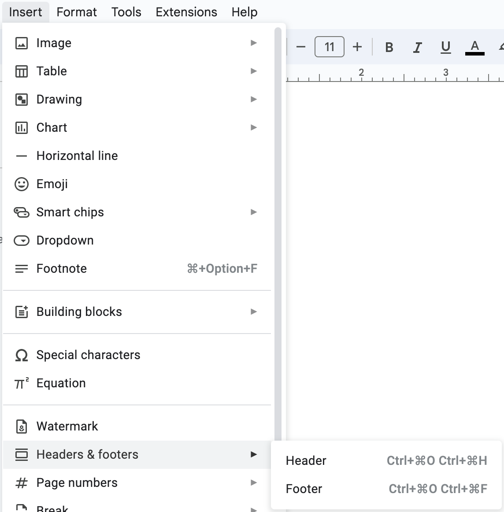

# Headers & Footers

## The Purpose of Headers & Footers

> **Spec point** — `spcpt_vqDRF2qZRWCYXkq4`

## The Purpose of Headers & Footers

### What is the purpose of headers & footers?

- Headers and footers are **areas at the top (header) and bottom (footer) of documents** that can be used to **help identify **them

- Headers and footers can contain:

  - **Document name**
  - **Author**
  - **Company logo**
- Headers and footers **only need to be added once** and are replicated on each page, **saving time** and **reducing the chance of data errors**

#### Automated objects

- Headers and footers can also contain automated objects to **enhance the professionalism **of a document
- Examples of automated objects include:

  - **Date/time**
  - **Page numbering**
  - **Total number of pages**

#### Aligning contents

- The contents of headers and footers **can be aligned consistently** within a document
- They can be aligned to the:

  - **Left margin**
  - **Right margin**
  - **Centred within margins**
