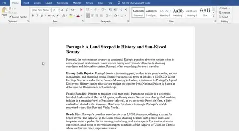
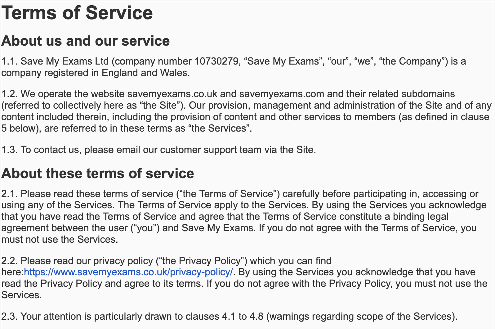
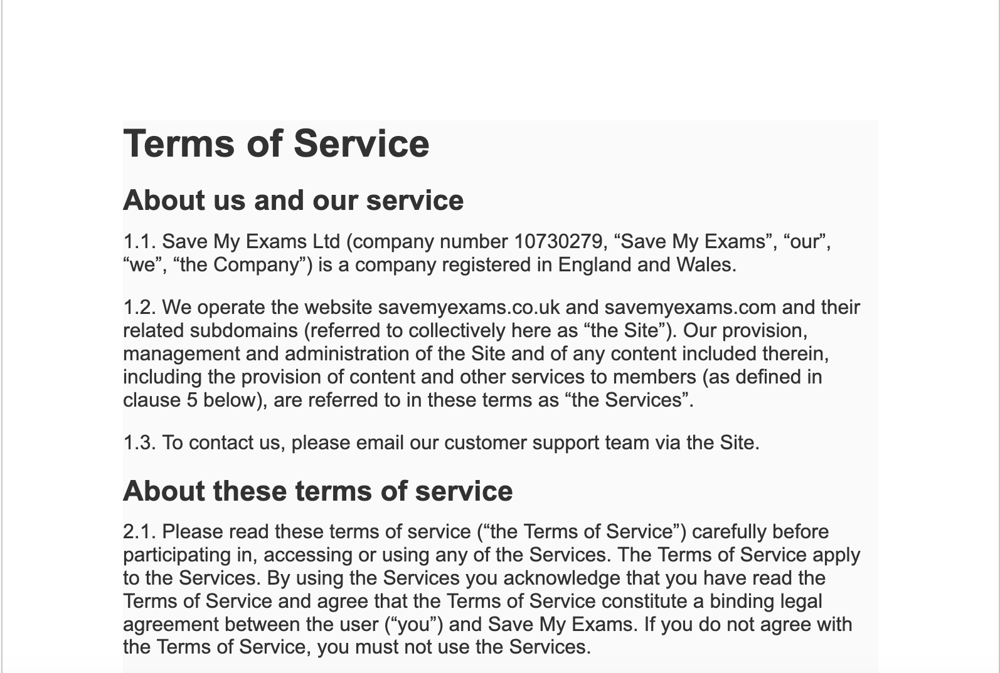
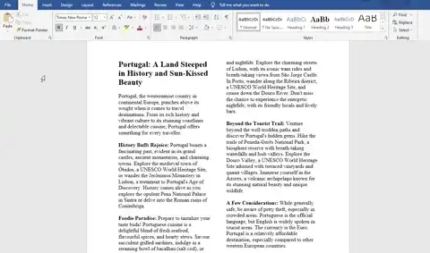

# Layout

## How can you change the layout of a page?

- The layout of a page can be changed in a variety of ways, including:

  - **Size**
  - **Orientation**
  - **Number of columns etc.**

*Changing page layout of a document*

## Gutter Margin

> **Spec point** — `spcpt_THTHds5gZcdV633y`

## Gutter Margin

### What is a gutter margin?

- A gutter margin provides **extra space on either side** (left or right) of a document
- It **ensures text is not obscured** by a binding mechanism when the document is folded or opened
- Without gutter margins, printed information **can be hidden or difficult to read**
- Benefits include:

  - **Improved readability**
  - **Enhanced aesthetics**

#### Without a gutter margin

#### With a gutter margin

## Pagination

> **Spec point** — `spcpt_N2p2qfzzw4QVVh4K`

## Pagination

### What is pagination?

- Pagination is a method of **dividing information into manageable chunks** to **control the layout** and organisation of a document
- Pagination is used in:

  - **Printed materials**
  - **Websites and applications**

*Adding breaks to a document*

#### Page breaks

- A page break forces content to start on a new page **even when there is still space available**.
- Common uses include:

  - Starting a **new chapter or section**
  - **Separating graphics and tables** from surrounding text to improve readability
  - Ensuring all **page elements appear at the top** of a page

#### Column breaks

- A column break **divides a page into multiple columns** to suit specific content types
- Common uses include:

  - Creating a **newsletter or brochure**
  - **Formatting content for easier viewing on screen**

#### Section breaks

- A section break creates** independent sections that can be formatted differently**
- Common uses include:

  - Changing **page orientation** for a specific section
  - Applying different **column layouts** in the same document
