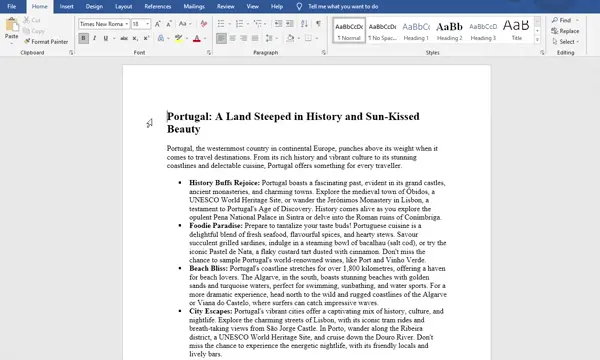
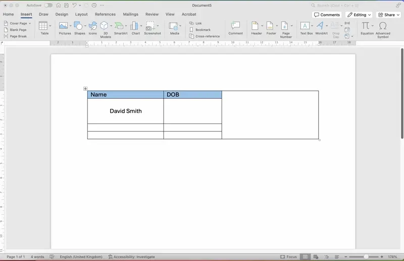
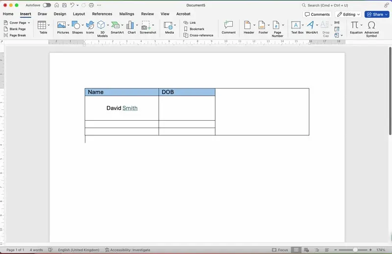

# Navigation

## Navigation

> **Spec point** — `spcpt_GnXcj8dvs4zmzvPz`

## Navigation

### How can a user navigate a document effectively?

- To effectively navigate a document, a user should make use of two key features:

  - **Bookmarks**
  - **Hyperlinks**

#### Bookmarks

- A bookmark in a document works similarly to a bookmark in the real world, it allows the user to **mark a place in a document** that they wish to be able to easily find and navigate to again
- To create a bookmark:

  - **Highlight the text you wish to bookmark then click 'Insert bookmark'**
- To delete a bookmark:

  - **Click the bookmarks buttons and then select 'Delete'**

#### Hyperlinks

- A hyperlink is a **clickable link** that can **navigate to another place **in a document or to an external webpage or external file
- To create a hyperlink:

  - **Highlight the text you wish to link, click 'Insert" then "Link'**
- To delete a hyperlink:

  - **Highlight the text you wish to link, click 'Insert" then "Link' then 'Remove Link'**

