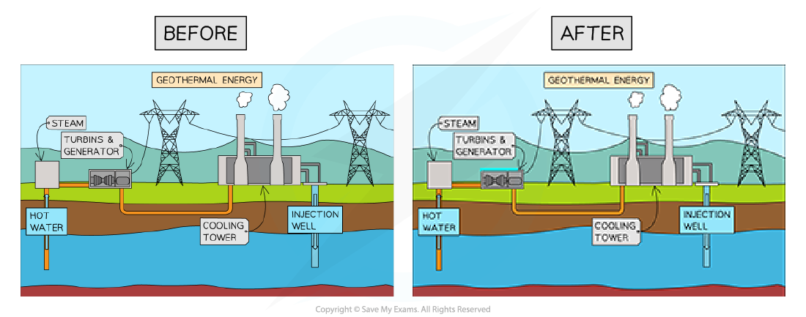

# File Size Reduction

## File Compression

> **Spec point** — `spcpt_VgcqbkjC4Q79rwrR`

## File Compression

### What is file compression?

- File compression is** reducing the size of a file** in order to **take up less storage space** and make **file transmission faster**
- Images are often the largest element of a file and can be resized/resampled by:

  - **Reducing the resolution**
  - **Reducing the colour depth**

#### Resolution

- Resolution is the **total amount of pixels** that make up an image
- The resolution is calculated by **multiplying the height and width** of the image (in pixels)
- In general, the **higher the resolution the more detail in the image** (higher quality)
- Reducing resolution** decreases the number of pixels** and therefore **reduces file size**
- Be aware that reducing resolution can cause **a loss of image quality**, especially when viewed at larger sizes

#### Colour depth

- Colour depth is the **number of bits stored per pixel** in an image
- The colour depth is dependent on the number of colours needed in the image
- In general, the** higher the colour depth the more detail in the image** (higher quality)
- Reducing colour depth means **using fewer bits **and therefore** fewer colours**, which can reduce the file size
- Like with resolution, reducing colour depth can lead to **a loss of image quality**
