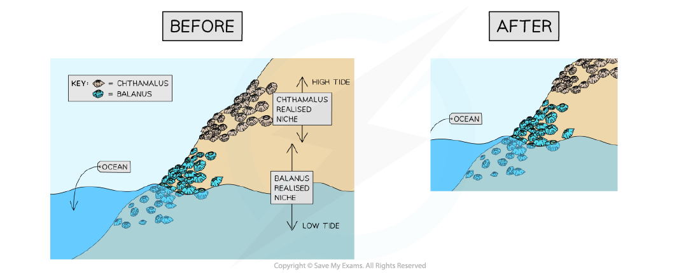
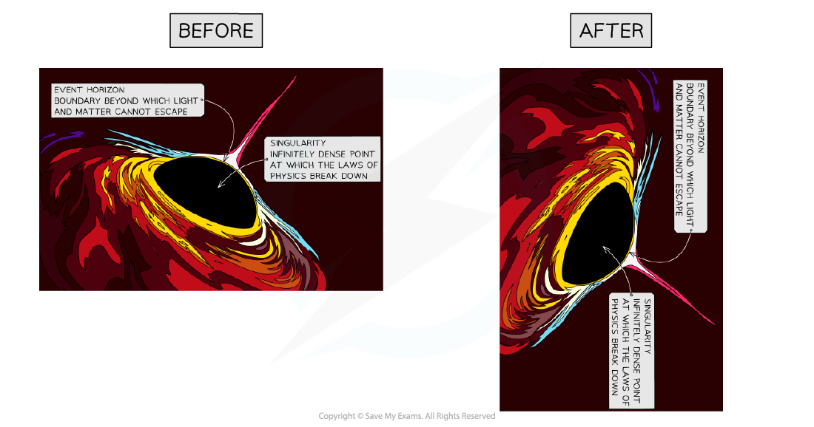
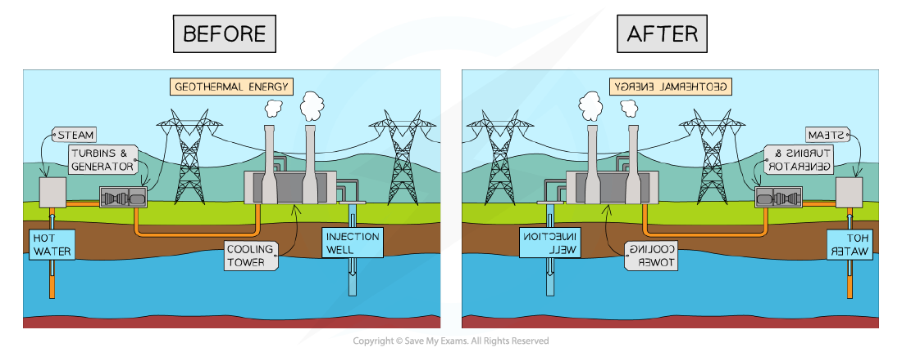
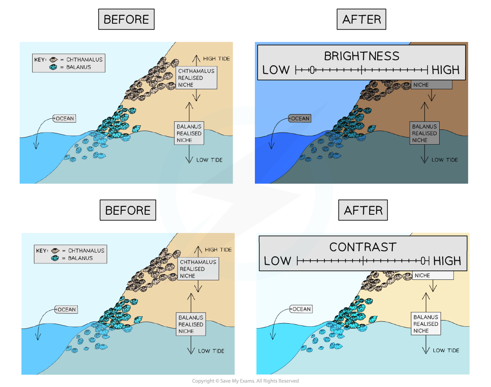
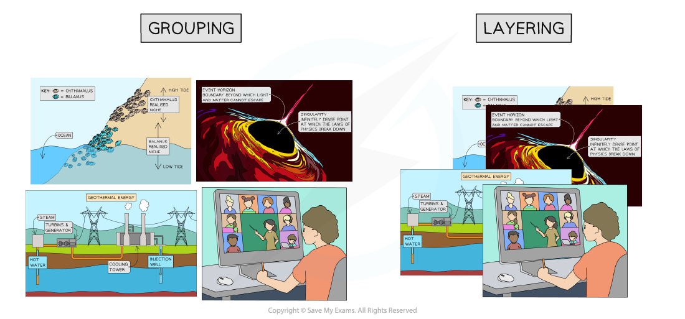

# Image Editing

## Image Editing

> **Spec point** — `spcpt_VKz7h7QjztBMXQfH`

## Image Editing

### What is image editing?

- Image editing is the process of manipulating images and changing them to suit the user's end goal
- Image editing can be done in several ways, the exam requires you to know about:

  - **Placing an image with precision**
  - **Resizing an image**
  - **Cropping an image**
  - **Rotating an image**
  - **Reflecting (flipping) an image**
  - **Adjusting brightness and contrast**
  - **Grouping and layering images**

#### Placing an image with precision

- This refers to positioning an image accurately within a document or other media
- You can usually do this by selecting the image and dragging it to the desired location
- Some software allows for more precision through the use of coordinates or alignment tools

#### Resizing an image

- This means changing the dimensions of an image
- You can often do this by selecting the image and dragging its corners or edges
- **Maintaining the aspect ratio** means the image's width and height change at the same rate, preventing distortion
- Adjusting the aspect ratio can change the shape and proportions of the image

#### Cropping an image

- This involves cutting out and discarding parts of an image
- Cropping tools usually allow you to select a portion of the image to keep and discard the rest

#### Rotating an image

- This means turning the image around a central point
- Most software allows rotation to any angle, and common rotations such as 90 degrees or 180 degrees are often provided as options

#### Reflecting (flipping) an image

- This means creating a mirror image of the original
- An image can be flipped horizontally (left to right) or vertically (top to bottom)

#### Adjusting brightness and contrast

- These tools change the light and dark values in an image
- Brightness affects all pixels in the image equally, making the image lighter or darker
- Contrast adjusts the difference between light and dark values, which can make the image appear more or less detailed

#### Grouping and layering images

- These techniques help to organise multiple images
- **Grouping** combines images so they can be moved or transformed as a single unit
- **Layering** involves placing images on top of each other
- You can change the order of layered images, moving them to the front or back

> **Exam Hint**
> - Make sure you use specific technical terms when answering questions on this topic

> **Worked Example**
> An image has been changed in several different ways.
> Original image
> 
> 
> 
> For each of the following images describe the software editing technique used to produce
> the edited images are shown from the original image.
> Edited images
> 
> 
> 
> **[4]**
> 
> **Final answer:** **Answers**
> 
> **Final answer:** **A - Resize the image maintaining an aspect ratio [1]**
> **B - Rotate the image 90 degrees anti-clockwise/counter-clockwise 270 degrees clockwise [1]**
> **C - Reflect the image in the Y axis [1]**
> **D - Brightness adjusted [1]**
