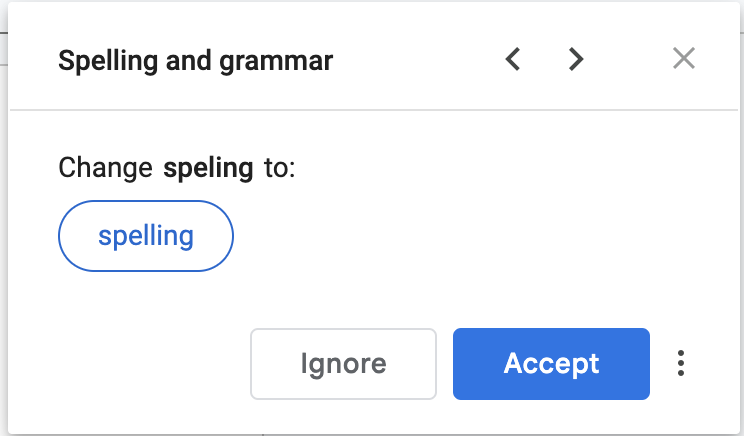

# Proofing Tools

## Spell Check Software

> **Spec point** — `spcpt_sg4DhSTF6f24s6yp`

## Spell Check Software

### What is spell check software?

- Spell check software is **built in to many word processing applications **and compares **words typed in a document** to **those held in its dictionary**
- Any words that do not match **are flagged and highlighted** for the user to check
- Most commonly, flagged words** will be underlined in red**
- If a word is not in the dictionary but is spelt correctly, it will still be flagged
- Most common examples of flagged words that may be spelt correctly include:

  - ***Proper nouns***
  - **Words in other languages**

#### Considering automated suggestions

- Automated suggestions provided by spell check software **may not always be accurate or appropriate**
- The software may not recognise some words or phrases, particularly **technical terms or jargon**
- Always** use your judgement **when accepting or rejecting these suggestions

## Validation Checks

> **Spec point** — `spcpt_ndXYGfrttXTzHrgF`

## Validation Checks

### What are validation checks?

- A validation check is essential to ensure data is accurate, complete, and meets specific criteria before it's processed
- It helps minimise data entry errors and maintains the integrity of the data
- Details of specific validation routines can be found [here](https://www.savemyexams.com/igcse/ict/cie/21/revision-notes/5-the-systems-life-cycle/the-systems-life-cycle/the-systems-life-cycle-design/)

> **Worked Example**
> A document contains the sentence "Fistral Beach is a well-known beach in Cornwall, England". The text is spell checked.
> 
> Explain why the word Fistral is flagged as an error
> 
> **[3]**
> 
> **Answer**
> 
> **Final answer:** **Fistral is the name of a specific beach and will not be in a dictionary [1]**
> **Spell checkers do not include proper nouns [1]**
> **It can be added to the dictionary so that it is not flagged if used again [1]**
