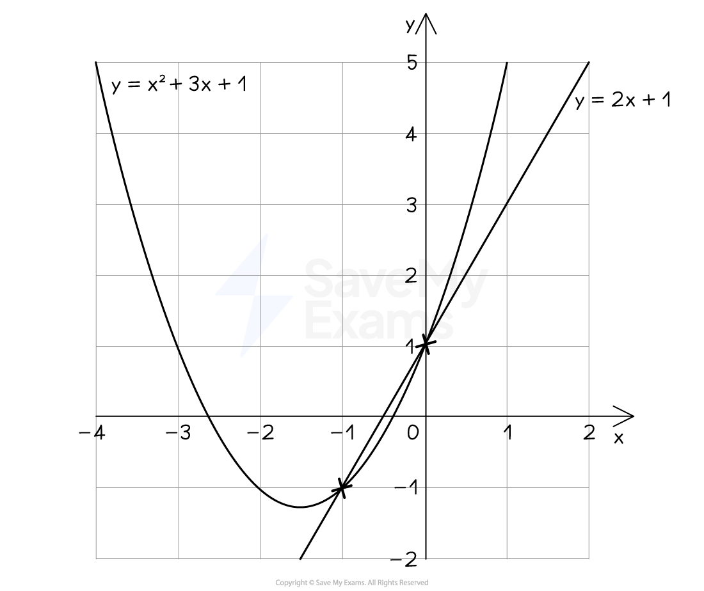
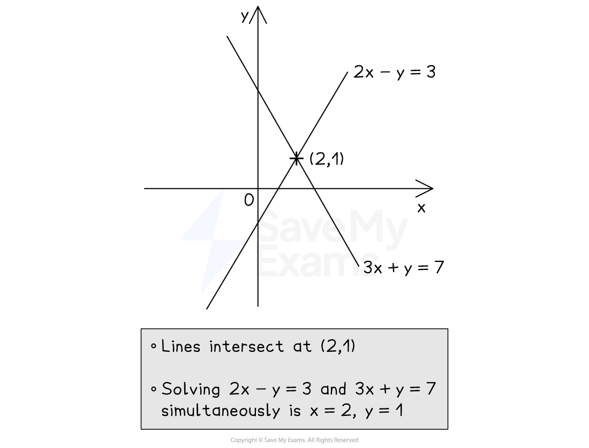

# Solving Equations from Graphs

## Solving Equations Using Graphs

> **Spec point** — `spcpt_nJvPgFGmPTS4vH5M`

## Solving Equations Using Graphs

### How do I find the coordinates of points of intersection?

- Plot** two graphs** on the** same **set of **axes**

  - The **points** **of intersection** are where the two lines **meet**
- For example, plot* y* = *x*2 + 3*x* + 1 and *y* = 2*x* + 1 on the same axes

  - They meet twice, as shown
  - The **coordinates** of** intersection** are (-1, -1) and (0, 1)

### How do I solve simultaneous equations graphically?

- The *x * and *y  ***solutions** to **simultaneous equations** are the *x  *and *y  ***coordinates** of the **point of intersection**
- For example, to solve 2*x *- *y *= 3 and 3*x *+ *y* = 7 simultaneously

  - **Rearrange** them into the form ***y***** = *****mx***** + *****c***
  
    - *y* = 2*x* - 3 and *y* = -3*x* + 7
  - Use a** table of values** to plot each line
  - Find the **point of intersection**, (2, 1)
  - The** solutions **are therefore *x* = 2 and *y* = 1

### How do I use graphs to solve equations?

- This is easiest explained through an example
- You can use the** graph** of $y=x^{2}-4x-2$ to **solve** the following **equations**

  - $x^{2}-4x-2=0$
  
    - The **solutions** are the two** *****x*****-intercepts**
    - This is where the curve cuts the *x*-axis (also called **roots**)
  - $x^{2}-4x-2=5$
  
    - The **solutions **are the two** *****x*****-coordinates** where the curve** intersects** the **horizontal line** $y=5$
  - $x^{2}-4x-2=x+1$
  
    - the **solutions** are the two** *****x*****-coordinates** where the curve **intersects **the **straight line** $y=x+1$
    - The straight line must be **plotted** on the same axes first
- To solve a** different** equation like $x^{2}-4x+3=1$

  - **add / subtract terms** to both sides to get "graph = ..."
  
    - For example, subtract 5 from both sides
    
      - $x^{2}-4x-2=-4$
      - This can now be done as above

> **Exam Hint**
> - When solving equations in *x*, only give ***x-*****coordinates** as final answers
> 
>   - Include the *y*-coordinates if solving simultaneous equations

> **Worked Example**
> Use the graph of $y=10-8x^{2}$ shown to estimate the solutions of each equation given below.
> 
> 
> 
> (a) $10-8x^{2}=0$
> 
> **Answer:**
> 
> > *The function equals zero, so the **x**-intercepts of its graph are the solutions*
> *Read off the values where the curve cuts the **x**-axis*
> *Use a suitable level of accuracy (no more than 2 decimal places from the scale of this graph)*
> 
> *-1.12 and 1.12 *
> 
> > *These are the two solutions to the equation*
> 
> **Final answer:** **x**** = -1.12 and ****x ****= 1.12**
> 
> (b) $10-8x^{2}=8$
> 
> **Answer:**
> 
> > *The function equals 8, so draw the horizontal line **y** = 8*
> *Find the **x**-coordinates where this cuts the graph  *
> 
> *-0.5 and 0.5 *
> 
> > *These are the two solutions to the original equation*
> 
> **Final answer:** **x**** = -0.5 and ****x ****= 0.5**
