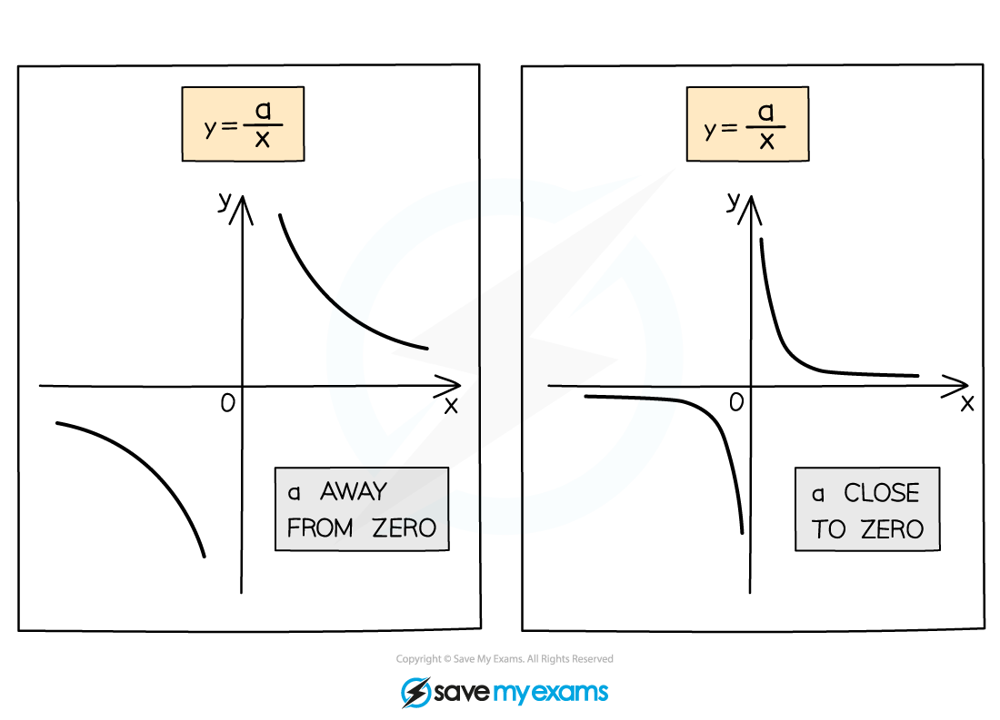

# Types of Graphs

## Types of Graphs

> **Spec point** — `spcpt_pDxTVfb4ZTRT6F3n`

## Types of Graphs

### What graphs do I need to know?

- You need to be able to **recognise** the following **lines**:

  - **Straight lines**
  
    - *y*  = *mx*  + *c*
    - Such as *y*  = 3*x * + 2, *y*  = 5*x * - 1, ...
    - Two** important** ones are *y* =  *x*  and *y* =  -*x*
  - **Horizontal lines**
  
    - *y*  = *c*
    - Such as *y*  = 4, *y*  = -10, ...
  - **Vertical lines**
  
    - *x*  = *k*
    - Such as *x*  = 2, *x*  = -1, ...
- You need to be able to recognise **quadratic **graphs

  - *y*  = *x*2
  - *y*  = -*x*2
  - *y*  = *ax*2  + *bx*  + *c*
- You also need to be able to recognise **reciprocal** graphs

  - $y=\frac{1}{x}$
  - $y=\frac{a}{x}$

### What does a quadratic graph look like?

- The **equation** of a **quadratic graph** is *y*  = *ax*2  + *bx*  + *c*
- A quadratic graph has either a **u-shape** or an **n-shape**

  - This type of shape is called a **parabola**
- **u-shapes **are called **positive **quadratics

  - because the number in front of *x*2 is positive
  
    - For example, *y*  = 2*x*2  + 3*x*  + 4
- **n-shapes **are called **negative **quadratics

  - because the number in front of *x*2 is negative
  
    - For example, *y*  = -3*x*2  + 2*x*  + 4
- You can plot quadratic graphs using a **table of values**

### What are the key features of a quadratic graph?

- The point where the graph turns is called the **vertex**

  - **Positive **quadratics have a **minimum** point
  
    - The bottom of the u-shape
  - **Negative** quadratics have a **maximum point**
  
    - The top of the n-shape
- Quadratic graphs always have a **vertical line of symmetry** down the **middle**

  - The **equation** of the vertical line of** **symmetry is**  *****x***** = *****k***
  
    - *k* is the *x*-coordinate of the minimum or maximum point
- Quadratic graphs do** not** have to cross the *x*-axis

  - If they do, **two** ***x*****-intercepts** are created, called **roots**
  
    - If the curve just** touches** the *x*-axis, only **1 root** is created
  - **Roots** are **symmetric** about the **vertical line of symmetry**
- Quadratic graphs **always** have one ***y*****-intercept**

### What does a reciprocal graph look like?

- The **equation** of a **reciprocal graph** is $y=\frac{a}{x}$

  - You **cannot **substitute in *x*  = 0 (**division by zero** is **not **allowed)
  
    - $x\neq0$
  - You should** not include** *x*  = 0 in a **table of values**
- The **shape** of $y=\frac{a}{x}$ is shown below (for a positive value of *a*)

  - It has two **two curved branches**
  
    - The branches are** L-shaped**
    - The L is more **rectangular** when *a* is **smaller**
  - The branches **never connect**!
- A **negative** value of *a*  **reflects** the shape in the ***y*****-axis**

> **Worked Example**
> In each of the cases below, state the letter of the graph that corresponds to the equation given.
> 
> 
> 
> (a) $y=x+5$
> 
> **Answer:**
> 
> > * This is a straight-line graph, **y**  = **mx**  + **c*
> 
> **Final answer:** **Graph D**
> 
> (b) $y=-x^{2}+3x+2$
> 
> **Answer:**
> 
> > *This is a quadratic graph, **y**  = **ax**2**  + **bx**  + **c ** (**a**  = -1, **b**  = 3, **c**  = 2)*
> 
> > *The number in front of **x**2* *is negative so it has an n-shape*
> 
> **Final answer:** **Graph C**
> 
> (c) $y=\frac{4}{x}$
> 
> **Answer:**
> 
> > *This is a reciprocal graph,* $y=\frac{a}{x}$
> *It has two L-shaped branches*
> 
> **Final answer:** **Graph B**
