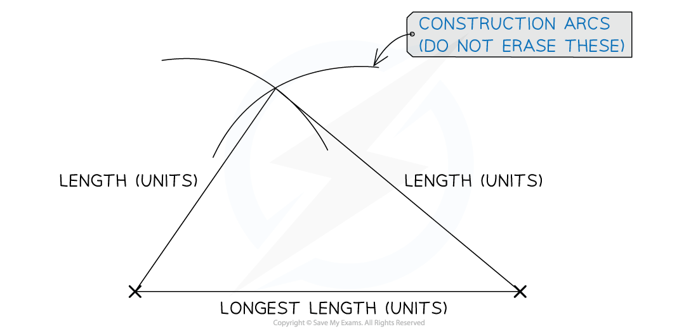

# Constructing Triangles

## Constructing SSS Triangles

> **Spec point** — `spcpt_nxTbCZC2J73KdFNg`

## Constructing SSS Triangles

### What are SSS Triangle constructions?

- **SSS** just stands for **side, side, side**!
- An **SSS triangle construction** is a triangle **drawn accurately** if you are **told the lengths of its three sides** and no other information
- You will need:

  - a **pencil**
  - a **ruler**
  - a **pair of compasses**

### How do I construct an SSS triangle?

- **STEP 1**
Use a **ruler** to draw the **longest **side as the **horizontal **base near the bottom of the space you have been given

  - This needs to be **accurate**
  - Write its length (with units) just underneath

- **STEP 2**
Open your **compasses **so that the **length** from the **compass point to the tip of your pencil** is **exactly the length** of one of the **remaining sides**

  - Being extra careful not to change the length, put the compass point on one end of the horizontal line you have drawn and **draw an arc** above the horizontal line
  - You can draw a full circle rather than an arc if you prefer
- **STEP 3**
Open your **compasses **so that the length from the **compass point to the tip of your pencil** is **exactly the length** of the **third side**

  - Being extra careful not to change the length, put the compass point on the other end of the horizontal line and **draw another arc**, making sure that it **crosses the first arc**
- **STEP 4** Use your **ruler** to draw **straight lines** from each end of the horizontal line to the point **where the arcs cross**
- **STEP 5**
Use your **ruler** to **check **that the two new lines are **exactly equal** to the lengths given in the question

  - When you are confident that they are accurate, label the lines with their lengths and units

- **Do not rub out your arcs** as the examiner will use these to check your work
- Sometimes the instructions will include a **triangle name** such as triangle ABC

  - Make sure you label each vertex with the correct letters

> **Exam Hint**
> - SSS triangle construction questions are usually worth 2 marks; one for having the sides accurate and the other for clearly showing the construction arcs on your diagram
> - To ensure you get that second mark
> 
>   - Make sure you are confident using a pair of compasses accurately
>   - Do not erase the construction arcs from your diagram

> **Worked Example**
> **Using a ruler and pair of compasses only,** construct a triangle with sides 6 cm, 7 cm and 10 cm.
> Do not erase your construction arcs.
> 
> **Answer:**
> 
> *Draw the 10 cm line as the horizontal base*
> *In turn, place the point of the compasses at each end and draw an arc with radius 6 cm from one end, and another arc with radius 7 cm from the other end*
> *The third vertex of the triangle is the point at which they intersect*
> 
> > *Use your ruler to measure each side and check for accuracy*
> 
> 
