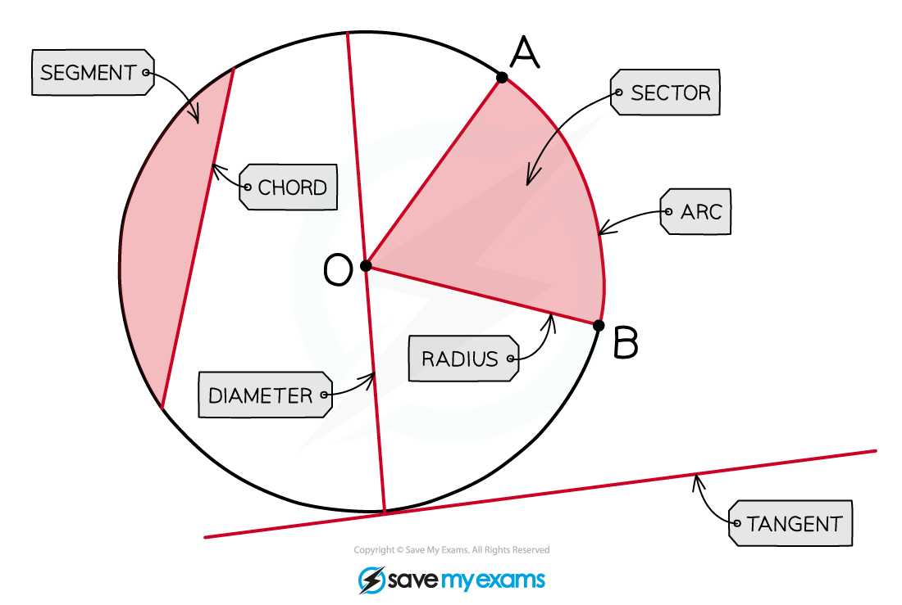

# Angle in a Semicircle

## Angle in a Semicircle

> **Spec point** — `spcpt_jVQwyZ7Dv75fvryF`

## Angle in a Semicircle

### What are circle theorems?

- **Circle Theorems** deal with angles that occur when lines are drawn within (and connected to) a circle

- You may need to use other **facts and rules** such as:

  - basic properties of lines and angles
  - properties of triangles and quadrilaterals
  - angles in parallel lines or polygons

### Circle Theorem: The angle in a semicircle is 90°

- The lines drawn from a **point** on the** circumference** to either end of a **diameter **are **perpendicular**

  - The angle at that point on the circumference is** 90°**
  - This circle theorem only uses half of the circle
  
    - The right-angle is called the angle in a **semicircle**

- To spot this circle theorem on a diagram look for a triangle where

  - **one side **is the **diameter**
  
    - Remember that a diameter always goes through the **centre**
  - **all three vertices** are on the **circumference**
- The 90º angle will always be the angle **opposite** the diameter
- When explaining this theorem in an exam you must use the **keywords: **

  - **The angle in a semicircle is 90°***** ***
- Questions that use this theorem may

  - appear in** whole circles** or in **semicircles**
  - require the use of **Pythagoras' Theorem** to find a missing length

> **Exam Hint**
> - As soon as you spot this arrangement in a question, mark the angle as 90° degrees on the diagram
> 
>   - Sometimes just doing this will earn you a mark!

> **Worked Example**
> *A*, *B*, and *C* are points on a circle. *AC* is a diameter of the circle. Find the value of *a*.
> 
> 
> 
> **Answer:**
> 
> > *As the line AC is the diameter of the circle, use the circle theorem "the angle in a semicircle is 90°" to state that angle B must be 90°*
> 
> > *We can now use the fact that the internal angles of a triangle sum to 180°, to find the unknown angle*
> 
> **a*** + 53 + 90 = 180*
> 
> **a*** + 143 = 180*
> 
> **Final answer:** **a**** = 37**
