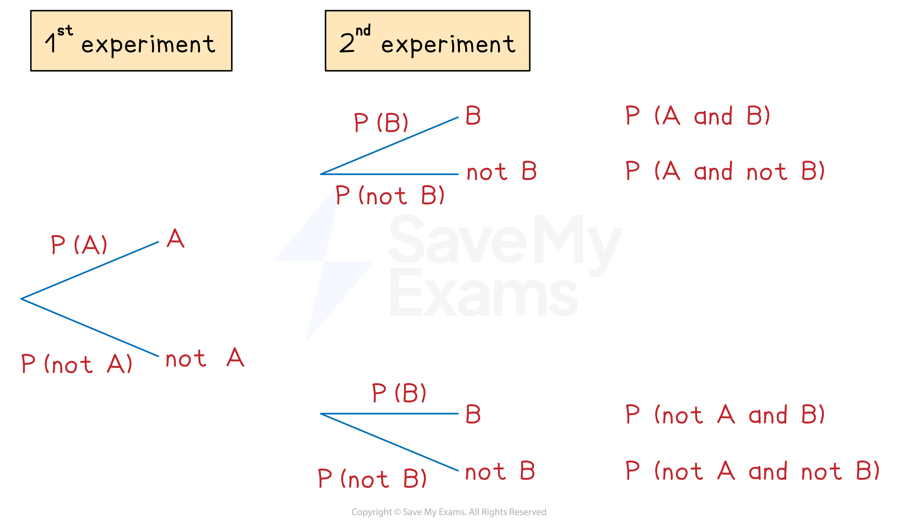

# Probability Tree Diagrams

## Tree Diagrams

> **Spec point** — `spcpt_bJdV9RcZkPsy79k8`

## Tree diagrams

### How do I draw a tree diagram?

- **Tree diagrams** can be used for** repeated** **experiments** with **two outcomes**

  - The **1st experiment **has outcome **A** or **not A**
  - The **2nd experiment **has outcome **B** or not **B**
- Read the tree diagram from** left to right** along its **branches**

  - For example, the top branches give A followed by B
  
    - This is called A** and** B

### How do I find probabilities from tree diagrams?

- Write the **probabilities** on each branch

  - Remember that P(**not **A) = 1 - P(A)
  
    - Probabilities on each **pair** of branches **add to 1**
- **Multiply** along the branches from** left to right**

  - This gives P(1st outcome **and** 2nd outcome)
- **Add** between the **separate cases**

  - For example
  
    - P(AA **or **BB) = P(AA) + P(BB)
- The probabilities of **all** possible cases **add to 1**
- If asked to find the probability of **at least one** outcome, it is quicker to do **1 - P(none)**

> **Exam Hint**
> When multiplying along branches with fractions, don't cancel fractions in your working - having the same denominator makes them easier to add together!

> **Worked Example**
> A worker drives through two sets of traffic lights on their way to work.
> Each set of traffic lights has only two options: green or red.
> The probability of the first set of traffic lights being on green is $\frac{5}{7}$.
> The probability of the second set of traffic lights being on green is $\frac{8}{9}$.
> 
> (a) Draw and label a tree diagram. Show the probabilities of every possible outcome.
> 
> **Answer:**
> 
> > *Work out the probabilities of each set of traffic lights being on red, R*
> *Use P(red) = 1 - P(green)*
> 
> `straight P (1^st straight R)=1−straight P (1^st straight G)=1−5 / 7=2 / 7`
> `straight P (2^nd straight R)=1−straight P (2^nd straight G)=1−8 / 9=1 / 9`
> 
> > *Draw the branches (with a label of G or R on the ends)*
> *Write the probabilities above each branch*
> *Calculate probabilities of each outcome by multiplying along the branches from left to right*
> 
> 
> 
> (b) Find the probability that both sets of traffic lights are on red.
> 
> **Answer:**
> 
> > *This is the answer for P(R, R) from the tree diagram*
> 
> **Final answer:** ** **$\frac{2}{63}$
> 
> (c) Find the probability that at least one set of traffic lights is on red.
> 
> **Answer:**
> 
> **Method 1**
> 
> > *This means the 1st is green and the 2nd is red*
> *Or the 1st is red and the 2nd is green*
> *Or the 1st is red and the 2nd is red ('at least one' could mean both)*
> *Add between the separate cases*
> 
> `straight P (at least one straight R)=straight P (straight G comma straight R)+straight P (straight R comma straight G)+straight P (straight R comma straight R)=5 / 63+16 / 63+2 / 63=23 / 63`
> 
> $\frac{23}{63}$
> 
> **Method 2**
> *At least one red means all the possible cases shown except two greens*
> *So P(at least 1 red) = 1 - P(two greens)*
> 
> `space 1−straight P (straight G comma straight G)=1−40 / 63=23 / 63`* *
> 
> $\frac{23}{63}$
