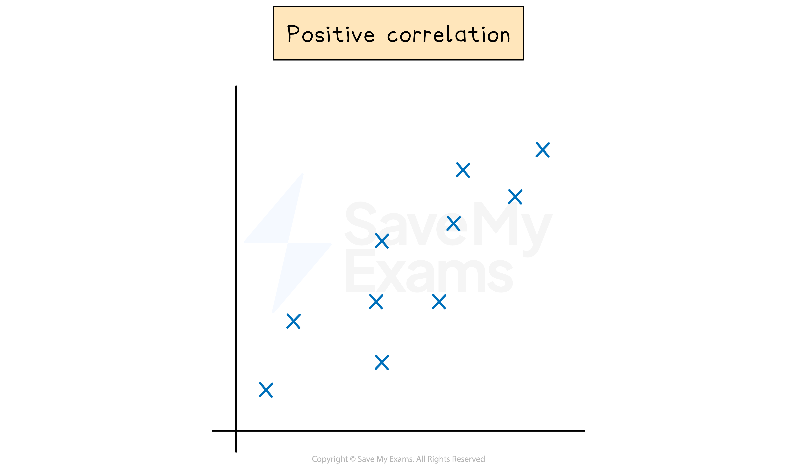
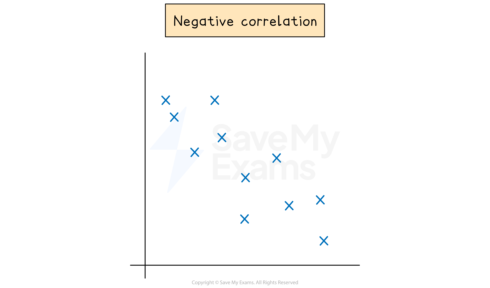
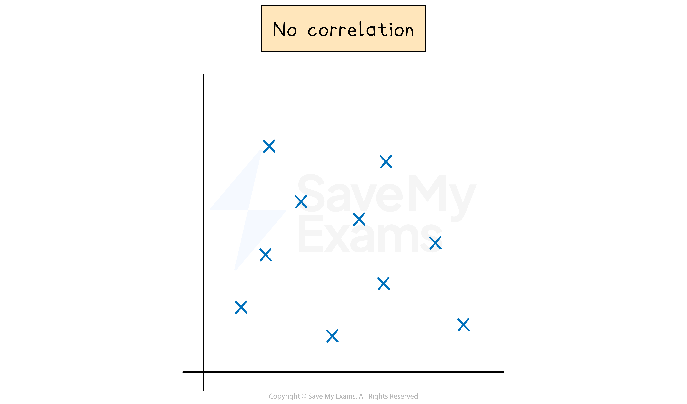

# Scatter Graphs & Correlation

## Correlation

> **Spec point** — `spcpt_b7NJ2fgyz9vSppx6`

## Correlation

### What is correlation?

- **Correlation** describes how two quantities are related to each other
- **Positive correlation** is when one quantity **increases** and the other quantity **increases**

  - For example, as temperature increases, sales of cold drinks increase
- **Negative correlation **is when one quantity **decreases** while the other quantity **increases**

  - For example, the value of a car decreases as its age increases
- **No (zero) correlation** is where there is no apparent relationship

  - For example, the masses of snails and scores in an exam

### What does the phrase "correlation does not imply causation" mean?

- If two quantities **correlate**, it does **not** mean that the first **causes** the second
- For example, each day you record the height of a sunflower and the weight of a puppy

  - As the height of the sunflower **increases**, the weight of the puppy **increases**
  
    - This is a **positive** correlation
  - But you **cannot claim** that:
  
    - If you want your puppy to weigh more, make your sunflower taller!
    - Sunflowers grow better when puppies are heavier!
  - Both quantities may be increasing due to another reason
  
    - In this case,** time**

## Scatter Graphs

> **Spec point** — `spcpt_kQJxjvWFpSXzHfGm`

## Scatter graphs

### What are scatter graphs?

- **Scatter** **graphs** (or **scatter diagrams**) are used to plot **pairs **of data

  - For example, students' Maths grades against their Physics grades
- The vertical and horizontal **axes** represent the two **quantities** being measured
- **Points** are plotted as **crosses**, ×

  - They are **not** joined up
- The general **shape **formed by the points shows the type of **correlation**

  - **Positive **correlation goes from bottom left to top right
  
    - A positive gradient
  - **Negative** correlation goes from top left to bottom right
  
    - A negative gradient
  - **No (zero)** correlation looks like a cloud of points
- **Correlations** can be **weak** or **strong**

  - The **stronger** the **correlation**, the **closer to a straight line** the data points lie

