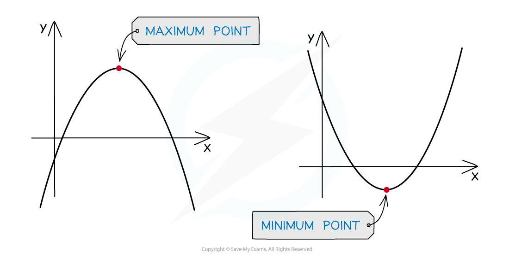
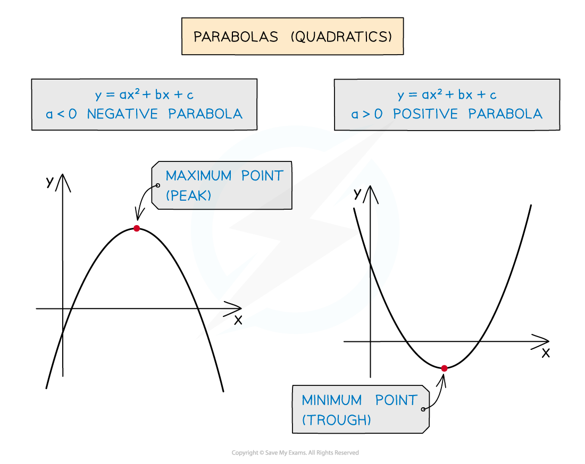
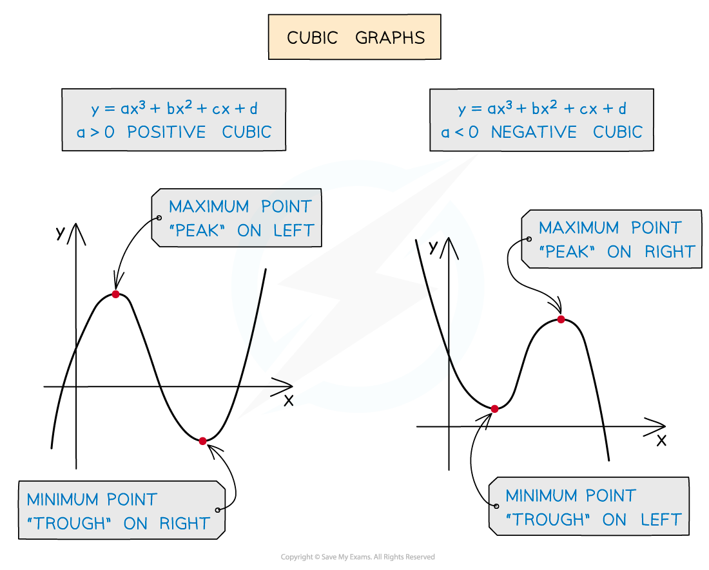

# Classifying Stationary Points

## Classifying Stationary Points

> **Spec point** — `spcpt_Fz9372S8ydYfzTD4`

## Classifying stationary points

### What are the different types of stationary points?

- You need to know **two **different types** **of stationary points:

  - **Maximum** **points** (this is where the graph reaches a “**peak**”)
  - **Minimum** **points** (this is where the graph reaches a “**trough**”)
  
    - These are also called **turning points**
    - Deciding which is which is called **classifying** them (or finding the **nature** of them)

- If a graph has multiple turning points, the one you are interested in can be described as a **local** maximum or minimum point

  - Other parts of the graph may still reach higher/lower values elsewhere

### How do I classify turning points using graphs?

- You can use the **shape of common graphs** to classify different turning points
- To** classify the turning point** on a** quadratic curve** (parabola), remember that:

  - A **positive** quadratic (**positive** ***x*****2** term) must have a **minimum** point
  - A **negative** quadratic (**negative** ***x*****2** term) must have a **maximum** point

- To** classify two different turning points** on a** cubic curve**, remember that:

  - A **positive** cubic has a **maximum** point on the **left** and a **minimum** on the **right**
  - A **negative** cubic has a **minimum** point on the **left** and a **maximum** on the **right**

### How do I classify turning points using the gradient function (derivative)?

- An alternative method if no graph is available is to use the **gradient function** (derivative) $\frac{dy}{dx}$

  - By looking at the **gradient just before and just after** a turning point, you can determine if it is a maximum or a minimum
  - Find the gradient just before and just after a turning point by substituting values near to the value of *x* into the gradient function
  - It helps to imagine what the **tangents** to the curve would look like

| Gradient before turning point | Gradient at turning point | Gradient after turning point | Type of turning point |
|---|---|---|---|
| Positive  / | Zero  ⁻ | Negative  \ | Maximum  /**—**\ |
| Negative  \ | Zero  _ | Positive  / | Minimum  \_/ |

### How do I classify turning points using the second derivative?

- Another method is to use the **second derivative**, $\frac{d^{2}y}{dx^{2}}$, which is the **derivative-of-the-derivative**

  - $\frac{d^{2}y}{dx^{2}}$ is pronounced "d-two-y by dx-squared"
- Differentiate the equation once to get $\frac{dy}{dx}$  then again to get $\frac{d^{2}y}{dx^{2}}$

  - This is the same as **differentiating** the original equation for $y$ **twice**
- If the stationary point is at $x=a$, substitute $x=a$ into the expression for $\frac{d^{2}y}{dx^{2}}$ to get a numerical value

  - If the result is **negative**, $\frac{d^{2}y}{dx^{2}}<0$, then the stationary point is a **maximum** point
  
    - This is often the opposite of what people expect!
  - If the result is **positive**,  $\frac{d^{2}y}{dx^{2}}>0$, then the stationary point is a **minimum** point
  - If the value is **zero**,  $\frac{d^{2}y}{dx^{2}}=0$, then the test has **failed**
  
    - You will need to try another method to classify the turning point

> **Worked Example**
> The turning points on the curve with equation $y=2x^{3}+3x^{2}-12x+1$ are (-2, 21) and (1, -6).
> 
> Determine the nature of these turning points.
> 
> **Answer:**
> 
> **Method 1: Using the graph**
> 
> > *Make a quick sketch of the curve*
> *It is a positive cubic so you know that it will start at the bottom left, have two turning points and go towards the top right*
> *You know the coordinates of the turning points and the **y**-intercept: (0, 1)*
> *(the sketch does not have to be perfect!)*
> 
> 
> 
> **Final answer:** **From the graph, which is a positive cubic, **
> **(-2, 21) is to the left of (1, -6)**
> 
> **Final answer:** **Therefore, (-2, 21) is a maximum point and (1, -6) is a minimum point**
> 
> **Method 2: Differentiation (1****st**** derivative)**
> 
> > *Differentiate the original equation to find the 1**st** derivative, the gradient function, *$\frac{dy}{dx}$
> 
> `table row cell 2 x cubed end cell rightwards arrow cell 6 x squared end cell row cell 3 x squared end cell rightwards arrow cell 6 x end cell row cell negative 12 x end cell rightwards arrow cell negative 12 end cell row 1 rightwards arrow 0 end table`
> 
> $\frac{dy}{dx}=6x^{2}+6x-12$
> 
> > *Find the gradient just before and just after each turning point by substituting a suitable **x**-value into the gradient function*
> 
> | *Turning point* | *Gradient before* | *Gradient after* |
> |---|---|---|
> | *(-2, 21)* | *sub ***x ***= -3*  *6(-3)**2** + 6(-3) - 12 = 24* | *sub ***x*** = -1*  *6(-1)**2** + 6(-1) - 12 = -12* |
> | *(1, -6)* | *sub ***x ***= 0*  *6(0)**2** + 6(0) - 12 = -12* | *sub ***x ***= 2*  *6(2)**2** + 6(2) - 12 = 24* |
> 
> **Final answer:** **The gradient just before (-2, 21) is positive and the gradient just after is negative, therefore the turning point here is a maximum point **
> 
> **Final answer:** **The gradient just before (1, -6) is negative and the gradient just after is positive, therefore the turning point here is a minimum point **
> 
> **Method 3: Differentiation (2****nd**** derivative)**
> 
> > *Differentiate the original equation to find the 1**st** derivative*
> 
> `table row cell 2 x cubed end cell rightwards arrow cell 6 x squared end cell row cell 3 x squared end cell rightwards arrow cell 6 x end cell row cell negative 12 x end cell rightwards arrow cell negative 12 end cell row 1 rightwards arrow 0 end table`
> 
> $\frac{dy}{dx}=6x^{2}+6x-12$
> 
> > *Differentiate again to find the 2**nd** derivative*
> 
> `table row cell 6 x squared end cell rightwards arrow cell 12 x end cell row cell 6 x end cell rightwards arrow 6 row cell negative 12 end cell rightwards arrow 0 end table`
> 
> $\frac{d^{2}y}{dx^{2}}=12x+6$
> 
> > *Find the nature of each turning point by substituting the value of its **x**-coordinate into the 2**nd** derivative*
> *A negative result indicates a maximum point (or positive for a minimum point)*
> 
> *For (-2, 21):   *`fraction numerator straight d squared y over denominator straight d x squared end fraction equals 12 open parentheses negative 2 close parentheses plus 6 equals negative 18`
> 
> **Final answer:** **The second derivative is negative, therefore the turning point at (-2, 21) is a maximum point**
> 
> *For (1, -6):   *`fraction numerator straight d squared y over denominator straight d x squared end fraction equals 12 open parentheses 1 close parentheses plus 6 equals 18`
> 
> **Final answer:** **The second derivative is positive, therefore the turning point at (1, -6) is a minimum point**
