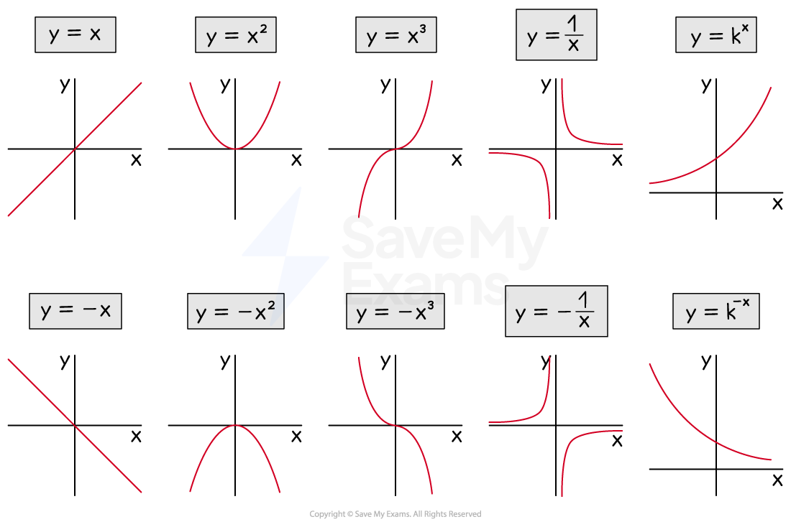
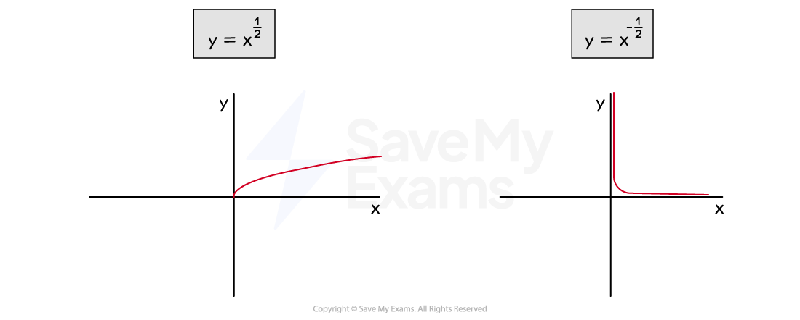
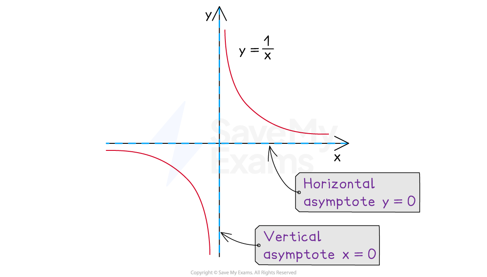
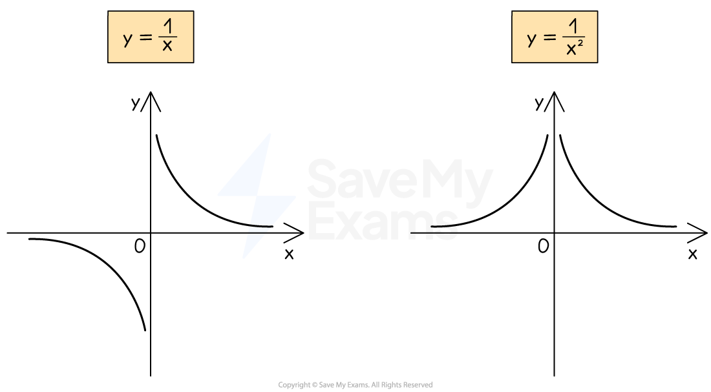

# Types of Graphs

## Types of Graphs

> **Spec point** — `spcpt_mFKDqdvs24Sm42xk`

## Types of Graphs

### What types of graphs do I need to know?

- You need to be able to **recognise, sketch, and interpret **the following types of graph:

  - **Linear** ($y=\pmx$)
  
    - $y=mx+c$ or $ax+by=c$
  - **Quadratic **($y=\pmx^{2}$)
  
    - $y=ax^{2}+bx+c$
  - **Cubic **($y=\pmx^{3}$)
  
    - $y=ax^{3}+b$ or $y=ax^{3}+bx^{2}+cx$
  - **Reciprocal** ($y=\pm\frac{1}{x}$)
  
    - $y=\frac{a}{x}+b$
  - **Exponential** ($y=k^{\pmx}$)
  
    - $y=ak^{x}+b$

- You may also need to recognise the graphs $y=x^{\frac{1}{2}}$ and $y=x^{-\frac{1}{2}}$
- These are equivalent to $y=\sqrt{x}$ and $y=\frac{1}{\sqrt{x}}$

- You must also be able to recognise the three basic **trigonometric graphs**, covered in the Trigonometry section

### Where are the asymptotes on reciprocal graphs?

- An **asymptote** is a line on a graph that a curve becomes closer to but never touches

  - These may be horizontal or vertical
- The **reciprocal **graph, $y=\frac{a}{x}$  (where $a$ is a constant)

  - **does not have a *****y*****-intercept**
  - **and does not have any roots**
- This graph has **two asymptotes**

  - A **horizontal** asymptote at the *x*-axis: $y=0$
  
    - This is the **limiting value** when the value of *x *gets very large (or very negative)
  - A **vertical** asymptote at the *y*-axis: $x=0$
  
    - This is the value that causes the **denominator to be zero**

- The reciprocal graph, $y=\frac{a}{x}+b$ (where $a$ and $b$ are both constants)

  - is the **same shape** as $y=\frac{a}{x}$
  - but is **shifted upwards** by $b$ units
  
    - $y=\frac{a}{x}-3$ would be $y=\frac{a}{x}$ shifted **down** by 3 units
  - This means the **horizontal asymptote** also **shifts up** by $b$ units
  
    - The asymptote of $y=\frac{a}{x}-3$ would be $y=-3$
  - The** vertical asymptote** remains on the ***y*****-axis**
- The graph of $y=\frac{1}{x^{2}}$ is similar to $y=\frac{1}{x}$ but has two key differences

  - $y=\frac{1}{x^{2}}$ is **steeper** than $y=\frac{1}{x}$
  - $y=\frac{1}{x^{2}}$ is **always positive**, even when $x$ is negative

### How do I draw exponential growth and decay?

- The equation $y=k^{x}$ represents **exponential growth** when $k>1$

  - $y=k^{x}$ represents **exponential decay **when $0<k<1$
  
    - $k$ is positive but** less than 1**
- Both of these graphs:

  - have a **horizontal asymptote** at $y=0$
  - **do not **have a **vertical asymptote**
  - have a $y$-intercept of $( 0 , 1 )$
- The graph of $y=ak^{x}+b$ is a similar shape to $y=k^{x}$, but there are some differences

  - It is first **stretched **vertically by $a$
  - It is then **shifted **$b$ units upwards
  
    - Therefore it has a **horizontal asymptote** at $y=b$
    - and a $y$-intercept of $( 0 , a + b )$
- For example, a population may be modelled as $y = 400 \times ( 1 \frac{1}{2} )^{x} + 100$, where $y$ is the population and  $x$ represents time

  - This is an exponential decay as $0<k<1$
  - The initial population (when $x=0$) will be 400 + 100 = 500
  
    - The $y$-intercept is (0, 500)
  - Over a long period of time (large $x$-value) the population will settle to 100
  
    - The asymptote is at $y=100$
- **Exponential decay** can also be identified by a **negative power **using **index laws**

  - $( 1 \frac{1}{2} )^{x = ( 2^{-1} } )^{x = 2^{-x} }$ so $y=400\times2^{-x}+100$ is the model above
  - This  has the form $y=k^{-x}$ where $k>1$

> **Worked Example**
> Match the graphs to the equations.
> 
> 
> 
> **(1) **$y=0.6x+2$**,    (2) **$y=3^{x}$**,    (3) **$y=-0.7x^{3}$**,    (4) **$y=\frac{4}{x}$**,   (5) **$y=-x^{2}+3x+2$
> 
> **Answer:**
> 
> > *Starting with the equations,*
> 
> > *(1)** is a linear equation (**y** = **mx **+ **c**) so matches the only straight line, graph **D*
> 
> > *(2) **is an exponential equation with a positive coefficient so matches graph **A*
> 
> > *(3) **is a cubic equation with a negative coefficient so matches graph **E*
> 
> > *(4)** is a reciprocal equation with a positive coefficient so matches graph **B*
> 
> > *(5) is a quadratic equation with a negative coefficient so matches graph C*
> 
> **Final answer:** **Graph A → Equation 2**
> 
> **Final answer:** **Graph B → Equation 4**
> 
> **Final answer:** **Graph C → Equation 5**
> 
> **Final answer:** **Graph D → Equation 1**
> 
> **Final answer:** **Graph E → Equation 3**
