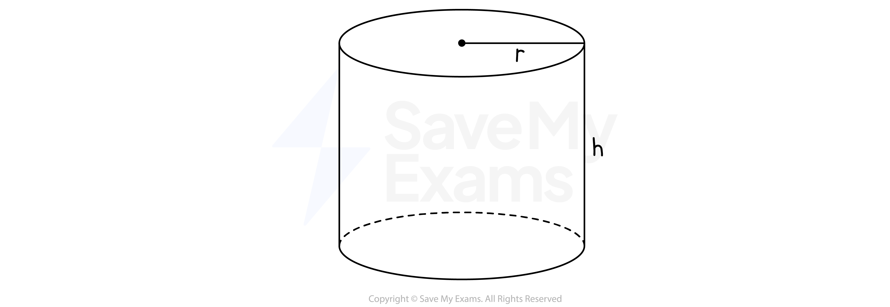
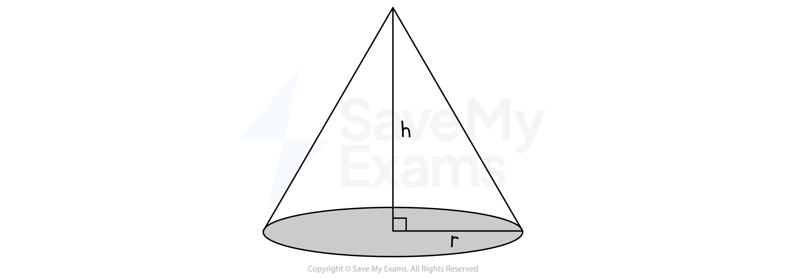
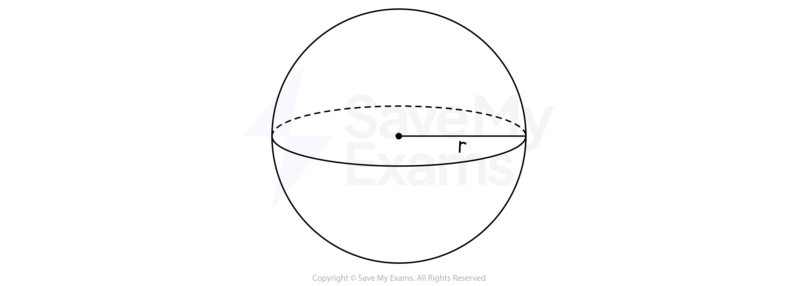
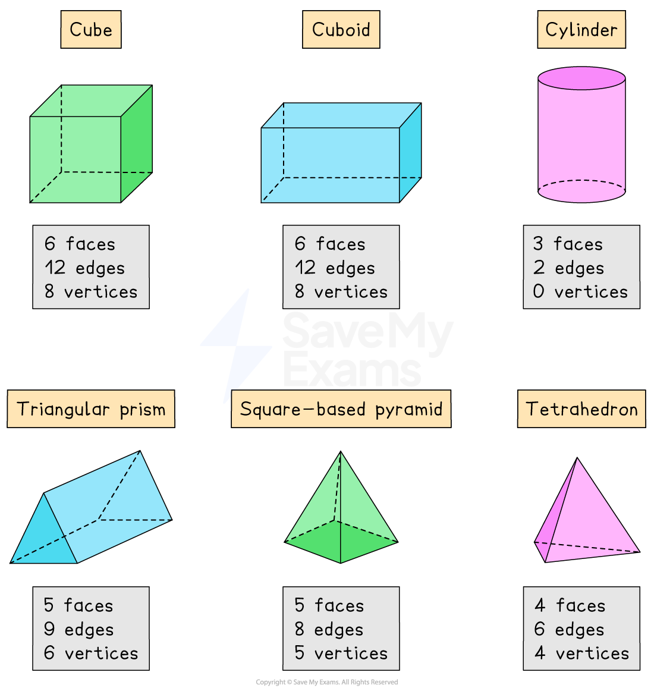
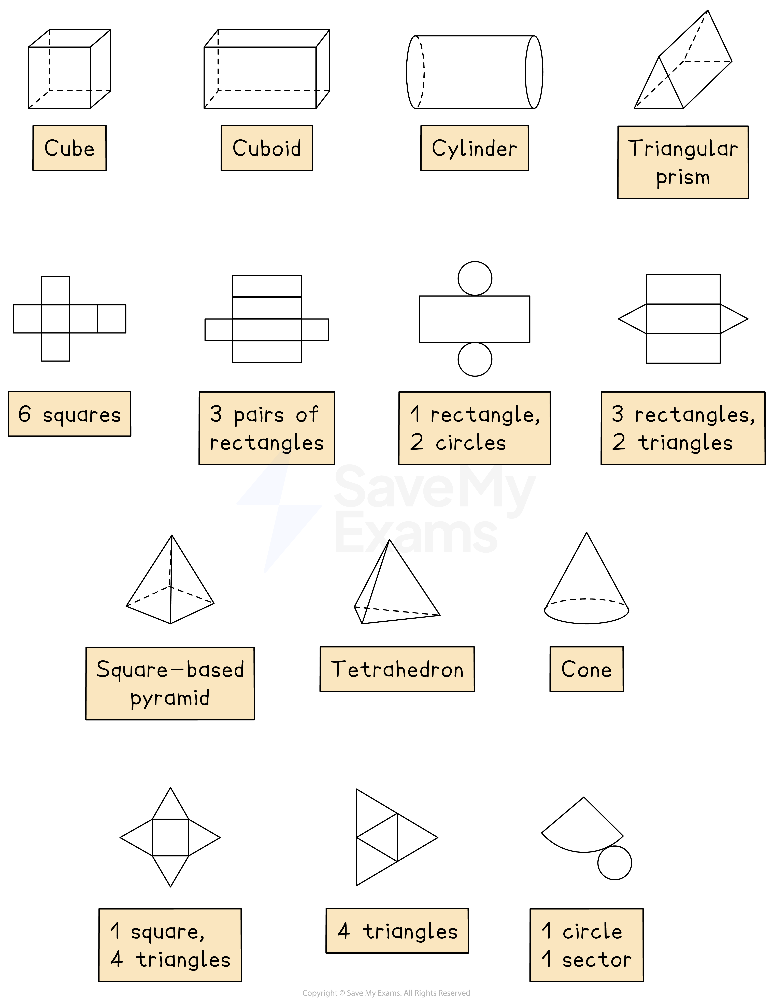
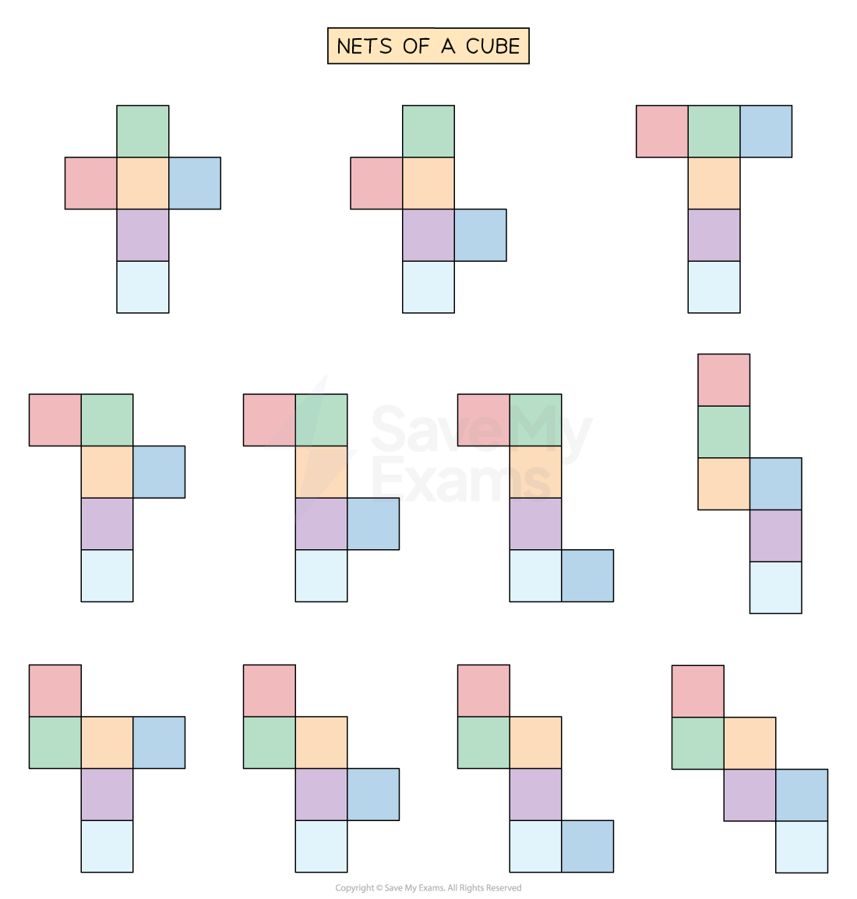
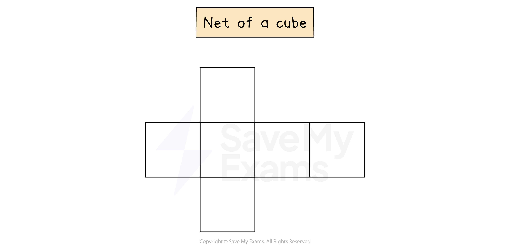
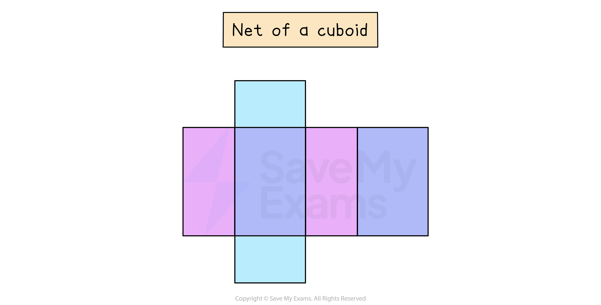
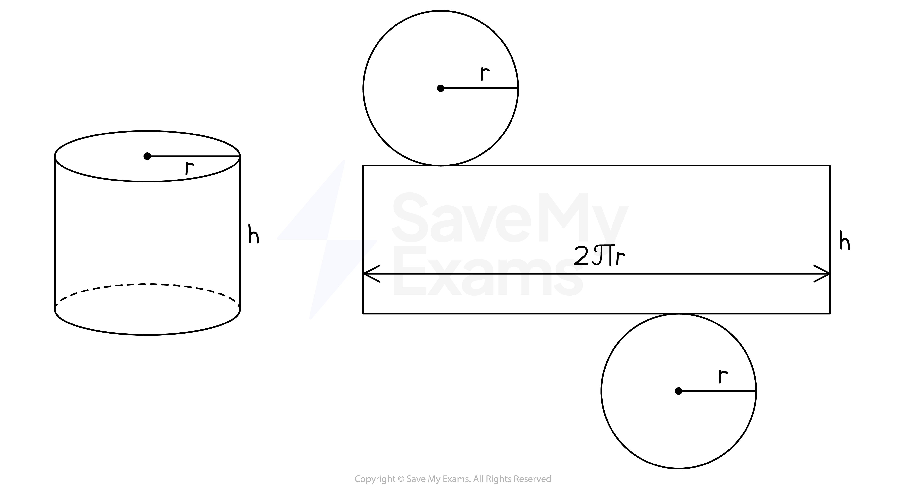
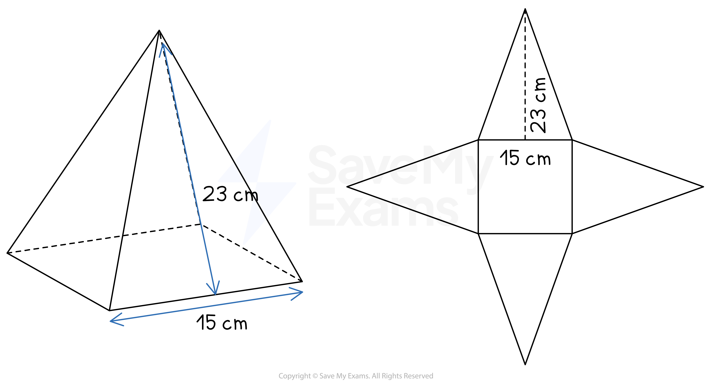

# 3D Shapes

## Properties of 3D Shapes

> **Spec point** — `spcpt_R2DrSNhXTVwnnd7c`

## Properties of 3D shapes

### What common 3D shapes do I need to know about?

- There are a number of **common 3D shapes **

  - You should know their **names **
  - and their **key properties**
- A **prism **is a 3D shape with the same **cross-section **throughout 

  - The cross-section of a **cube** is a **square**
  - The cross-section of a **cuboid** is a **rectangle**
  - There are **other prisms**, such as **triangular prisms** or **hexagonal prisms**
  
    - In these cases the exam question will make sure the shape of the cross-section is clear

  - A **cylinder** is similar to a prism
  
    - The cross-section of a **cylinder** is a **circle**

- There are a number of different types of **pyramid** 

  - A **pyramid** has a flat base and sloping sides that meet at a point
  - The pyramid may have a **square**, **rectangular** or **triangular **base
  - Some pyramids have special names you should know
  
    - A triangular-based pyramid is called a **tetrahedron**

  - A **cone** is similar to a pyramid
  
    - A **cone **has a circular base

- A **sphere **is a round solid ball shape

### What are the properties of 3D shapes?

- 3D shapes have a number of **faces**, **vertices **and **edges**

  - A **face** is a single flat surface of the 3D shape
  - A **vertex** (plural, **vertices**) is a corner of the 3D shape
  - An **edge** joins one vertex to another
- You should know the number and shape of the faces (and other surfaces) for the common 3D shapes

  - A **cube **has 6 equal, square faces
  - A **cuboid **has 3 pairs of rectangular faces
  - A **cylinder** has 2 equal circular faces and 1 curved surface
  
    - The curved surface has the shape of a rectangle if laid out flat
  - A **triangular prism** has 2 equal triangular faces and 3 rectangular faces
  
    - If the triangular faces are **equilateral** then **all **of the **rectangles will be equal**
    - If the triangular faces are **isosceles** then **two** of the **rectangles will be equal**
  - A **square-based pyramid** has 1 square face and 4 equal triangular faces
  - A **tetrahedron** has 4 triangular faces
  - A **sphere **has 1 curved surface; it is a ball shape

> **Exam Hint**
> Remembering the properties of 3D shapes will help in particular with questions involving surface area.

### What is a net of a solid?

- A **net **of a solid is a **2D drawing** that can be cut out and folded **to make a 3D shape**
- Each of the faces of the 3D shape are arranged in a certain pattern

  - Not every arrangement of the faces will create a net of that solid
  - Solids can have **more than one** arrangement that will work to make the 3D shape
- The **area **of the **net of a 3D shape** is the same as the **surface area **of the solid

*Nets of solids*

### What does the net of a cube or cuboid look like?

- The net of a **cube **has 6 squares connected at certain edges
- There are **11 different arrangements** of the square faces that will form a net of a cube

- The **most common** and **easiest to remember** is in the form of a cross

- A **cuboid **has 6 rectangular faces, so its net consists of 6 rectangles
- The most common and easiest net to remember is in the form of a cross

  - Pay attention to which rectangles are the same
  
    - They are colour-coded in the diagram below

### What does the net of a cylinder look like?

- The net of a **cylinder **consists of two circles and a rectangle
- The **length **of the rectangle is equal to the **circumference **of the circles

  - $\mathrm{Circumference}=2\timesπ\times\mathrm{radius}$
- The **width **of the rectangle is equal to the **height **of the cylinder

*Net of a cylinder*

### What does the net of a pyramid look like?

- The net of a **pyramid **consists of the base and a triangle attached to each edge of the base
- For example, a **square-based pyramid **has a square base and four congruent (identical) triangles

  - The **perpendicular height **of each triangle is equal to the **slant height **of the pyramid

*Example of a net of a pyramid*

> **Exam Hint**
> You may be given the dimensions of the solid when asked to draw a net
> 
> Make sure you put the correct lengths in the correct places by imagining cutting out and folding up the net.

> **Worked Example**
> A cuboid measures 6 cm by 3 cm by 2 cm.
> 
> On the 1 cm2 grid, draw an accurate net of this cuboid. One face has been drawn for you.
> 
> 
> 
> **Answer:**
> 
> > *The cuboid has three pairs of rectangles; measuring 6 cm by 3 cm, 6 cm by 2 cm, and 3 cm by 2 cm*
> 
> > *Make sure the net has two of each of these rectangles in the correct places*
> 
> 
