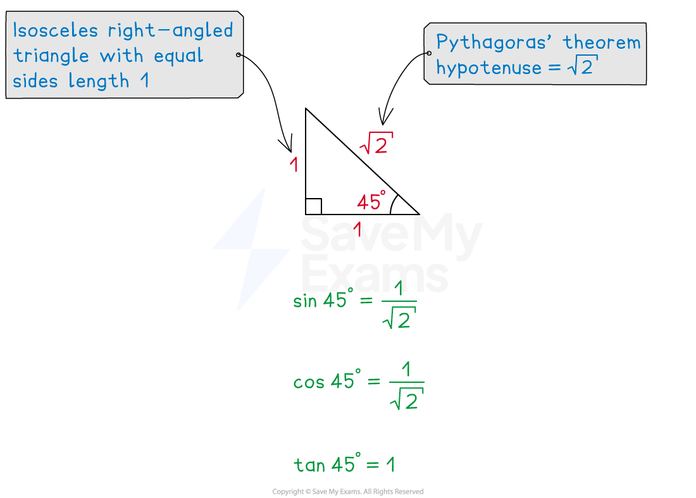
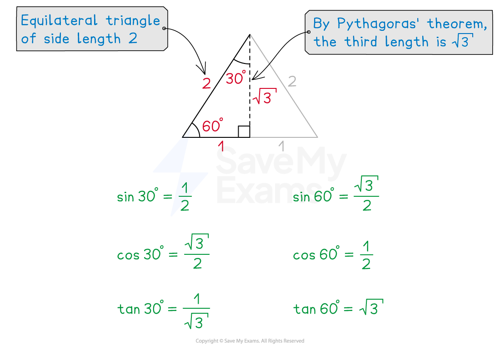
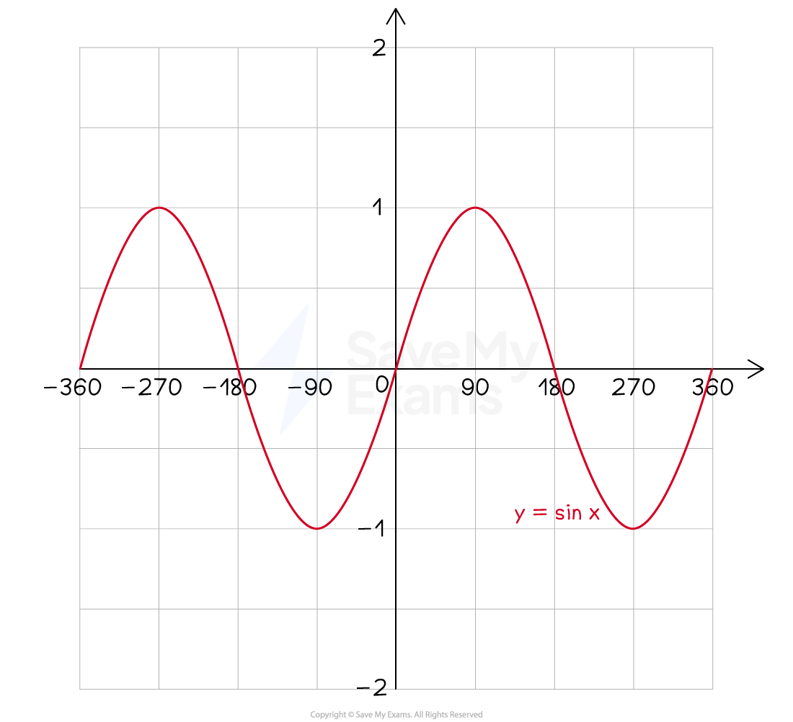
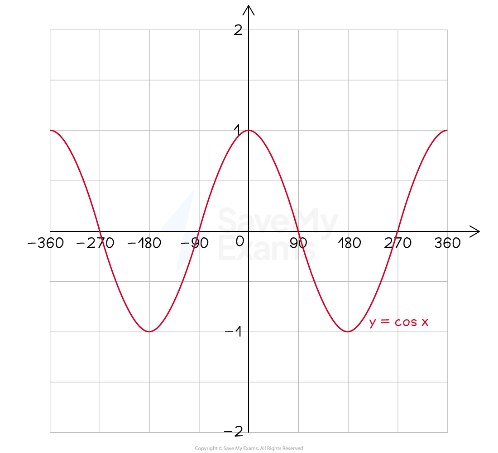
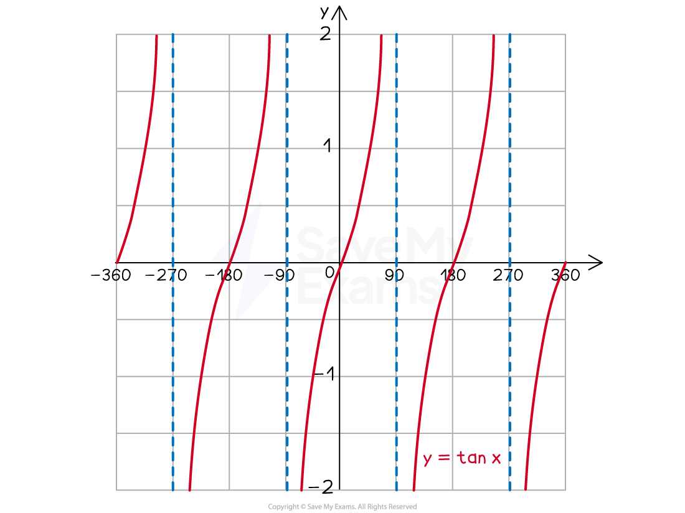

# Exact Trig Values

## Exact Trig Values

> **Spec point** — `spcpt_8KHZvTkCMKzyqzv3`

## Exact trig values

### What are exact values in trigonometry?

- For** certain angles** the values of sin θ, cos θ and tan θ can be written **exactly**

  - This means using fractions and surds
- You are** expected to know** the exact values of sin, cos and tan for

  - 0°, 30°, 45°, 60°, 90°, 180° and their multiples

| $θ$ | 0º | 30º | 45º | 60º | 90º |
|---|---|---|---|---|---|
| sin $θ$ | 0 | $\frac{1}{2}$ | $\frac{\sqrt{2}}{2}$ | $\frac{\sqrt{3}}{2}$ | 1 |
| cos $θ$ | 1 | $\frac{\sqrt{3}}{2}$ | $\frac{\sqrt{2}}{2}$ | $\frac{1}{2}$ | 0 |
| tan $θ$ | 0 | $\frac{\sqrt{3}}{3}$ | 1 | $\sqrt{3}$ | undefined |

### How can I remember these exact trig values?

- Look at **patterns** in the table

  - Note the values of sin θ from 0° to 90° match cos θ in reverse, from 90° to 0°

> **Exam Hint**
> Some people remember sin θ using the trick $\frac{\sqrt{0}}{2},\frac{\sqrt{1}}{2},\frac{\sqrt{2}}{2},\frac{\sqrt{3}}{2},\frac{\sqrt{4}}{2}$ which simplifies to $0,\frac{1}{2},\frac{\sqrt{2}}{2},\frac{\sqrt{3}}{2},1$.

- Two special **right-angled triangles **below** **can help you to find the exact values for 30º, 45º and 60º

  - Remember that by rationalising the denominator, $\frac{1}{\sqrt{2}}=\frac{1}{\sqrt{2}}\times\frac{\sqrt{2}}{\sqrt{2}}=\frac{\sqrt{2}}{2}$

#### Triangle for 45°

#### Triangle for 30° and 60°

- The **trig graphs** can help you to remember the exact values for  0º and multiples of 90º

### How do I use exact trig values?

- You may come across trig questions in a **non-calculator** question
- In trig calculations, **substitute **in the** exact trig values** and solve as usual

  - E.g. Solve the equation $\mathrm{cos}45=\frac{x}{12}$
  
    - Replace $\mathrm{cos}45$ with $\frac{\sqrt{2}}{2}$ to give $\frac{\sqrt{2}}{2}=\frac{x}{12}$
    - Then you can solve for $x$
- On trig graphs, you may be expected to find a coordinate

  - E.g. The coordinates $( 30 , k )$ lie on the graph $y=\mathrm{tan}x$, find $k$
  
    - $k$ will be equal to $\mathrm{tan}30$
    - The exact value of $\mathrm{tan}30$ is $\frac{\sqrt{3}}{3}$
    - Therefore $k=\frac{\sqrt{3}}{3}$

> **Exam Hint**
> - Writing these out (or sketching the triangles/graphs) on your paper at the beginning of the exam means that you can use them as many times as you need to during the exam!

> **Worked Example**
> Find the value of $x$ in the diagram below.
> 
> Give your answer as an exact value.
> 
> 
> 
> **Answer:**
> 
> > *Triangle **ABC** is a right-angled triangle, so use SOHCAHTOA*
> 
> > *We know the hypotenuse (**AC**)** ** and we want to calculate the opposite (**BC**), so use *$\mathrm{sin}θ=\frac{O}{H}$
> 
> $\mathrm{sin}60=\frac{x}{28}$
> 
> > *Remember that *$\mathrm{sin}60=\frac{\sqrt{3}}{2}$
> 
> > *So, *
> 
> $\begin{gathered} \frac{ \sqrt{3} }{2} & = \frac{x}{28} \\ 28 \times \frac{ \sqrt{3} }{2} & = x \\ 14 \times \sqrt{3} & = x \end{gathered}$
> 
> > *Leave in exact (surd) form*
> 
> **Final answer:** $x=14\sqrt{3}$** cm**
