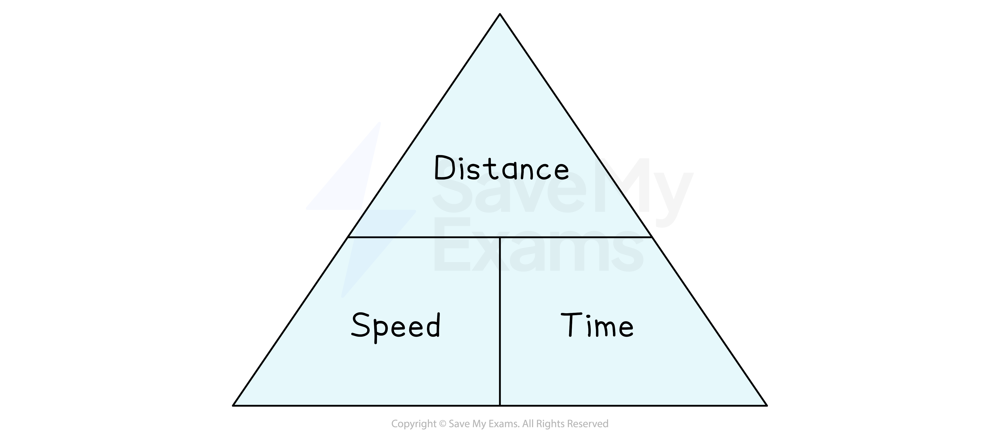

# Speed

## Speed

> **Spec point** — `spcpt_fjrhtKRwCZcZyHpP`

## Speed

### What is speed?

- **Speed** is equal to **distance **divided by **time**

- **Speed **is commonly measured in **metres per second** (**m/s**) or **kilometres per hour** (**km/h**)

  - The units indicate **speed** is **distance per time**
  $\mathrm{Speed}=\frac{\mathrm{Distance}}{\mathrm{Time}}$
- '**Speed**' (in this formula) means '**average** **speed**'
- The formula can be rearranged to

  - $\mathrm{Time}=\frac{\mathrm{Distance}}{\mathrm{Speed}}$
  - $\mathrm{Distance}=\mathrm{Speed}\times\mathrm{Time}$
- In harder problems there are often **two journeys **or **two parts to one longer journey**

### What is a formula triangle?

- A **formula triangle** shows the **relationship** between the** different measures** in a **compound formula**
- They can be useful if you are less confident with rearranging formulas
- For Speed, Distance and Time:

- If you are calculating a variable on the** top of the triangle**, multiply the two variables on the bottom

  - For example,  $\mathrm{Distance}=\mathrm{Speed}\times\mathrm{Time}$
- If you are calculating a variable on the **bottom of the triangle**, divide the top by the other variable on the bottom

  - For example,  $\mathrm{Speed}=\mathrm{Distance}\div\mathrm{Time}$  and  $\mathrm{Time}=\mathrm{Distance}\div\mathrm{Speed}$

> **Exam Hint**
> - Look out for a mixture of units
> 
>   - **Time** can be given as **minutes** but common phrases like '**half an** **hour'** (30 minutes) could also be used in the same question
>   - Any mixed units should be those in common use and easy to convert, e.g. **m** to **km **etc

> **Worked Example**
> (a) A runner completes a 10 km race in three quarters of an hour.
> 
> Find the average speed of the runner in metres per second. 
> Round your answer to 3 significant figures.
> 
> > *As the answer must be in metres per second, convert the distance to metres, and the time to seconds*
> 
> > *Multiply by 1000 to convert km to metres*
> 
> *10 km = 10 000 m*
> 
> > *Write the time in minutes, you could calculate this as* $\frac{3}{4}\times60\mathrm{mins}$
> 
> *Three quarters of an hour = 0.75 hrs = 45 mins*
> 
> > *Multiply by 60 to convert minutes to seconds*
> 
> *45 × 60 = 2 700 seconds*
> 
> > *Use the formula* $\mathrm{Speed}=\frac{\mathrm{Distance}}{\mathrm{Time}}$
> 
> $\mathrm{Speed}=\frac{10000m}{2700s}=3.703703...m/s$
> 
> > *Round to 3 significant figures*
> 
> **Final answer:** **3.70 m/s**
> 
> (b) A sprinter's average speed when running 100 m is 8.85 m/s.
> 
> Calculate the total time taken in seconds for the sprinter to run 100 m. 
> Round your answer to the nearest hundredth of a second.
> 
> > *The units are already in metres, and metres per second, so do not need converting to reach an answer in seconds*
> 
> > *Use the formula* $\mathrm{Speed}=\frac{\mathrm{Distance}}{\mathrm{Time}}$
> 
> $8.85m/s=\frac{100m}{\mathrm{Time}}$
> 
> > *Rearrange to make the time the subject*
> *Multiply both sides by time, and then divide both sides by the speed*
> 
> $\begin{gathered} 8.85 \times \text{Time} & = 100 \\ \text{Time} = \frac{100}{8.85} \\ \text{Time} & = 11.29943503... \end{gathered}$
> 
> > *Round to the nearest hundredth of a second (2 decimal places)*
> 
> **Final answer:** `equation`**11.30 s**
