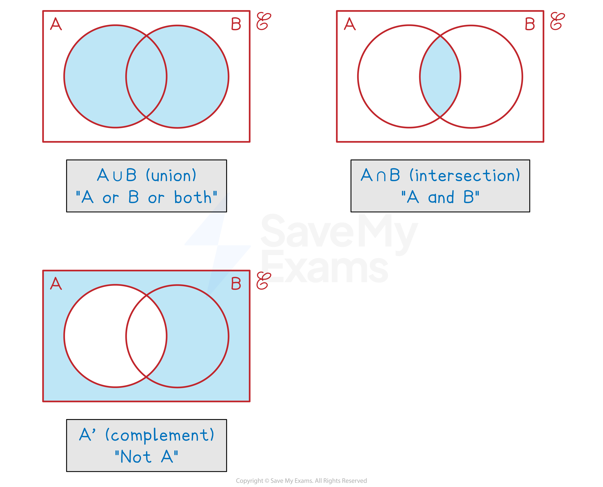

# Set Notation & Venn Diagrams

## Set Notation

> **Spec point** — `spcpt_STPtxxbX3N7dSZn4`

## Set notation

### What is a set?

- A set is a **collection of elements**

  - Elements could be anything
  
    - Numbers, letters, coordinates, ...
- You could describe a set by writing its elements inside **curly brackets** {}

  - {1, 2, 3, 6} is the set of factors of 6
- If the set of elements **follow a rule** then you can write this using a **colon inside the curly brackets** {... : ...}

  - The bit before the colon is the type of element
  - The bit after the colon is the rule
  
    - {*x* is a positive integer : *x*2 < 30} is the set of positive integers which, when squared, are less than 30
    - This is equal to {1, 2, 3, 4, 5}
  - The colon is often read as '**such that'**
  - If **no type** is specified, *x* can take **any value** (fractions, decimals, irrationals, ...)
  
    - {*x*: *x*2 < 30} means any value whose square is less than 30
  - A colon can also be replaced by a **vertical bar**
  
    - {*x* | *x*2 < 30}

### What do I need to know about set notation?

- $E$ is the **universal** set (the set of **everything**)

  - For example, if we are only interested in factors of 24 then $E$ = {1, 2, 3, 4, 6, 8, 12, 24}
  - You may see alternative notations used for $E$
  
    - U is a common alternative (different to $\cup$ for union!)
    - S or the Greek letter ξ (xi) may also be seen
- We use **upper case** letters to represent **sets** (*A*,*B*,*C*, ...) and **lower case** letters to represent **elements **(*a*,*b*,*c*, ...)
- n(*A*) is the **number of elements** in set *A*

  - For example, if $E$ = {1, 2, 3, 4, 5, 6, 7, 8, 9, 10}, *A* = {1, 4, 9}, *B* = {1, 2, 3, 4, 5, 6}
  n(*A*) = 3, n(*B*) = 6
- *A* $\cap$ *B*  means the **intersection** of *A* and *B* (the **overlap** of *A*  **and** *B*)

  - This is the set of elements that are in **both** set *A*  and set *B*
  *A* $\cap$ *B* = {1, 4}
- *A* $\cup$ *B* means the **union** of *A*  and *B*  (**everything** in *A*  **or** *B*  **or** both)

  - This is the set of elements that are in **at least one** of the sets
  - This **includes **elements in both sets (in the intersection)
  *A* $\cup$ B*  *= {1, 2, 3, 4, 5, 6, 9}
- *A'* means the **complement of *****A***

  - It is the **set** of all elements in the universal set $E$  that are **not in *****A***
  *A'*  = {2, 3, 5, 6, 7, 8, 10}

## Sets & Venn Diagrams

> **Spec point** — `spcpt_ffCvVFy6ppvSMNPD`

## Sets & venn diagrams

### What is a Venn diagram?

- A Venn diagram is a way to illustrate **all the elements within sets **and any** intersections **
- A Venn diagram consists of

  - a **rectangle** representing the **universal set (**$E$**)**
  - a **circle** for each **set**
  
    - Circles may or may not overlap depending on which **elements** are shared between **sets**

### What do the different regions mean on a Venn diagram?

- $A\cupB$  is represented by the regions that **are in** *A* or *B* or both
- $A\capB$  is represented by the region where the *A*  and *B* circles **overlap**

> **Worked Example**
> Two sets *A* and *B* are shown in the Venn diagram.
> 
> 
> 
> (a) Write down n(*A*).
> 
> **Answer:**
> 
> > *The elements of **A**  are anything inside the **A**  circle*
> 
> **A***  = {2, 6, 12, 14, 28}*
> 
> > *n(**A**) means the number of elements in **A*
> *There are 5 elements in **A*
> 
> **n(****A****) = 5**** **
> 
> (b) Use set notation to complete the sentence {14, 28} = ...
> 
> **Answer:**
> 
> > * 14 and 28 are the elements that are both in **A ** and **B*
> *This means they are in the intersection of **A ** and **B*
> 
> **Final answer:** **{14, 28} = ****A  ****∩ ****B**
> 
> (c) Write down the elements that are in set *A*  U *B*.
> 
> **Answer:**
> 
> > *A**  = {2, 6, 12, 14, 28} and **B**  = {7, 14, 21, 28, 35}*
> *A  **U **B  **is the set of elements that are in at least one of the sets *
> *For elements in both, only write them out once*
> 
> **Final answer:** **A****  ****U**** ****B ****= {2, 6, 7, 12, 14, 21, 28, 35}**
