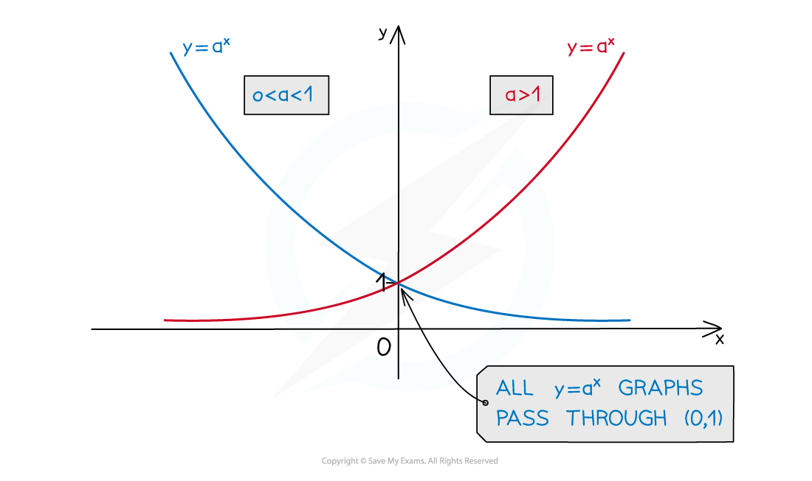

# Exponential Growth & Decay

## Exponential Growth & Decay

> **Spec point** — `spcpt_qqvSFN8pdPKVGKCR`

## Exponential Growth & Decay

The ideas of compound interest and depreciation can be applied to other (non-money) situations, such as increasing or decreasing populations.

### What is exponential growth?

- When a quantity **grows exponentially** it is **increasing** from an original amount by a scale factor (or percentage) each year for $x$ years

  - Some questions use a different timescale, such as each day, or each minute
- Real-life examples of exponential growth include:

  - Population increases
  - Bacterial growth
  - The number of people infected by a virus

### What is exponential decay?

- When a quantity** exponentially decays** it is **decreasing **from an original amount by a scale factor (or percentage) each year for $x$ years

  - Some questions use a different timescale, such as each day, or each minute
- Real-life examples of exponential decay include:

  - The temperature of hot water cooling down
  - The value of a car decreasing over time
  - Radioactive decay (the mass of a radioactive substance over time)

### How do I use models for exponential growth or decay?

- Scenarios which exponentially grow or decay can be **modelled with an equation**
- A useful format for this equation is

  - $y=a^{x}$
  
    - E.g. $y=4^{x}$ or $y=0.8^{x}$
  - If $a>1$ then it is exponential** growth**
  - If $0<a<1$ then it is exponential **decay**
  - $a$ cannot be negative
- $y=3^{x}$ could model the number of flies, $y$, in a population of flies, against the number of days, $x$

  - The initial number of flies, when $x=0$,  is $3^{0}=1$
  - After 2 days, the number would be $3^{2}=9$
  - After 4 days, the number would be $3^{4}=81$
  - From the values above, and the fact that $a>1$, this is **exponential growth**
- $y=0.5^{x}$ could model `equation`the radius of a water droplet, $y\mathrm{cm}$, as it evaporates where $x$ is measured in minutes

  - The initial radius of the droplet, when $x=0$,  is $0.5^{0}=1\mathrm{cm}$
  - After 2 minutes, the radius would be $0.5^{2}=0.25\mathrm{cm}$
  - After 4 minutes, the radius would be $0.5^{4}=0.0625\mathrm{cm}$
  - From the values above, and the fact that $0<a<1$, this is **exponential decay**

### How are exponential models related to exponential graphs?

- Plotting an **exponential model**, $y=a^{x}$, on a set of axes gives an **exponential graph** with the following shape

- The $y$**-intercept** is always 1

  - This is because the $y$-intercept is where $x=0$
  - $y=a^{0}=1$
- There is an **asymptote **at `equation`$y=0$ (the curve gets closer and closer to the *x*-axis without crossing it)

  - This is because there are no solutions to $0=a^{x}$

### Are there any other exponential models I may encounter?

- You may see exponential models in the form $y=ba^{x}$

  - The coefficient, $b$, scales (**stretches**) the graph **vertically**
  - The $y$-intercept will be $( 0 , b )$
  
    - This is because when $x=0$,  $y = b a^{0} = b ( 1 ) = b$
  - $b$ is the **initial **(starting) **amount **of the quantity being modelled

> **Exam Hint**
> - Look out for how the question wants you to give your final answer
> 
>   - It may want the final amount to the nearest thousand or to the nearest integer

> **Worked Example**
> A large population of birds increases exponentially according to the model
> 
> $N=1.04^{t}$
> 
> where $N$ is the number of birds, measured in thousands, and $t$ is the number of years.
> 
> Find the population after 13 years, giving your answer to the nearest hundred.
> 
> > *Substitute in* $t=13$
> 
> $N=1.04^{13}\,N=1.665073507...$
> 
> > *The question asks for the answer to the nearest hundred*
> *The question also states that* $N$ *is measured in thousands*
> 
> *1.665073507... × 1000 = 1665.073507... birds*
> 
> > *Round to nearest hundred*
> 
> **Final answer:** **1700**

> **Worked Example**
> The percentage of tickets still available for a concert is modelled approximately by the equation
> 
> $y=a^{x}$
> 
> Where $y$ is the percentage of tickets still available, as a decimal, and $x$ is the number of days since the tickets have been released.
> 
> (a) After 3 days, 51.2% of the tickets are still available. Find the value of `equation`$a$.
> 
> > $x$ *will be 3 (from 3 days)*
> $y$ *will be 0.512 (as the percentage is written as a decimal in this model)*
> *Substitute these values into the model*
> 
> $0.512=a^{3}$
> 
> > *Find* $a$ *by taking the cube root of both sides*
> 
> $\begin{gathered} \sqrt[3]{0.512} & = a \\ 0.8 & = a \end{gathered}$
> 
> $a=0.8$
> 
> (b) What percentage of tickets remain after 2 weeks? State your answer to three significant figures.
> 
> > *Now that* $a$ *is known, the full equation of the model is*
> 
> $y=0.8^{x}$
> 
> > $x$ *is measured in days*
> 
> *2 weeks = 2 × 7 = 14 days*
> 
> > *Substitute in* $x=14$
> 
> $y=0.8^{14}=0.04398046511...$
> 
> > *Turn this into a percentage by multiplying by 100*
> 
> *4.398046511... %*
> 
> > *Round to three significant figures*
> 
> **Final answer:** **4.40 %**
> 
> (c) State one reason why this model may not be appropriate for the scenario.
> 
> **Final answer:** **The value of ****y**** can never reach zero (there is an asymptote at **$y=0$**). **
> **The model suggests that the tickets never truly run out (which is unrealistic).**
