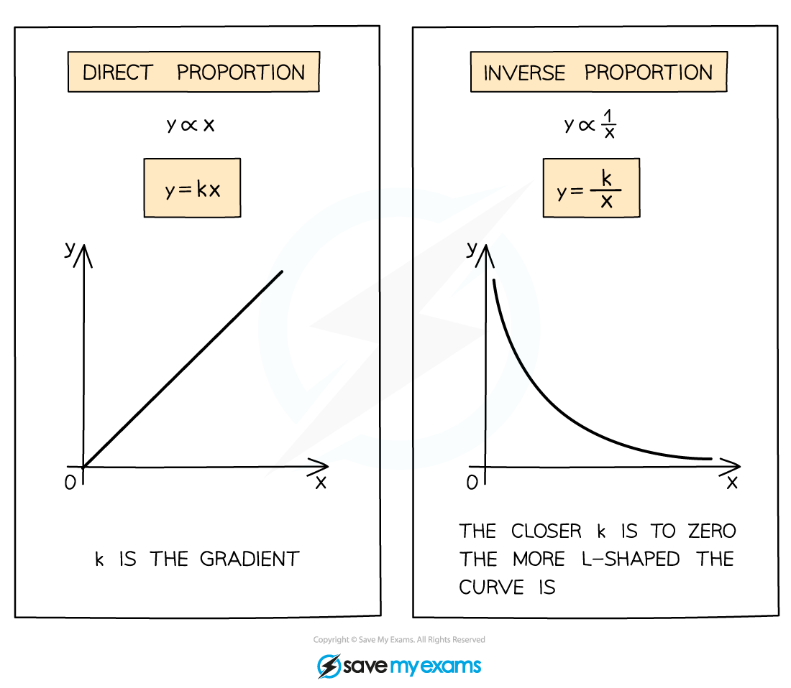

# Variation Models

## Variation Models

> **Spec point** — `spcpt_Vy3hcHd5KHJCvYNJ`

## Variation Models

### What is a variation model?

- A **variation**, or **proportion**, model describes how one quantity varies with another
- For example:

  - $y=kx$ is a **linear **variation model and shows **direct proportion**
  - $y=kx^{2}$ is a **quadratic **variation model
  - $y=kx^{3}$ is a **cubic **variation model
  - $y=\frac{k}{x}$ is a **reciprocal **variation model and shows **inverse proportion**

### How do I use a variation model to find missing data values?

- The equation of a variation model is an equation of a curve or line that models a set of **data**

  - Substitute in the *x*-values to find the *y*-values (or the other way around)
- If you are not given the equation, you may have to find it **using the data** given

  - E.g. If you are told the model is linear, you can substitute a known pair of *x* and *y* values into $y=kx$ to find $k$
  - You can then use the full equation to find any missing values

> **Worked Example**
> Consider the following table of data.
> 
> | $x$ | 1 | 3 | $q$ |
> |---|---|---|---|
> | $y$ | 36 | $p$ | 9 |
> 
> Given that $y$ is inversely proportional to $x$, find the values of $p$ and $q$.
> 
> > *As* $y$ *is inversely proportional to* $x$ *we can write the equation*
> 
> $y=\frac{k}{x}$
> 
> > *Substitute the pair of known values into the equation to find* $k$
> 
> $\begin{gathered} 36 = \frac{k}{1} \\ k = 36 \end{gathered}$
> 
> > *So the full equation of the variation model is*
> 
> $y=\frac{36}{x}$
> 
> > *Substitute in* $x=3$ *to find* $p$
> 
> $p=\frac{36}{3}=12$
> 
> $p=12$
> 
> > *Substitute in* $y=9$ *to find* $q$
> 
> $\begin{gathered} 9 = \frac{36}{q} \\ 9 q & = 36 \\ q = \frac{36}{9} = 4 \end{gathered}$
> 
> $q=4$

### How do I identify the best variation model for given data?

- You may be asked to select the **most suitable variation model** for given data
- Using the data to **sketch a rough graph** is one way to do this

  - You could do this on your graphic display calculator
  
    - E.g. a U-shaped graph could suggest a quadratic variation model, $y=kx^{2}$
- If you are given a **suggested variation model** (or must choose the most suitable from several) you should **test the values** using the given data

  - **Substitute **the value of *x* into the suggested model, and see how close the result is to the actual value of *y* in the table
  - Do this for at least 3 data points
  - You will then be able to judge if the suggested model is appropriate, or select the best one

> **Worked Example**
> Consider the data in the table below.
> Decide which out of a linear, quadratic, or cubic variation model would be most suitable for the data, and use this to find an equation for $y$ in terms of $x$.
> 
> | $x$ | 2 | 4 | 6 |
> |---|---|---|---|
> | $y$ | 20 | 80 | 180 |
> 
> > *Start by checking if the model is linear,* $y=kx$
> 
> > *Using the first data point to find* $k$
> 
> $\begin{gathered} 20 = k \times 2 \\ k = 10 \end{gathered}$
> 
> > *Use this to check the second data point*
> 
> $y = 10 x
> y = 10 ( 4 ) = 40$
> 
> *Not close to 80, so not linear*
> 
> > *Consider if the model is quadratic,* $y=kx^{2}$
> 
> > *Use the first data point to find* $k$
> 
> $\begin{gathered} 20 = k \times 2^{2} \\ 20 = 4 k \\ k = 5 \end{gathered}$
> 
> > *Use this to check the second data point*
> 
> $\begin{gathered} y = 5 x^{2} \\ y = 5 ( 4 )^{2} = 80 \end{gathered}$
> 
> > *It works for the second point, now check the third*
> 
> $y = 5 ( 6 )^{2} = 180$
> 
> > *Also correct for the third point, so this is an appropriate variation model*
> 
> **Final answer:** **A quadratic variation model is suitable**
> 
> **Final answer:** **Its full equation is  **$y=5x^{2}$
> 
> > *If a cubic model is tested,* $y=kx^{3}$*, the first point produces the equation* $y=\frac{5}{2}x^{3}$ *but this does not model the other two data points accurately*

> **Worked Example**
> Two variation models are suggested for the data in the table below.
> 
> Model A:   $y=\frac{400}{x^{2}}$
> 
> Model B:    $y=\frac{800}{x^{3}}$
> 
> | $x$ | 5 | 6 | 10 | 15 |
> |---|---|---|---|---|
> | $y$ | 25 | 15 | 3 | 2 |
> 
> Determine which variation model is more suitable.
> 
> > *Add a row to the table for each of the suggested models*
> 
> > *Use the same given values of* $x$ *(5, 6, 10, 15) to calculate the* $y$ *values that each model predicts*
> 
> > *E.g. To find the* $y$ *value that model A predicts for* $x=5$
> 
> $y=\frac{400}{5^{2}}=16$
> 
> | $x$ | 5 | 6 | 10 | 15 |
> |---|---|---|---|---|
> | $y$ | 25 | 15 | 3 | 2 |
> | `equation`*Model A:* $y=\frac{400}{x^{2}}$ | *16* | *11.111...* | *4* | *1.777...* |
> | *Model B:* $y=\frac{800}{x^{3}}$ | *6.4* | *3.703...* | *0.8* | *0.237...* |
> 
> > *Compare the modelled* $y$ *values to the actual* $y$ *values*
> 
> > *The values for Model A are much closer to the actual values than Model B*
> 
> **Final answer:** **Model A is more suitable**
