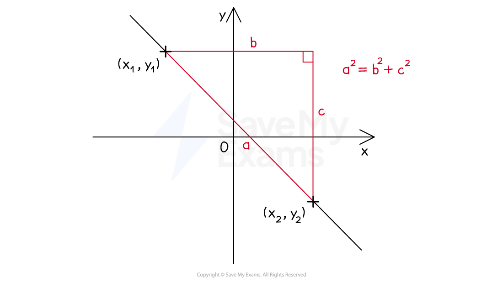

# Length of a Line

## Length of a Line

> **Spec point** — `spcpt_hMqjBRzQQfvsc9f8`

## Length of a line

### How do I calculate the length of a line?

- The **distance between two points** with coordinates `(x_ 1 comma y_ 1)` and `(x_ 2 comma y_ 2)` can be found using the formula

`d=√((x_ 1−x_ 2)²+(y_ 1−y_ 2)²)`

- This formula uses** Pythagoras’ theorem**  $a^{2}+b^{2}=c^{2}$

  - It is applied to the difference in the $x$-coordinates and the difference in the $y$-coordinates

> **Exam Hint**
> Be extra careful when negative coordinates are involved. It can help to put negative numbers in brackets to make your working clearer, e.g. `(−6)−(−8)=2`.

> **Worked Example**
> Point *A* has coordinates (3, -4) and point *B* has coordinates (-5, 2).
> 
> Calculate the distance of the line segment *AB*.
> 
> **Answer:**
> 
> > *Using the formula for the distance between two points,* `d=√((x_ 1−x_ 2)²+(y_ 1−y_ 2)²)`* *
> 
> > *Substitute in the two given coordinates*
> 
> `d=√((3−(−5))²+((−4)−2)²)`
> 
> > *Be careful with the negative numbers*
> `3−(−5)=8` *and* `(−4)−2=−6`
> 
> > *Simplify*
> 
> `d=√((8)²+(−6)²)=√(64+36)=√(100=10`
> 
> **Final answer:** **10 units**
