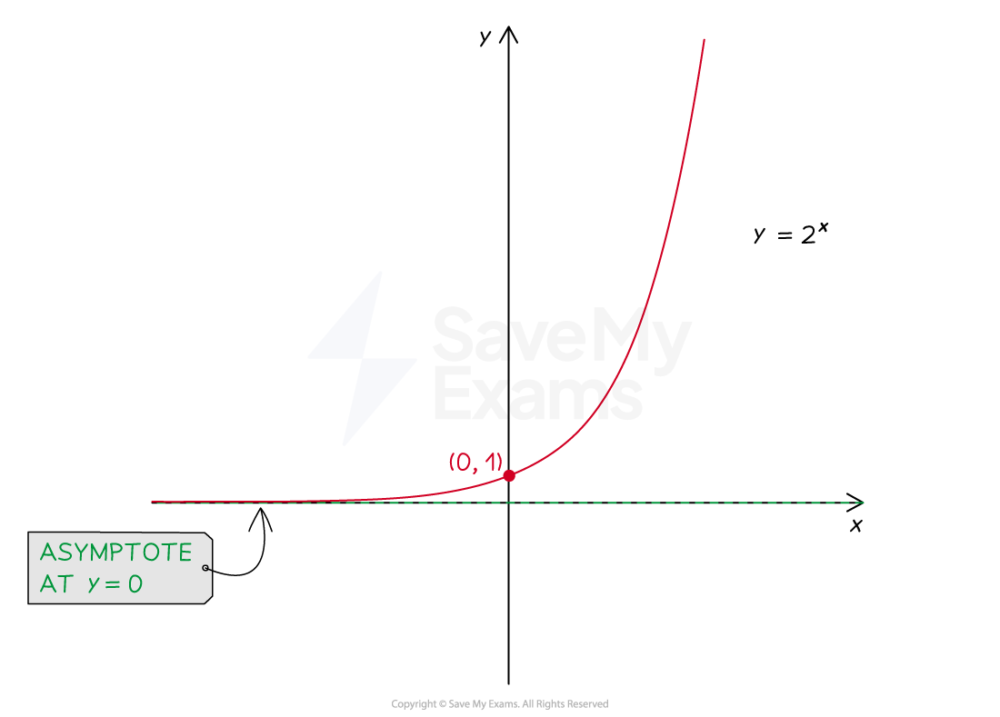
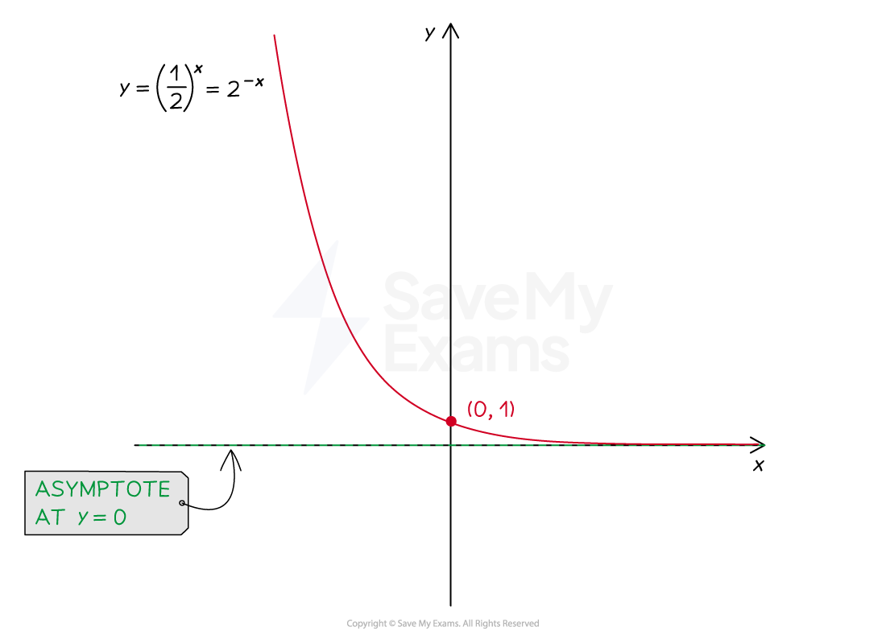
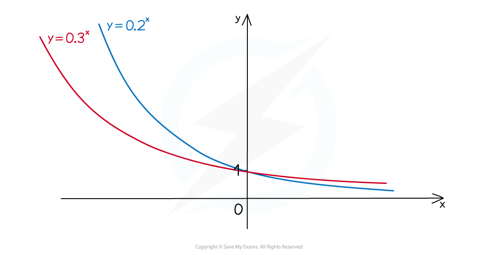

# Exponential Graphs

## Exponential Graphs

> **Spec point** — `spcpt_ry7yDNdQZ7hsVXRY`

## Exponential Graphs

### What is an exponential graph?

- An** exponential** graph is of the form $y=a^{x}$

  - When $a>1$, $y=a^{x}$ represents **exponential growth**
  
    - Values of *y* increase as *x* increases
  - When $0<a<1$, $y=a^{x}$ represents **exponential decay**
  
    - $a$ is positive but** less than 1**
    - Values of *y* decrease as *x* increases

- Graphs of both **exponential growth** and **exponential decay**

  - have a **horizontal *****asymptote*** at $y=0$
  - **do not **have a **vertical asymptote**
  - have a $y$-intercept of $( 0 , 1 )$

- **Exponential decay** can also be identified by a **negative power **using **index laws**

  - $( 1 \frac{1}{2} )^{x = ( 2^{-1} } )^{x = 2^{-x} }$
  - This  has the form $y=a^{-x}$ where $a>1$

### How do I compare exponential graphs?

- For** **$y=a^{x}$** **where** **$a>1$: 

  - The graph with a higher value of $a$ is the “higher” graph for $x>0$
  
    - but the "lower" graph for $x<0$
- For** **$y=a^{x}$** **where** **$0<a<1$:

  - The graph with a higher value of $a$ is the “higher” graph for $x>0$
  
    - but the "lower" graph for $x<0$

> **Worked Example**
> (a) Identify the equation that shows exponential decay.
> 
> A: $y=4^{2x}$
> 
> B: $y=\frac{6}{x}$
> 
> C: $y=0.3^{x}$
> 
> D: $y=5x^{3}$
> 
> > *A is an exponential graph as the **x** is in the power*
> *The base number is greater than 1 so it is** exponential growth **(not decay)*
> 
> > *B has the **x** as the denominator in a fraction*
> *It is a reciprocal graph*
> 
> > *C is an exponential graph as the **x** is in the power*
> *The base number is between 0 and 1 so it is** exponential decay*
> 
> > *D has** x** raised to the power 3*
> *It is a cubic graph*
> 
> **Final answer:** **C:**** **$y=0.3^{x}$** shows exponential decay**
> 
> (b) On the same set of axes, sketch the graphs of  $y=3^{x}$  and  $y=4^{x}$.
> 
> *Both graphs will have the "typical"* $y=a^{x}$ *exponential growth shape for* $a>1$
> 
> > $y=4^{x}$ *will be the "higher" graph for* $x>0$ *and "lower" graph for* $x<0$
> 
> > *Both graphs go through* $( 0 , 1 )$ *and have an asymptote along the* $x$*-axis*
> 
> 
