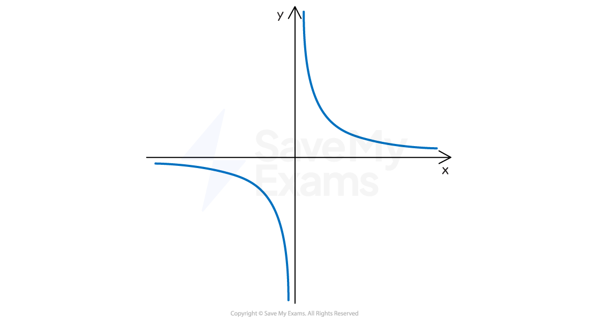
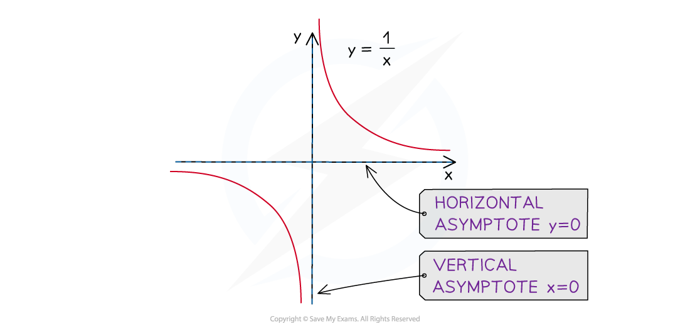

# Reciprocal Graphs

## Reciprocal Graphs

> **Spec point** — `spcpt_xVgvkMgFJmrrTsM9`

## Reciprocal Graphs

### What is a reciprocal graph?

- A **reciprocal** graph is of the form $y=\frac{a}{x}$

  - It does **not **have a** *****y*****-intercept**
  - and** **does** not **have any** roots**
  - This means that the curve **does not cross** either the ***x-***** or *****y*****-axes**

### What are the asymptotes on a reciprocal graph?

- An **asymptote** is a line on a graph that a curve becomes closer and closer to but never touches

  - These may be** horizontal or vertical** lines
- A reciprocal graph has **two asymptotes**

  - A **horizontal** asymptote along the *x*-axis (with** equation** $y=0$)
  
    - This is the **limiting value** of *y* when the value of *x* gets very large (either positive or negative)
  - A **vertical** asymptote along the *y*-axis (with **equation** $x=0$)
  
    - This shows the **problem** of trying to **divide by zero**

### What about graphs of the form y = a/x + b ?

- The reciprocal graph, $y=\frac{a}{x}+b$ (where $a$ and $b$ are both constants)

  - is the **same shape** as $y=\frac{a}{x}$
  - but is **shifted upwards** by $b$ units
  
    - $y=\frac{1}{x}+2$ would be $y=\frac{1}{x}$ shifted **up** by 2 units
    - $y=\frac{4}{x}-3$ would be $y=\frac{4}{x}$ shifted **down** by 3 units
  - This means the **horizontal asymptote** also **shifts up** by $b$ units,
  
    - The **equation** of the horizontal asymptote is $y=b$
    - $y=\frac{5}{x}+6$ would have a horizontal asymptote of $y=6$
    - $y=\frac{1}{x}-7$ would have a horizontal asymptote of $y=-7$
  - The** vertical asymptote** remains along the ***y*****-axis**
  
    - The **equation **of the vertical asymptote is $x=0$
    - $y=\frac{3}{x}+9$ would have a vertical asymptote of $x=0$

> **Worked Example**
> The diagram below shows the graph of $y=\frac{2}{x}-4$.
> 
> 
> 
> (a) Write down the equation of the horizontal asymptote.
> 
> > *A reciprocal graph of the form* $y=\frac{a}{x}+b$ *will have a horizontal asymptote at* $y=b$
> 
> $y=-4$
> 
> (b) Write down the equation of the vertical asymptote.
> 
> > *A reciprocal graph of the form* $y=\frac{a}{x}+b$* will always have a vertical asymptote along the **y**-axis*
> 
> $x=0$
