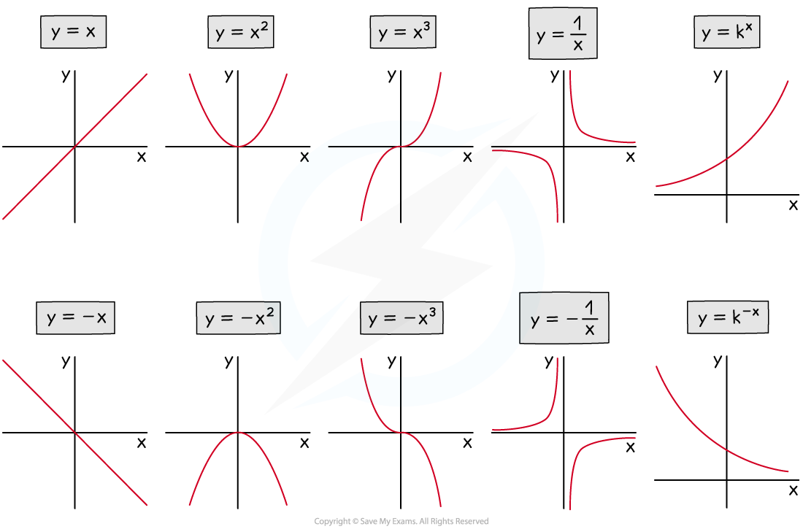

# Using Calculators to Sketch Graphs

## Using Calculators to Sketch Graphs

> **Spec point** — `spcpt_CZjxXXvnG72P6Dn5`

## Using Calculators to Sketch Graphs

### How do I draw graphs on my graphic display calculator?

- Navigate on your calculator to the **Add Graphs** button

  - You may need to start a new document first
  - On some models you will need to select **graph mode** in the menu
- Enter the **equation **of the function on the line **f(x)= **

  - This is the function, `straight f open parentheses x close parentheses`
  - On other models it may be labelled as **f1(x)=** or **Y1:**
- Press **enter** or **EXE** and the graph should appear

  - You may need to go to the menu or press the **zoom** button to zoom in or out
  
    - The "**zoom - fit**" button (or equivalent) automatically zooms for you on the key features
    - Other models may also have a "**V-Window**" menu where you can select the exact range of values to show

### How do I find graph features using my graphic display calculator?

- Once the graph is drawn, go to the menu and select **analyze graph** (or equivalent), which gives a list of options

  - Other models may feature a **G-Solv** button
- **Zeros (or roots):** these are the ***x*****-intercepts**

  - You may have to click before and after the *x*-intercept you require so that the calculator knows **where to search**
  - **y-intercepts **can be found **without a calculator** by substituting $x=0$ into `straight f open parentheses x close parentheses`
  
    - though some models do include a **Y-ICEPT** button which can be used
- **Maximum or minimum points:** these are the coordinates of the **highest point** and **lowest point** on the graph

  - You may have to click before and after the point you require so that the calculator knows where to search
  - These can be called **local maxima** or** local minima**
  - They are also referred to as **turning points**
  
    - or the **vertex** if talking about a **quadratic** graph

### How do I sketch a graph in the exam from my graphic display calculator?

- Exam questions may ask you to **sketch **the graph on a given blank set of axes

  - You do** not **need to **plot** points exactly
  
    - and you do **not** need a** table** of values
  - **Draw** a **single** **smooth freehand **curve that copies the shape of the curve on your graphic display calculator
  
    - Do **not** use a ruler for curves!
    - Copy any **key features **and **symmetries**

- Exam questions may ask you to use your calculator to sketch an **unknown function** that you have not seen before

### How do I create a table of values on my graphic display calculator?

- Your calculator can create **tables of values** for you, if needed
- Find the** table** function

  - Type in the** **graph **equation **(the** function**, f(x)=)
  - Enter the **start** value (or equivalent)
  
    - The first *x*-value in the table
  - Enter the **end** value (or equivalent)
  
    - The last *x*-value in the table
  - Enter the **step size **(or equivalent)
  
    - How big the steps (gaps) are from one *x*-value to the next
  - You may have to select **SET** to set the above values
  - Press **enter **or **EXE **to see the table of values

> **Exam Hint**
> - Exam questions will say "draw this graph on your calculator" to make it clear when using a calculator is intended

> **Worked Example**
> (a) Draw the graph of $y=2x^{2}-4x-6$ on your calculator and use it to sketch the curve on the axes provided, showing coordinates of all axes intercepts and any maximum or minimum points.
> 
> > *Start a new graph on your calculator and enter *`straight f open parentheses x close parentheses equals 2 x squared minus 4 x minus 6`* to generate the graph*
> *This shows the curve has a minimum point (not a maximum point)*
> 
> > *Select the option to "analyze" the graph (this may be labelled as G-Solv)*
> *Choose the option "zeros" (or roots) to find the **x**-intercepts*
> *Choose the option "minimum" (or equivalent) to find the coordinates of the minimum point*
> 
> > *The question asks for all axes intercepts, so this includes the **y**-intercept*
> *Substitute *$x=0$* into *`straight f open parentheses x close parentheses equals 2 x squared minus 4 x minus 6`* to get -6 *
> *(or you can use the Y-ICEPT button on some models)*
> 
> > *Show all the above information on a sketch using coordinates*
> 
> 
> 
> (b) Match the following curve equations to the sketches below. You may use your graphic display calculator in this question.
> 
> **(1)  **$y=0.6x+2$**    (2)  **$y=3^{x}$**    (3)  **$y=-0.7x^{3}$**    (4)  **$y=\frac{4}{x}$**   (5)  **$y=-x^{2}+3x+2$
> 
> 
> 
> > *(1)** is a straight line equation (**y** = **mx **+ **c**) so must match graph **D*
> 
> > *(2) **requires plotting on a graphic display calculator to see that it is A*
> 
> > *(3) **requires plotting on a graphic display calculator to see that it is E*
> 
> > *(4)** requires plotting on a graphic display calculator to see that it is B*
> 
> > *(5) is a quadratic equation with a negative coefficient so matches graph C*
> 
> > *When plotting these graphs on your calculator, you may need to use the zoom function or V-Window button to see the overall shapes of the graphs*
> 
> **Final answer:** **(1) → D**
> **(2) → A**
> **(3) → E**
> **(4) → B**
> **(5) → C**
