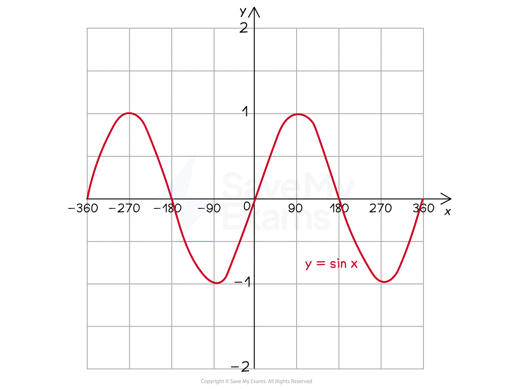
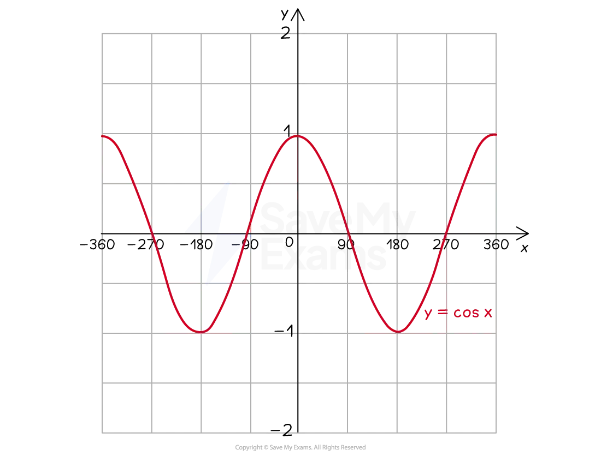
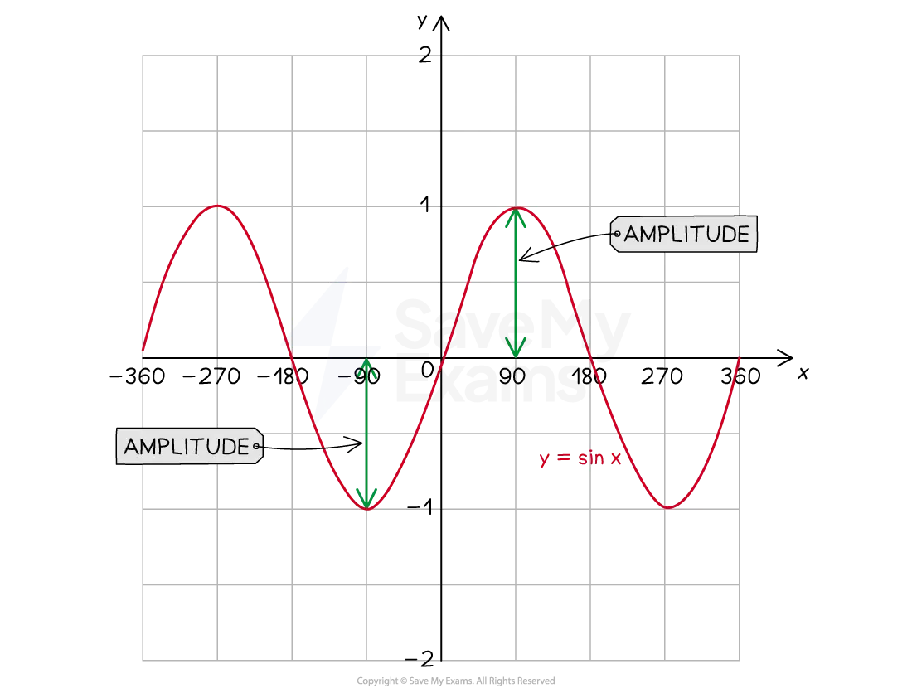
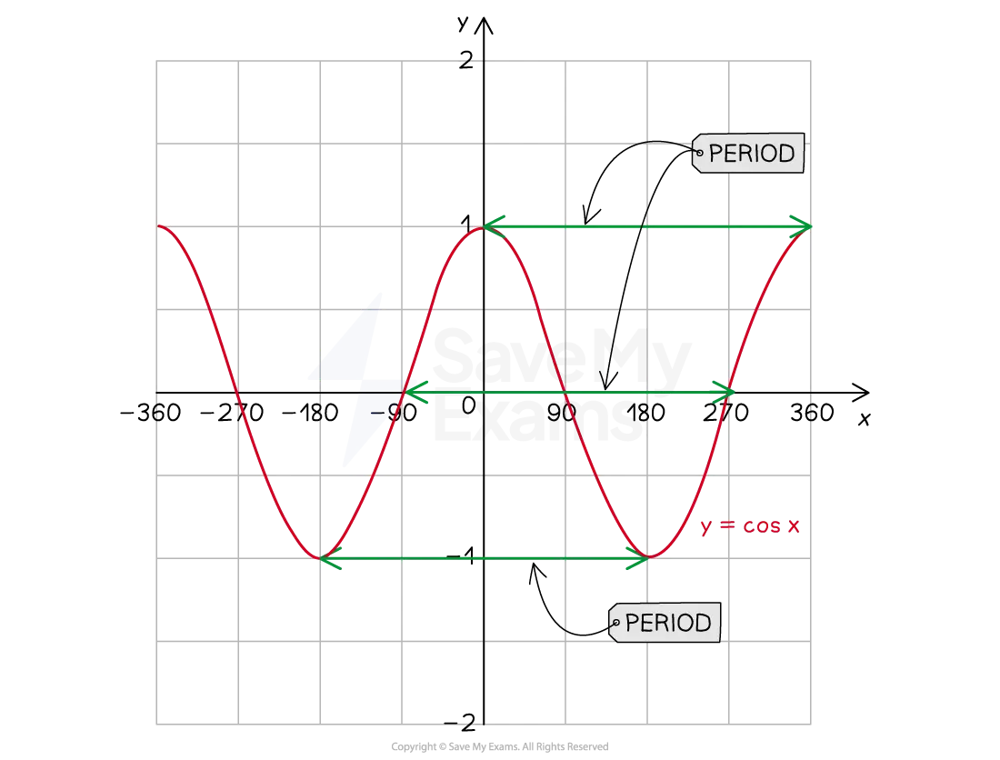

# Periods & Amplitudes

## Periods & Amplitudes

> **Spec point** — `spcpt_SHcsvHT2wCm9TyHj`

## Periods & Amplitudes

### What are oscillating graphs?

- The **sine** and **cosine **graphs are *oscillating* graphs

  - Both graphs oscillate between** a maximum and a minimum point**
  - A cycle is completed when the graph returns an initial starting point
  - The cycle is **repeated indefinitely** in both the positive and negative *x* directions

### What are the features of oscillating graphs?

- An oscillating graph has the following key features:

  - The** amplitude** is half the vertical distance from the maximum point to the minimum point
  
    - This is the distance from the `equation`horizontal line of symmetry (often the *x*-axis) to the minimum or maximum point
  - E.g. For the graph $y=\mathrm{sin}x$ the amplitude is 1

- The **period** is the distance along the* x*-axis to complete a full oscillation

  - Maximum point to maximum point
  - Minimum point to minimum point
  - *x*-intercept to next but one *x*-intercept
  - E.g. For the graph $y=\mathrm{cos}x$ the period is 360º

### How do I draw an oscillating graph from its equation?

- An oscillating function has **equation**

  - $\mathrm{f} ( x ) = a \sin ( b x )$
  - $\mathrm{f} ( x ) = a \cos ( b x )$
- The $a$ represents the **amplitude** of the function

  - The bigger the value of $a$ the bigger the **range** of values of the function
  - E.g. For the graph $y=5\mathrm{cos}x$
  
    - The amplitude is 5 units
    - The distance from the *x*-axis (horizontal line of symmetry) to the maximum/minimum point would be 5 units
  - E.g. For the graph $y=2+\frac{1}{5}\mathrm{cos}x$
  
    - The amplitude is $\frac{1}{5}$ of a unit
    - The vertical distance from the line $y=2$ to the maximum/minimum point would be $\frac{1}{5}$ of a unit
- The $b$* *determines the **period** of the function

  - The bigger the value of $b$* *the **quicker** the function repeats a cycle
  - The period is $\frac{360^{\circ}}{b}$
  
    - A **larger value** of $b$ produces a **shorter period**
  - E.g. For the graph $y = \sin ( 2 x )$
  
    - The period is $\frac{360}{2}=180^{\circ}$
    - The graph has been 'squashed' by a factor of 2 horizontally
    - Two complete cycles will occur in an interval of $360^{\circ}$
  - E.g. For the graph $y = \sin ( 1 \frac{1}{2} x )$
  
    - The period is $\frac{360}{\frac{1}{2}}=360\times\frac{2}{1}=720^{\circ}$
    - The graph has been 'stretched'
    - Half a cycle will occur in an interval of $360^{\circ}$

> **Exam Hint**
> - You can use your **graphic display calculator **to help you interpret or compare trigonometric graphs

> **Worked Example**
> The diagram below shows the graph with equation $y = a \sin ( b x )$, where $a$ and $b$ are integer values.
> 
> 
> 
> (a) Write down the period.
> 
> > *The graph intersects the **x** axis at 0, then again at 45º and again at 90º*
> 
> > *One full cycle is complete over an interval of 90º*
> 
> **Final answer:** **Period = 90º**
> 
> (b) Write down the amplitude.
> 
> > *The graph goes to a maximum of 3 and a minimum of -3*
> 
> **Final answer:** **Amplitude = 3**
> 
> (c) Write down the values of $a$ and $b$.
> 
> > $a$* is the amplitude*
> 
> > *The period is *$\frac{360^{\circ}}{b}$* *
> 
> $\begin{gathered} 90 = \frac{360}{b} \\ b = \frac{360}{90} \\ b = 4 \end{gathered}$
> 
> $a=3\,b=4$
> 
> (d) Give a reason as to why the picture cannot be modelled by $y = a \cos ( b x )$.
> 
> **Final answer:** **The curve in the diagram goes through the origin **$(0,0)$
> ** but a curve with equation of the form **$y=a\mathrm{cos}(bx)$
> **would intercept the ****y****-axis at **$(0,a)$
> 
> **Any suitable reason as to how a cosine graph is different from a sine graph**
