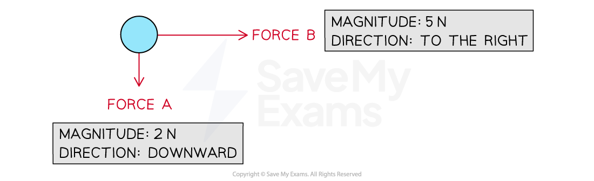
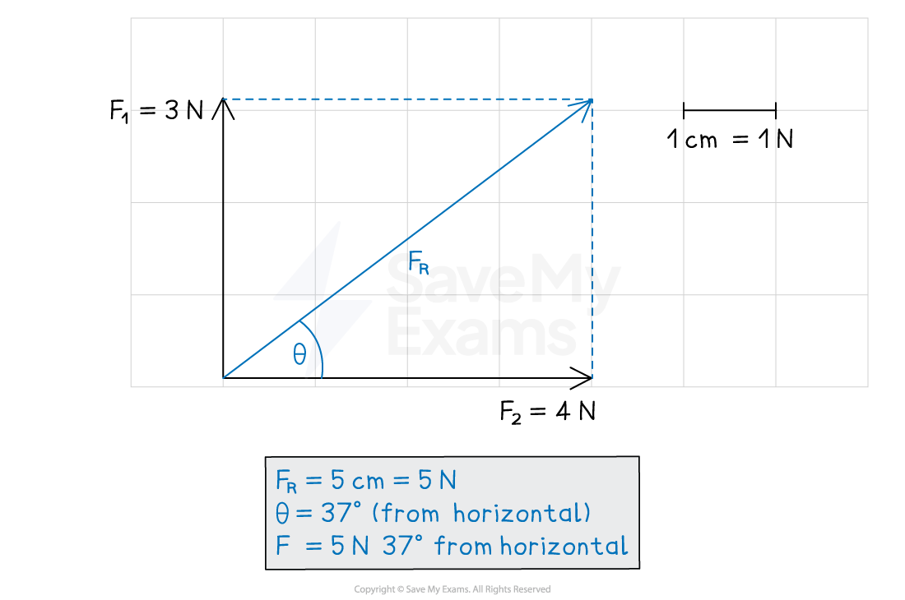
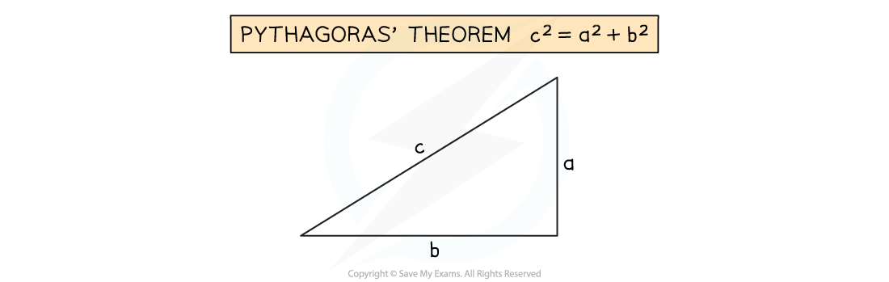

# Calculating with Vectors

## Calculations with vectors

> **Spec point** — `spcpt_fSr68tCctvBN4HFP` · Determine, by calculation or graphically, the resultant of two vectors at right angles, limited to forces or velocities only

## Calculations with vectors

### Extended Tier Only

- **Vectors** can be drawn using **vector diagrams**

### Vector diagrams

- **Vectors** are represented by an arrow

  - The **length** of the arrow represents the **magnitude**
  - The **direction** of the arrow indicates the **direction **
  - The **scale **of the arrows should be **proportional **to the relative magnitudes of the forces
  
    - An arrow for a 4 N force should be twice as long as an arrow for a 2 N force

#### Vector diagram of two forces acting on an object

*The lengths of the arrows are proportional to the magnitude of the forces, and show the direction that forces act in*

### Calculating vectors graphically

- Vector diagrams can be used to combine vectors
- Vectors at **right angles** to one another can be **combined** into one **resultant vector**

  - The resultant vector will have the combined effect of the two original vectors
  - For example, a resultant force vector will have the combined effect of two component forces
- **Component **vectors are sometimes drawn with a dotted line and a **subscript **indicating horizontal or vertical

  - A force $F$, for example, may have two components:
  
    - $F_{V}$ is the vertical component of the force $F$
    - $F_{H}$ is the horizontal component of force $F$

- To calculate vectors graphically means carefully producing a scale drawing with all lengths and angles correct

  - This should be done using a sharp** pencil**, **ruler **and **protractor**
- Follow these steps to carry out calculations with vectors using a scale drawing:

1. Choose a **scale** which fits the page

  - For example, use 1 cm = 10 m/s or 1 cm = 1 N, so that the diagram is around 10 cm high
2. Draw the vectors at **right angles** to one another
3. Complete the rectangle
4. Draw the **resultant vector** diagonally from the origin
5. Carefully **measure the length** of the resultant vector
6. Use the scale factor to calculate the **magnitude**
7. Use the protractor to measure the** angle**

*Vectors can be measured or calculated graphically using scaled vector diagrams*

### Combining vectors by calculation

- In this method, a vector diagram is still essential, but it does **not **need to be exactly to scale
- The vector diagram can take the form of a sketch, as long as the resultant side and component sides are clearly labelled

*Using a vector diagram to resolve two force vectors F1 and F2 into a resultant force vector FR*

- When the magnitudes of the two vectors at right angles are known, then **Pythagoras' theorem** can be used to find the magnitude of the missing vector

  - Using Pythagoras' theorem, the magnitude of *F**R* is related to the magnitudes of *F**1* and *F**2* by

$F_{R}^{2}=F_{1}^{2}+F_{2}^{2}$

*Pythagoras' theorem states that the square of the hypotenuse is equal to the sum of the squares of the other two sides*

- **Trigonometry **can then be used to find the angle of the resultant vector

*Trigonometry relates the side lengths to the angles of right-angled triangles*

- Two vectors at right angles to each other represent the opposite and adjacent sides of a right-angled triangle $\mathrm{tan}θ=\frac{\mathrm{opposite}}{\mathrm{adjacent}}$ $\mathrm{tan}θ=\frac{F_{1}}{F_{2}}$
$\theta = \text{tan} ^{ - } 1 ( \frac{F_{1}}{F_{2}} )$

  - The tangent function relates the opposite and adjacent sides of a right-angled triangle by

  - Therefore, the angle of *F**R* can be calculated by

> **Worked Example**
> A force acts on an object with 60 N to the right. A second force of 100 N acts on the same object in the upward direction.
> 
> Calculate the resultant force acting on the object.
> 
> [4]
> 
> **Answer:**
> 
> **Step 1: Draw a vector diagram**
> 
> 
> 
> **Step 2: Calculate the magnitude of the resultant force using Pythagoras' theorem**
> 
> $F^{2}=60^{2}+100^{2}$ **[1 mark]**
> 
> $F=\sqrt{60^{2}+100^{2}}$
> 
> $F=\sqrt{13600}$
> 
> $F=117N$ **[1 mark]**
> 
> **Step 3: Calculate the direction of the resultant vector using trigonometry**
> 
> 
> 
> $\mathrm{tan}θ=\frac{\mathrm{opposite}}{\mathrm{adjacent}}$
> 
> $\mathrm{tan}θ=\frac{100}{60}$
> 
> $\\theta = \tan ^{- 1} ( \frac{100}{60} ) = 59^{\circ}$ **[1 mark]**
> 
> **Step 4: State the final answer, complete with magnitude and direction**
> 
> $F=117N\mathrm{at}59^{\circ}$ from the horizontal **[1 mark]**

> **Exam Hint**
> If the question specifically asks you to use the calculation or graphical method, you must solve the problem as asked. However, if the choice is left up to you, then any correct method will lead to the correct answer.
> 
> Remember to give both the **magnitude** of the resultant vector **and** its **direction**. The resultant of two vectors is limited to **forces** and **velocities** only in this course.
