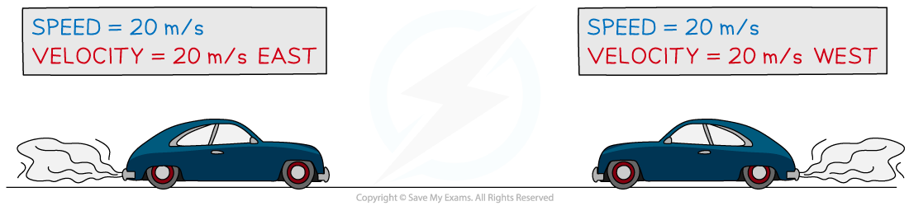

# Speed & Velocity

## Speed

> **Spec point** — `spcpt_KMFnbwzFtjsPrYx5` · Define speed as distance travelled per unit time;
recall and use the equation v = s/t

## Speed

- The **speed** of an object is defined as

** Distance travelled per unit time**

- Speed is a **scalar** quantity

  - This is because it only contains a **magnitude **(without a direction)
- For objects that are moving at a **constant speed**, the equation for calculating speed is:

$v=\frac{s}{t}$

- Where:

  - $v$ = speed, measured in metres per second (m/s)
  - $s$ = distance travelled, measured in metres (m)
  - $t$ = time, measured in seconds (s)

## Average speed

> **Spec point** — `spcpt_X2dDDtxnWRWyX8gm` · Recall and use the equation average speed = total distance travelled / total time taken

## Average speed

- The **speed **of an object can **vary **throughout its journey
- Therefore, it is often more useful to know an object's **average speed**

### Examples of average speeds

- Average walking speed = 1.5 m/s
- Average running speed = 3 m/s
- Average cycling speed = 6 m/s

*An experienced hiker might have an average speed of 2.0 m/s, whereas a particularly excited bumble bee can have average speeds of up to 4.5 m/s *

- A car travels at different instantaneous speeds throughout its journey

  - The car speeds up and slows down
  - The car may stop at junctions and traffic lights
- The average speed of the journey of the car can be found by dividing the total distance travelled by the total time taken

- The equation for calculating the **average speed** of an object is:

$\mathrm{Average} \mathrm{speed}=\frac{\mathrm{total} \mathrm{distance} \mathrm{travelled}}{\mathrm{total} \mathrm{time} \mathrm{taken}}$

- **Average speed** considers the **total distance travelled** and the **total time taken**

*Formula triangle for average speed, distance travelled and time taken*

> **Worked Example**
> Planes fly at typical average speeds of around 250 m/s.
> 
> Calculate the distance travelled by a plane moving at this average speed for 2 hours.
> 
> [3]
> 
> **Answer:**
> 
> **Step 1: List the known quantities**
> 
> - Average speed = 250 m/s
> - Time taken = 2 hours
> 
> **Step 2: Write the relevant equation**
> 
> $\mathrm{average} \mathrm{speed}=\frac{\mathrm{total} \mathrm{distance} \mathrm{travelled}}{\mathrm{total} \mathrm{time} \mathrm{taken}}$
> 
> **Step 3: Rearrange to make distance travelled the subject**
> 
> $\mathrm{total} \mathrm{distance} \mathrm{travelled}=\mathrm{average} \mathrm{speed}\times\mathrm{total} \mathrm{time} \mathrm{taken}$ **[1 mark]**
> 
> **Step 4: Convert any units**
> 
> - The time given in the question is not in standard units
> - Convert 2 hours into seconds:
> 
> $2\mathrm{hours}=2\times60\times60$
> 
> $2\mathrm{hours}=7200s$ **[1 mark]**
> 
> **Step 5: Substitute the values for average speed and time taken**
> 
> $\mathrm{total} \mathrm{distance} \mathrm{travelled}=250\times7200$
> 
> $\mathrm{total} \mathrm{distance} \mathrm{travelled}=1800000m=1800\mathrm{km}$ **[1 mark]**

## Velocity

> **Spec point** — `spcpt_68yMRrj8RbxfTKsx` · Define velocity as speed in a given direction

## Velocity

- **Velocity** is a vector quantity with magnitude and direction
- Velocity is defined as:

**Speed in a given direction**

- The direction of a velocity can be given in **words**

  - For example, 20 m/s east
- Or the direction of velocity can be given using a **positive **or **negative value**

  - For example, −20 m/s
- A positive direction is typically in the direction of the initial motion, to the right or upward
- A negative velocity is typically in the opposite direction to the initial velocity, to the left or downward

*The cars in the diagram above have the same speed (a scalar quantity) but different velocities (a vector quantity).*

> **Exam Hint**
> The positive and negative values of velocity can be assigned to any direction as long as the negative velocity is in the opposite direction to the positive value. You can decide which direction you assign to be positive as long as you are consistent throughout a question.

- The equation for velocity is very similar to the equation for speed:

$v=\frac{s}{t}$

- Where:

  - $v$ = velocity, measured in metres per second (m/s)
  - $s$ = displacement, measured in metres (m)
  - $t$ = time, measured in seconds (s)
- Velocity is a vector quantity, so it uses displacement, s, which is another vector quantity
- When dealing with velocities, **direction** must be stated alongside the answer
