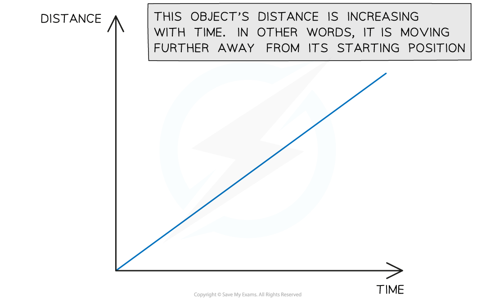
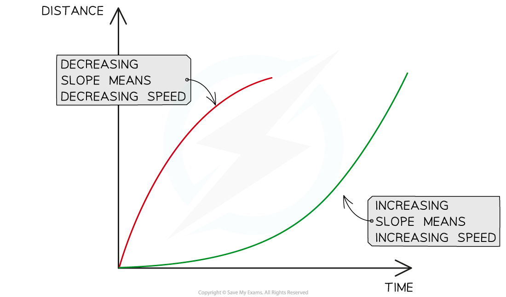
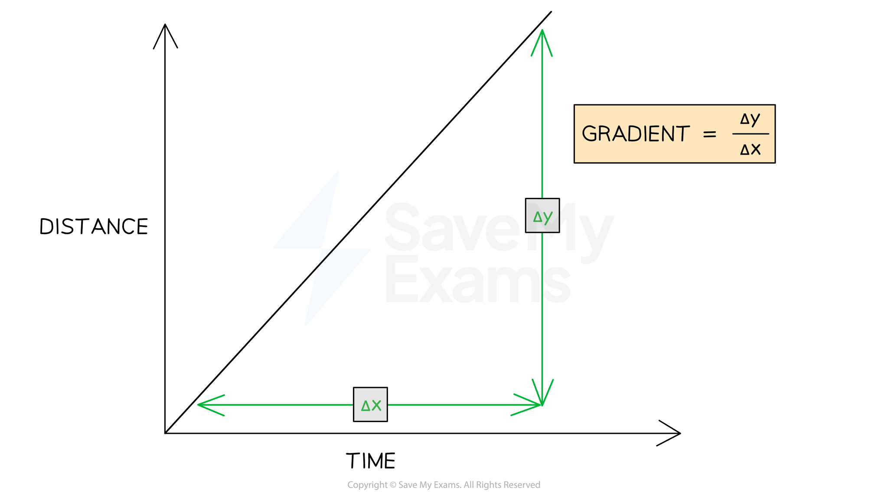

# Distance-Time Graphs

## Distance-time graphs

> **Spec point** — `spcpt_8MV2gdtFB6mxfBF5` · Sketch, plot and interpret distance–time graphs
Determine, qualitatively, from given data or the shape of a distance–time graph when an object is:
  (a) at rest
  (b) moving with constant speed
  (c) accelerating
  (d) decelerating

## Distance-time graphs

- A **distance-time graph** is used to describe the motion of an object and calculate its speed

*The graph shows an object moving further away from its origin at a constant speed*

### Constant speed on a distance-time graph

- If an object is moving at a **constant speed**, the distance-time graph will be a **straight line**

  - If the constant speed is **zero**, the line will be **horizontal**
  - If the constant speed is **non-zero**, the line will have a **gradient**
- If an object has a speed of zero, the object is **stationary**

  - The distance moved by the object over time is zero
- The **gradient **of a distance-time graph represents the **speed **of the object

  - A **steeper slope**, or a higher gradient, represents a **greater speed**
  - A **shallower slope**, or a lower gradient, represents a **slower speed**

#### Different speeds on a distance-time graph

*Both of these objects are moving at a constant speed because the lines are straight, but they represent different speeds*

### Changing speed on a distance-time graph

- Often, the speed of an object is **not constant**
- If the speed of an object is **changing**, the object is **accelerating**
- If an object is **accelerating**, the distance-time graph will be a** curved line**
- A **curve **on a distance-time graph is a **changing gradient**

  - If the **gradient increases** over time, the **speed is increasing** over time
  - If the **gradient decreases** over time, the **speed is decreasing** over time

#### Speed of an object increasing and decreasing on a distance-time graph

*The red line shows a decreasing gradient and represents an object slowing down, or decelerating. The green line shows an increasing gradient and represents an object speeding up, or accelerating*

### Plotting a distance-time graph

- Follow these steps to plot a distance-time graph from data:

  1. Label the x-axis with time and the y-axis with distance
  2. Choose sensible scales so that the graph occupies more than half of the graph grid
  3. Use the data given to plot points on the graph
  4. Join the points with straight lines if speed is constant, or curves if the speed is changing

> **Exam Hint**
> You could be asked to describe the motion of an object from data given in a question. You can read more about the use of graphs in exams in the article [Graph skills for GCSE Physics](https://www.savemyexams.com/learning-hub/exam-guides/graph-skills-in-gcse-physics/)

## Using distance-time graphs

> **Spec point** — `spcpt_kNSxpKtJntQYyhz4` · Calculate speed from the gradient of a straight-line section of a distance–time graph

## Using distance-time graphs

- The **speed** of a moving object can be calculated from the **gradient** of the line on a **distance-time** graph:

$\mathrm{speed}=\mathrm{gradient}=\frac{\Deltay}{\Deltax}$

*The speed of an object can be found by calculating the gradient of a distance-time graph*

- $\Deltay$ is the **change** in y (distance) values
- $\Deltax$ is the **change** in x (time) values

> **Worked Example**
> A distance-time graph is drawn below for part of a train journey. The train is travelling at a constant speed.
> 
> 
> 
> Calculate the speed of the train.
> 
> [4]
> 
> **Answer:**
> 
> **Step 1: Draw a large gradient triangle on the graph **
> 
> - The image below shows a large **gradient triangle** drawn with dashed lines
> - $\Deltay$ and $\Deltax$ are labelled, using the **units** as stated on each axis **[1 mark]**
> 
> 
> 
> **Step 2: Convert units for distance and time into standard units**
> 
> - The distance travelled, $s=8\mathrm{km}=8\times1000=8000m$
> **AND**
> The time taken, $t=6\mathrm{min}=6\times60=360s$ **[1 mark]**
> 
> **Step 3: State that speed is equal to the gradient of a distance-time graph**
> 
> - The **gradient** of a **distance-time** graph is equal to the **speed** of a moving object:
> 
> $\mathrm{gradient}=v=\frac{\Deltay}{\Deltax}=\frac{s}{t}$ **[1 mark]**
> 
> **Step 4: Substitute values to calculate the speed**
> 
> $v=\frac{8000}{360}$
> 
> $v=22.2m/s$ **[1 mark]**

> **Worked Example**
> A student decides to take a stroll to the park. They find a bench in a quiet spot, take a seat, and read a book on black holes. After some time reading, the student realises they lost track of time and runs home.
> 
> A distance-time graph for the trip is drawn below.
> 
> 
> 
> (a) How long does the student spend reading the book? [1]
> 
> (b) Which section of the graph represents the student running home? [1]
> 
> (c) What is the total distance travelled by the student? [2]
> 
> **Answer:**
> 
> **Part (a)**
> 
> - The student spends **40 minutes** reading their book
> - The **flat** section of the line (section B) represents an object which is **stationary**, so section B represents the student sitting on the bench reading
> - This section lasts for **40 minutes** **[1 mark]**
> 
> 
> 
> **Part (b)**
> 
> - **Section C** represents the student running home
> - The **slope** of the line in section C is **steeper** than the slope in section A
> - This means the student was moving at a **faster** speed (running) in section C **[1 mark]**
> 
> **Part (c)**
> 
> - The student initially travels a distance of 0.3 km in section A **[1 mark]**
> - The student will run another 0.3 km to return home in section C
> - Therefore, the total distance travelled by the student is **0.6 km ****[1 mark]**

> **Exam Hint**
> Draw the **largest gradient triangle** possible within the straight section the question asks about. Examiners award credit for seeing the triangle drawn on the graph itself. Do not use the whole line if the graph has more than one section.
> 
> Remember to check the **units** on each axis. These may not always be in standard units; in our example, the unit of distance was **km** and the unit of time was **minutes**. Double-check which units to use in your answer.
