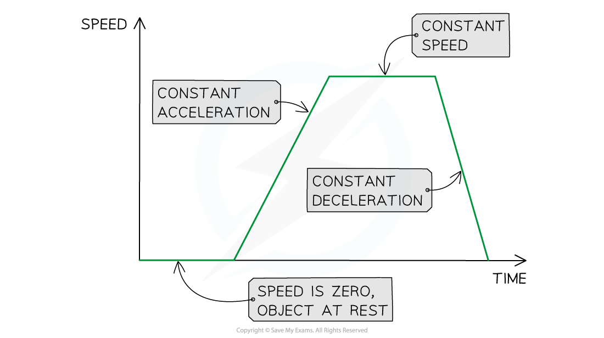
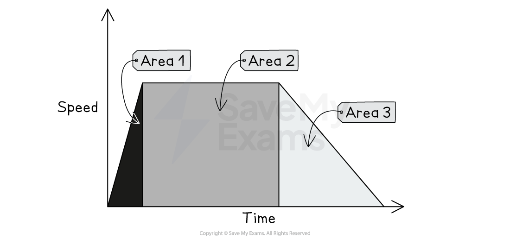

# Speed-Time Graphs

## Speed-time graphs

> **Spec point** — `spcpt_Mx46YYX5NnDy4Drd` · Sketch, plot and interpret speed–time graphs
Determine, qualitatively, from given data or the shape of a speed–time graph when an object is:
  (a) at rest
  (b) moving with constant speed
  (c) accelerating
  (d) decelerating

## Speed-time graphs

- A **speed-time graph** is used to describe the speed of an object and calculate its acceleration

### Constant acceleration on a speed-time graph

- If an object is moving at a **constant acceleration**, the speed-time graph will be a **straight line**

  - If the constant acceleration is **zero**, the line will be **horizontal**
  - If the constant acceleration is **non-zero**, the line will have a **gradient**
- If an object has an **acceleration **of **zero**, the object is travelling at a **constant speed**

  - If the **constant speed** is **zero**, then the object is **stationary**

#### Motion on a speed-time graph

*This image shows how to interpret the slope of a speed-time graph*

- The [gradient of a speed-time graph](https://www.savemyexams.com/igcse/physics/cie/23/revision-notes/1-motion-forces-and-energy/1-2-motion/1-2-5-calculating-acceleration-from-speed-time-graphs/?_ai=internal-linking) represents the object's **acceleration**

  - A **steeper slope**, or a higher gradient, represents a **greater acceleration**
  - A **shallower slope**, or a lower gradient, represents a** smaller acceleration**
- If the gradient is positive, the line slopes upward

  - A **positive gradient** represents an increasing speed, or **acceleration**
- If the gradient is negative, the line slopes downward

  - A **negative gradient** represents a decreasing speed, or **deceleration**

#### Speeding up and slowing down on a speed-time graph

*Both of these objects are moving at a constant acceleration, because the lines are straight. The positive gradient represents an increasing speed or positive acceleration. The negative gradient represents a decreasing speed or negative acceleration.*

### Plotting a speed-time graph

- Follow these steps to plot a speed-time graph from data:

  1. Label the x-axis with time and the y-axis with speed
  2. Choose sensible scales so that the graph occupies more than half of the graph grid
  3. Use the data given to plot points on the graph
  4. Join the points with horizontal straight lines if the speed is constant, or sloped straight lines if the speed is not constant

> **Exam Hint**
> You could be asked to describe the motion of an object from data given in a question. You can read more about graph skills in the article [Graph skills in GCSE Physics](https://www.savemyexams.com/learning-hub/exam-guides/graph-skills-in-gcse-physics/)

## Using speed-time graphs

> **Spec point** — `spcpt_syZf4ZP5PZPkRZZw` · Calculate the area under a speed–time graph to determine the distance travelled for motion with constant speed or constant acceleration

## Using speed-time graphs

- **Speed-time graphs** can also be used to determine the distance travelled by an object

### The area under a speed-time graph

- The **area **under a speed-time graph** **represents the** distance travelled**

***The area under a speed-time graph represents the distance travelled***

- If the area of a section of the speed-time graph forms a **triangle**, the area can be calculated using:

$A_{T}=\frac{1}{2}bh$

- If the area of a section of the speed-time graph forms a** rectangle**, the area can be determined using:

$A_{R}=bh$

- Where:

  - $A_{T}$ = area of a triangle
  - $A_{R}$ = area of a rectangle
  - $b$ = base
  - $h$ = height

- The **total distance travelled** can be determined by finding the** total area** under the speed-time graph
- The distance travelled for **part of the journey** can be determined by finding the area under the graph for a specific **time interval**

#### Area under a speed-time graph split into sections

*The area under a speed-time graph can be split into triangular and rectangular sections*

> **Worked Example**
> The speed-time graph below shows a car journey that lasts for 160 seconds.
> 
> 
> 
> Calculate the total distance travelled by the car on this journey.
> 
> **Answer:**
> 
> **Step 1: Recall that the area under a speed-time graph represents the distance travelled**
> 
> - In order to calculate the total distance travelled, the total area underneath the graph must be determined
> 
> **Step 2: Identify each enclosed area**
> 
> - In this example, there are **five** enclosed areas under the line
> - These can be labelled as areas 1, 2, 3, 4 and 5, as shown in the image below: **Step 3: Calculate the area of each enclosed shape under the line**
> 
> - Area 1 = area of a triangle
> 
> $A_{1}=\frac{1}{2}bh$
> 
> $A_{1}=\frac{1}{2}\times40\times17.5$
> 
> $A_{1}=350m$
> 
> - Area 2 = area of a rectangle
> 
> $A_{2}=bh$
> 
> $A_{2}=30\times17.5$
> 
> $A_{2}=525m$
> 
> - Area 3 = area of a triangle
> 
> $A_{3}=\frac{1}{2}bh$
> 
> $A_{3}=\frac{1}{2}\times20\times7.5$
> 
> $A_{3}=75m$
> 
> - Area 4 = area of a rectangle
> 
> $A_{4}=bh$
> 
> $A_{4}=20\times17.5$
> 
> $A_{4}=350m$
> 
> - Area 5 = area of a triangle
> 
> $A_{5}=\frac{1}{2}bh$
> 
> $A_{5}=\frac{1}{2}\times70\times25$
> 
> $A_{5}=875m$
> 
> **Step 4: Calculate the total distance travelled by finding the total area under the line**
> 
> - Add up each of the five areas enclosed:
> 
> $\mathrm{total} \mathrm{distance}=A_{1}+A_{2}+A_{3}+A_{4}+A_{5}$
> 
> $\mathrm{total} \mathrm{distance}=350+525+75+350+875$
> 
> $\mathrm{total} \mathrm{distance}=2175m$

> **Exam Hint**
> Some areas will need to be split into a triangle and a rectangle to determine the area for a specific time interval, like areas 3 and 4 in the worked example above.
> 
> If you are asked to find the distance travelled for a specific time interval, then you just need to find the area of the section above that time interval.
> 
> For example, the distance travelled between 70 s and 90 s is the sum of Area 3 + Area 4.
> 
> In questions like this, marks would be awarded for recognising that the distance travelled is the area under the graph, calculating the area of some of the individual sections correctly, and for the final answer.
