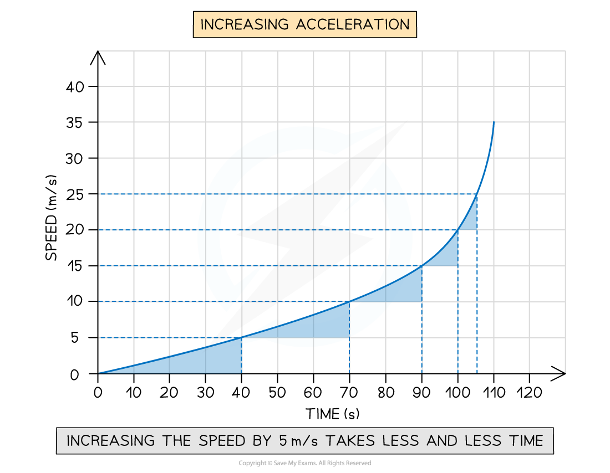
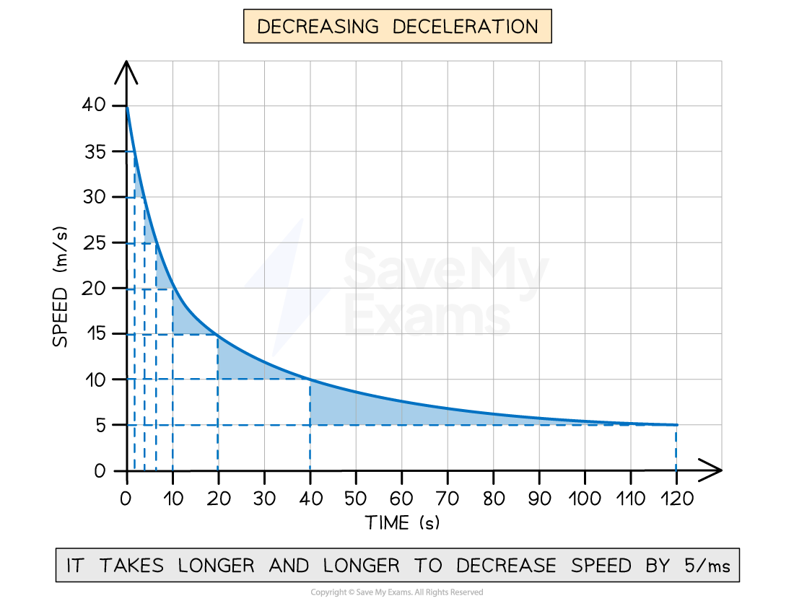
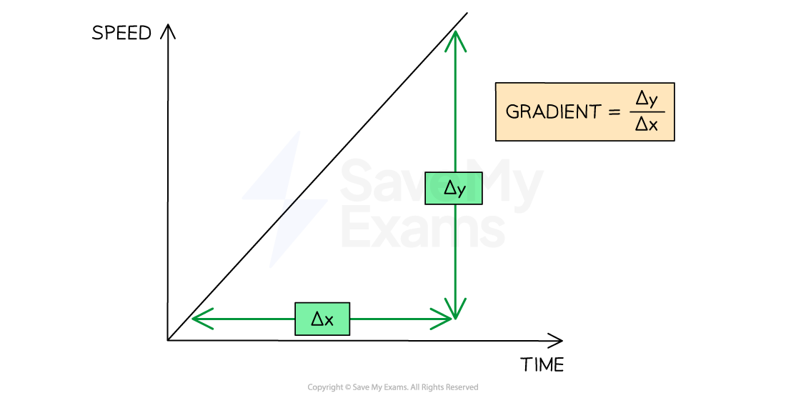

# Calculating Acceleration from Speed-Time Graphs

## Interpreting speed-time graphs

> **Spec point** — `spcpt_d25dVch4NmXGDHtg` · Determine from given data or the shape of a speed–time graph when an object is moving with:
   (a) constant acceleration
   (b) changing acceleration

## Interpreting speed-time graphs

**Extended tier only**

- When interpreting speed-time graphs, the shape of the graph can show:

  - constant acceleration
  - changing acceleration

- The **gradient **of a speed-time graph shows the **acceleration **of a moving object

  - The gradient is **positive **if the object is accelerating (speed increases with time)
  - The gradient is **negative **if the object is decelerating (speed decreases with time)

### Interpreting constant positive acceleration on a speed-time graph

- When the acceleration is **constant **and **non-zero**:

  - the graph is a **straight line**
  - velocity is **increasing **at a **constant **rate, i.e. speed changes by the same amount in equal intervals of time

#### Constant positive acceleration on a speed-time graph

*A speed-time graph for an object with constant positive acceleration. Its speed increases by 5 m/s every 20 s, showing that the rate at which the speed increases is constant.*

### Interpreting increasing positive acceleration on a speed-time graph

- When the acceleration is **increasing**:

  - the graph is a **curve **
  - velocity is **increasing **at an **increasing **rate, i.e. the speed changes by the same amount in increasingly shorter time intervals

#### Increasing positive acceleration on a speed-time graph

*A speed-time graph for an object with changing positive acceleration. The time taken for the speed to increase by 5 m/s decreases over time, showing that acceleration is increasing.*

### Interpreting decreasing positive acceleration on a speed-time graph

- When the acceleration is **decreasing**:

  - the graph is a **curve**
  - velocity is **increasing **at a **decreasing **rate, i.e. the speed changes by the same amount in increasingly longer time intervals

#### Decreasing positive acceleration on a speed-time graph

*A speed-time graph for an object with changing positive acceleration. The time taken for the speed to increase by 5 m/s increases over time, showing that acceleration is decreasing.*

### Interpreting decreasing negative acceleration on a speed-time graph

- When the deceleration is **decreasing:**

  - the graph is a **curve**
  - the velocity is **decreasing **at a **decreasing **rate, i.e. the speed changes by the same amount in increasingly longer intervals of time

#### Decreasing negative acceleration on a speed-time graph

*A speed-time graph for an object with changing negative acceleration. The time taken for the speed to decrease by 5 m/s increases over time, showing that deceleration is decreasing.*

> **Exam Hint**
> In CIE IGCSE Physics, interpreting graphs is a **required **skill
> 
> - For your exam, you are also expected to calculate the **gradient **of a graph and the area under a graph
> - Finding the **area under a graph** is covered in the revision note [Speed-time graphs](https://www.savemyexams.com/igcse/physics/cie/23/revision-notes/1-motion-forces--energy/1-2-motion/1-2-4-speed-time-graphs/)

## Calculating acceleration

> **Spec point** — `spcpt_Rg74tCrrqgmHNTzF` · Calculate acceleration from the gradient of a speed–time graph

## Calculating acceleration

### Extended Tier Only

- The [acceleration of an object](https://www.savemyexams.com/igcse/physics/cie/23/revision-notes/1-motion-forces-and-energy/1-2-motion/1-2-2-acceleration/?_ai=internal-linking) can be calculated from the **gradient** of a speed-time graph

### Finding the gradient when acceleration is constant

- When acceleration is **constant**, the speed-time graph will be a **straight line**
- The gradient of a straight line can be found using:

$\mathrm{gradient}=\frac{\Deltay}{\Deltax}$

- Where:

  - $\Deltay$ = change in $y$ (speed) values
  - $\Deltax$ = change in $x$ (time) values
- Therefore, the gradient is equal to:

$a=\frac{\Deltav}{\Deltat}$

- Where:

  - $a$ = acceleration, measured in metres per second squared (m/s2)
  - $\Deltav$ = change in speed, measured in metres per second (m/s)
  - $\Deltat$ = change in time, measured in seconds (s)

*The gradient of a speed-time graph for constant acceleration can be found using Δy divided by Δx*

### Finding the gradient when acceleration is changing

- When acceleration is **changing**, the speed-time graph will be a **curve**
- The **gradient **of a point on a **curve** can be found by drawing a **tangent **to the curve

  - A tangent to the curve is a **straight line** drawn to match the **gradient **of the curve at a **specific point**

#### A tangent to the curve

*The value of the gradient at a single point on a curve can be determined by finding the gradient of the tangent to that point *

- The tangent provides a gradient that is representative of the gradient at a **specific point** on the curve
- The gradient of the tangent can be found using:

$\mathrm{gradient}=\frac{\Deltay}{\Deltax}$

- The value of the gradient at a specific point on the curve represents the acceleration of the object **at that moment**

  - This is called **instantaneous acceleration**

> **Worked Example**
> A cyclist is training for a cycling tournament.
> 
> The speed-time graph below shows the cyclist's motion as they cycle along a flat, straight road.
> 
> ![Speed-time graph with speed in metres per second on the vertical axis and time in seconds on the horizontal axis, showing five lines. Line A shows the cyclist stationary for 5 seconds. Line B shows the cyclist constantly accelerating from 0 to 5 m/s between 5 s and 10 s. Line C shows the cyclist maintaining a constant 5 m/s speed between 10 s and 13 s. Line D shows the cyclist constantly accelerating from 5 m/s to 10 m/s between 13 s and 15 s. Line E shows the cyclist maintaining a constant 10 m/s speed between 15 s and 20 s.](assets/6d7dc6ecb771-speed-time-gradient-we1.png)
> 
> (a) In which section (A, B, C, D, or E) of the speed-time graph is the cyclist's acceleration the largest? [1]
> 
> (b) Calculate the cyclist's acceleration between 5 and 10 seconds. [3]
> 
> **Answer:**
> 
> **Part (a)**
> 
> **Step 1:** **Recall that the slope of a speed-time graph represents the magnitude of acceleration**
> 
> - The slope of a speed-time graph indicates the magnitude of acceleration
> - Therefore, the only sections of the graph where the cyclist is accelerating are sections B and D
> - Sections A, C and E are flat; in other words, the cyclist is moving at a constant speed (therefore, not accelerating)
> 
> **Step 2: Identify the section with the steepest slope**
> 
> - Section D of the graph has the steepest slope
> - Hence, the largest acceleration is shown in section D **[1 mark]**
> 
> **Part (b)**
> 
> **Step 1: Recall that the gradient of a speed-time graph gives the acceleration**
> 
> - Calculating the gradient of a slope on a speed-time graph gives the acceleration for that time period **[1 mark]**
> 
> **Step 2: Draw a large gradient triangle at the appropriate section of the graph**
> 
> - A gradient triangle is drawn for the time period between 5 and 10 seconds **[1 mark]**
> 
> 
> 
> **Step 3: Calculate the size of the gradient and state this as the acceleration**
> 
> - The acceleration is given by the gradient, which can be calculated using:
> 
> $a=\frac{\Deltay}{\Deltax}$
> 
> $a=\frac{5}{5}$
> 
> $a=1m/s^{2}$
> 
> - Therefore, the cyclist accelerated at 1 m/s2 between 5 and 10 seconds **[1 mark]**

> **Exam Hint**
> Use the **entire straight-line section**, where possible, to calculate the gradient. Examiners tend to award credit if they see a **large gradient triangle** used.
> 
> Remember to actually draw the lines directly on the graph itself, particularly when the question asks you to **use the graph** to calculate the acceleration.

> **Worked Example**
> A skydiver jumps from a plane and reaches terminal velocity after 15 seconds. A  speed-time graph of their motion is shown below.
> 
> Use the graph to find the acceleration at 5 seconds.
> 
> 
> 
> [3]
> 
> **Answer:**
> 
> **Step 1: Draw a tangent to the curve at the point where t = 5 s ****[1 mark]**
> 
> 
> 
> **Step 2: Calculate the gradient of the tangent**
> 
> - Change in y (speed): $\Deltay$
> - Change in x (time): $\Deltax$
> 
> $a=\frac{\Deltay}{\Deltax}$
> 
> $a=\frac{58-20}{9.75-0.75}$ **[1 mark]**
> 
> $a=\frac{38}{9.0}$
> 
> `a space equals space 4.2 space straight m divided by straight s squared space open parentheses 2 space straight s. straight f. close parentheses` **[1 mark]**

> **Exam Hint**
> The CIE IGCSE Physics specification includes knowing how to calculate the gradient of a tangent to the curve in the maths skills section. This means that you could be asked to demonstrate this skill in any topic. The skills in this revision note are applicable to any type of graph. For more information on interpreting graphs in Physics, see the article [Graph skills in GCSE Physics](https://www.savemyexams.com/learning-hub/exam-guides/graph-skills-in-gcse-physics/)
