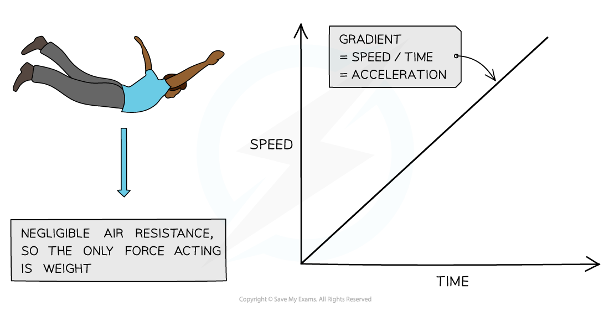

# Freefall

## Acceleration of free fall

> **Spec point** — `spcpt_yRNGJt23ZpsHZYyQ` · State that the acceleration of free fall g for an object near to the surface of the Earth is approximately constant and is approximately 9.8 m/s2

## Acceleration of free fall

- In the absence of **air resistance**, all objects fall with the **same *****acceleration***** **regardless of their mass
- This is called the **acceleration of free fall**

  - This is also sometimes called acceleration due to gravity
- For an object near to the surface of the Earth, the acceleration of free fall, **g**, is approximately constant and is approximately **9.8 m/s****2**

*In the absence of air resistance, Galileo discovered that all objects (near Earth's surface) fall with an acceleration of about 9.8 m/s2*

- This means that for every second an object falls, its velocity will increase by 9.8 m/s
- The symbol $g$ also stands for the **gravitational field strength**, and can be used to calculate the force of weight acting on an object using its mass:

$W=mg$

- Where:

  - $W$ = the force of weight acting on an object, measured in newtons (N)
  - $m$ = mass of object, measured in kilograms (kg)
  - $g$ = gravitational field strength, measured in newtons per kilogram (N/kg)

## Motion of falling objects

> **Spec point** — `spcpt_Zm87xRNtF9pJkXhz` · Describe the motion of objects falling in a uniform gravitational field 
 - with and without air/ liquid resistance (including reference to terminal velocity)

## Motion of falling objects

### Extended Tier Only

### Falling objects without air resistance

- A **vacuum **is a space that contains no matter, so there are **no particles** to exert frictional forces on a falling object
- When objects fall in a vacuum, there is no air resistance or liquid resistance so the only force acting on them is the force of **weight**

$W=mg$

- [Newton's second law](https://www.savemyexams.com/igcse/physics/cie/23/revision-notes/1-motion-forces--energy/1-4-effects-of-forces/1-4-3-newtons-second-law/) of motion describes acceleration as:

$a=\frac{F}{m}$

- Where:

  - $a$ = acceleration, measured in metres per second squared (m/s2)
  - $F$ = force exerted on object, measured in newtons (N)
  - $m$ = mass of object, measured in kilograms (kg)
- Since the only force acting on a falling object in a vacuum is weight, the equation can be expressed as

$a=\frac{W}{m}$

- Weight is the product of mass and gravitational field strength, so the equation can be expressed as

$a=\frac{mg}{m}$

- Here, the masses cancel each other out

`a space equals fraction numerator space up diagonal strike m g over denominator up diagonal strike m end fraction`

- So, for objects falling in a vacuum

$a=g$

- Where $g$ = acceleration of free fall

- This theory was tested by astronauts on the Moon

  - A hammer and a feather were dropped from **equal heights** on the Moon, where there is** no air resistance**
  - The hammer and the feather fell with the **same acceleration** and landed at the same time
  - This proved that objects falling in a vacuum have the same acceleration **regardless of their mass**

- This also applies when air resistance is so small that it can be disregarded

  - When air resistance is described as **negligible**, it can be **approximated **to an object falling in a vacuum

#### Object falling with no air resistance

*In the absence of air resistance, objects fall with constant acceleration*

- Objects falling through a vacuum will **never **reach a **terminal velocity**

### Falling objects with air resistance

- When an object falls through **air**, it experiences **air resistance**

  - Air resistance is a **frictional **force produced by collisions with air particles as the object moves through the air
- Air resistance **increases **as the** speed **of the object **increases**
- When objects fall through **air**,** two forces** are exerted on the object:

  - The force of **weight**
  - The force of **air resistance**
- When the force of **air resistance** becomes **equal **to the force of weight, then the object **stops accelerating** and falls at a **constant speed**

  - This is called** terminal velocity**

#### How does a skydiver reach terminal velocity?

*The stages of a skydiver's fall until they reach terminal velocity*

- When a skydiver jumps out of a plane, initially the only force acting on them is **weight**

  - The resultant force acts in the downward direction
  - The skydiver **accelerates**

- As the skydiver accelerates, their **speed increases,** so the force of **air resistance increases**

  - The resultant force acts in the downward direction with a smaller magnitude
  - The skydiver continues to **accelerate **but at a **slower **rate

- **Air resistance** increases until it is **equal **to the **weight**

  - The forces are balanced
  - There is no resultant force
  - **Terminal velocity** is reached
- The parachute is deployed, increasing the surface area of the skydiver

  - The parachute collides with many more air particles
  - **Air resistance increases** greatly

- The force of **air resistance** is now **greater than** the force of **weight**

  - The resultant force acts in the upward direction
  - The skydiver continues falling in a downward direction
  - The skydiver is **decelerating**

- As the skydiver decelerates, their **speed decreases**

  - Therefore, **air resistance decreases**
  - Therefore, the resultant force decreases

- **Air resistance** decreases until it is **equal **to the **weight**

  - The forces are balanced
  - There is no resultant force
  - A new, **slower terminal velocity** is reached

#### Graph showing the motion of the skydiver as they reach terminal velocity

*The graph shows how the speed of the skydiver changes during the descent. The horizontal parts of the graph show the periods of terminal velocity*

### Falling objects with liquid resistance

- When objects fall through a **liquid** due to the force of weight, the liquid exerts a **frictional (drag) force** on the object as it falls

- Drag forces** oppose the motion **of an object

  - They act to slow it down
- Drag **increases **as the** speed **of the object **increases**

- When the **drag force** becomes **equal **to the force of weight, the object **stops accelerating** and reaches a **terminal velocity**

> **Worked Example**
> A small object falls out of an aircraft. Choose words from the table to complete the sentences below:
> 
> | **accelerates** | **air pressure** |
> |---|---|
> | **air resistance** | **falls at a steady speed** |
> | **gravitational field strength** | **slows down** |
> 
> (a) The weight of an object is the product of the object's mass and the __________. [1]
> 
> (b) When an object falls, initially it ____________. [1]
> 
> (c) As the object falls faster, the force of ______________ acting upon the object increases. [1]
> 
> (d) Eventually, the object ______________ when the force of friction equals the force of weight acting on it. [1]
> 
> **Answer:**
> 
> **Part (a)**
> 
> The weight of an object is the product of the object's mass and the **gravitational field strength**. **[1 mark]**
> 
> - The weight force is due to the Earth's gravitational pull on the object's mass as it falls through a uniform gravitational field
> 
> **Part (b)**
> 
> When an object falls, initially it **accelerates. ****[1 mark]**
> 
> - The **resultant force** on the object is **very large** initially, so it accelerates
> - This is because there is a **large unbalanced force** downwards (its weight) - the upward force of air resistance is very small to begin with
> 
> **Part (c)**
> 
> As the object falls faster, the force of **air resistance **acting on the object increases. **[1 mark]**
> 
> - The force of **air resistance** is due to **friction** between the object's motion and **collisions with air particles**
> - Collisions with air particles slow the object down, so air itself produces a **frictional force**, called **air resistance** (sometimes called **drag**)
> 
> **Part (d)**
> 
> Eventually, the object **falls at a steady speed** when the force of friction equals the force of weight acting on it. **[1 mark]**
> 
> - When the upward acting **air resistance** increases enough to **balance** the downward **weight** force, the resultant force on the object is **zero**
> - This means the object is no longer accelerating; it is moving at a **steady** **speed **called **terminal velocity**

> **Exam Hint**
> Don't confuse 'air resistance' with 'air pressure' - these are two different concepts!
> 
> Exam questions about terminal velocity tend to involve the motion of skydivers as they fall
> 
> A common misconception is that skydivers move upwards when their parachutes are deployed; however, this is not the case, they are in fact **decelerating** to a lower terminal velocity
