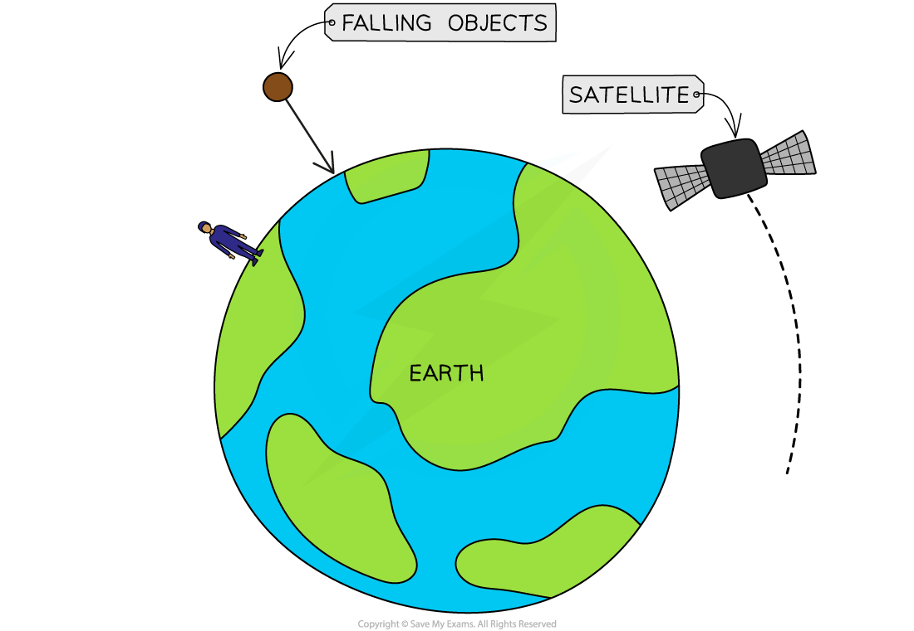
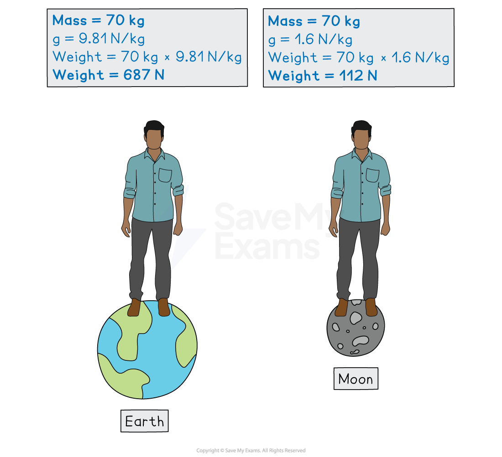
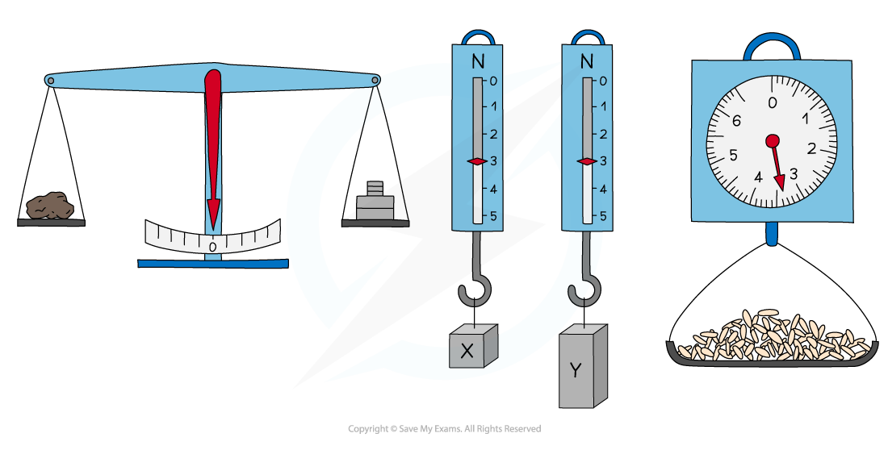

# Mass & Weight

## Mass & weight

> **Spec point** — `spcpt_b6gVft7s9jC8T4W7` · - State that mass is a measure of the quantity of matter in an object at rest relative to the observer
- State that weight is a gravitational force on an object that has mass (C)

## Mass & weight

### Mass

- Mass is defined as:

**A measure of the quantity of matter in an object at rest relative to the observer**

- The greater the mass of an object, the more difficult it is to speed it up, slow it down, or change its direction
- Mass is a **scalar** quantity that has **magnitude** but no direction
- Mass is measured in **kilograms** (kg)

  - Sometimes mass may be given in **grams **(g) but this will need to be converted to kilograms when used in calculations
  
    - 1000 g = 1 kg
    - 1 g = 0.001 kg
  - To convert **g to kg**, **divide **the mass in g by 1000
  - To convert **kg to g**, **multiply **the mass in kg by 1000

### Weight

- Weight is a gravitational **force** on an object with mass
- Since weight is a force, it is a **vector** quantity with both **magnitude **and **direction**
- Weight is measured in **newtons **(N)

> **Worked Example**
> An object has a mass of 4.5 kg.
> 
> State the mass of the object in grams (g).
> 
> [1]
> 
> **Answer:**
> 
> **Step 1: State the conversion between g and kg**
> 
> - 1 kg = 1000 g
> 
> **Step 2: Convert kg into g by multiplying **
> 
> $m=4.5\times1000$
> 
> $m=4500g$ **[1 mark]**

> **Exam Hint**
> Students commonly confuse mass and weight because the terms are used interchangeably in everyday speech. In Physics, mass and weight mean very different things, and you must be confident that you can explain the difference.
> 
> - Mass is the amount of **matter **an object has; it is a **scalar **quantity, and it is measured in **kg**.
> - Weight is a **force**; it is a **vector **quantity, and it is measured in **N**.

## Weight & gravity

> **Spec point** — `spcpt_vXjq49gFRbHhWGXT` · - Describe, and use the concept of, weight as the effect of a gravitational field on a mass (E)

## Weight & gravity

### Extended Tier Only

### Weight and gravitational field strength

- Weight is the effect of a** gravitational field** on a mass
- Weight is defined as:

**The force acting on an object with mass when placed in a gravitational field**

- Planets have strong gravitational fields

  - Hence, they attract nearby masses with a strong gravitational force
- Because of weight:

  - Objects stay firmly on the ground
  - Objects will always fall to the ground
  - Satellites are kept in orbit

*Some of the phenomena associated with gravitational attraction and the weight force*

## Defining gravitational field strength

> **Spec point** — `spcpt_J9yrCG73TnZFxNn3` · Define gravitational field strength as force per unit mass; recall and use the equation g = W / m and know that this is equivalent to the acceleration of free fall

## Defining gravitational field strength

- **Gravitational field strength **is defined as:

**The force per unit mass acting on an object in a gravitational field**

- Near to the surface of the Earth, this is approximately equal to **9.8 N/kg **

$g=\frac{W}{m}$

- Where:

  - $g$ = gravitational field strength, measured in newtons per kilogram (N/kg)
  - $W$ = force of weight, measured in newtons (N)
  - $m$ = mass of object, measured in kilograms (kg)

- An object in free fall in a vacuum, in a uniform gravitational field, will **accelerate **at a rate also known as $g$

  - Where $g$ = acceleration of free fall
  - In this context, $g$ = 9.8 m/s2
  - Gravitational field strength and acceleration of free fall are **equivalent **quantities

### Mass vs. weight

- An object’s mass **always **remains the same, regardless of its location in the Universe
- The weight force exerted on the object will differ depending on the strength of the gravitational field in its location
- For example, the gravitational field strength on the Moon is **1.63 N/kg**, meaning an object’s weight will be about **6 times** less than on Earth

*On the Moon, a person's mass will stay the same but their weight will be much lower*

- You can find more information about the gravitational field strength on different planets in the revision note [Gravitational field strength](https://www.savemyexams.com/igcse/physics/cie/23/revision-notes/6-space-physics/6-1-earth--the-solar-system/6-1-5-gravitational-field-strength/)

> **Worked Example**
> NASA's Artemis mission aims to send the first woman astronaut to the Moon. Isabelle hopes to one day become an astronaut. She has a mass of 42 kg.
> 
> Compare Isabelle's weight on Earth with her weight on the Moon.
> 
> Take the Earth's gravitational field strength as 9.8 N/kg, and the Moon's gravitational field strength as 1.6 N/kg.
> 
> [4]
> 
> **Answer:**
> 
> **Step 1: List the known values**
> 
> - Mass, $m=42\mathrm{kg}$
> - Gravitational field strength on Earth, $g_{E}=9.8N/\mathrm{kg}$
> - Gravitational field strength on Moon, $g_{M}=1.6N/\mathrm{kg}$
> 
> **Step 2: State the equation linking weight,  mass and gravitational field strength**
> 
> $g=\frac{W}{m}$
> 
> **Step 3: Rearrange to make weight the subject**
> 
> $W=mg$ **[1 mark]**
> 
> **Step 4: Calculate the weight force exerted on Isabelle on Earth**
> 
> $W_{E}=mg_{E}$
> 
> $W_{E}=42\times9.8$
> 
> `W_ E=411.6 straight N=410 straight N (2 straight s. straight f.)` **[1 mark]**
> 
> **Step 5: Calculate the weight force exerted on Isabelle on the Moon**
> 
> $W_{M}=mg_{M}$
> 
> $W_{M}=42\times1.6$
> 
> `W_ M=67.2 straight N=67 straight N (2 straight s. straight f.)` **[1 mark]**
> 
> **Step 6: Compare the two values of weight**
> 
> - The weight force is **greater** on Earth than on the Moon
> - This is because the Earth has a **larger** gravitational field strength than the Moon, so Isabelle's weight force is larger on Earth than on the Moon **[1 mark]**

> **Exam Hint**
> You will be expected to remember that ***g***** = 9.8 N/kg** and use it in calculations

## Using a balance

> **Spec point** — `spcpt_FHkkvFJSBV8W8N2t` · Know that weights (and masses) may be compared using a balance

## Using a balance

- The **weight **of two objects can be compared using a **balance**

  - Because the gravitational field strength is approximately **constant **everywhere on Earth, this also allows us to measure the **mass **of an object

$m=\frac{W}{g}$

*A balance can be used to compare two different weights*

- **Balances **can be digital or analogue

  - The object being measured is placed on the balance
  - The reading given is **mass** in kg or g
- **Force meters**, or **newton meters**,** **consist of a spring and hook

  - The object being measured is hung from the hook
  - The reading given is **weight **in N
