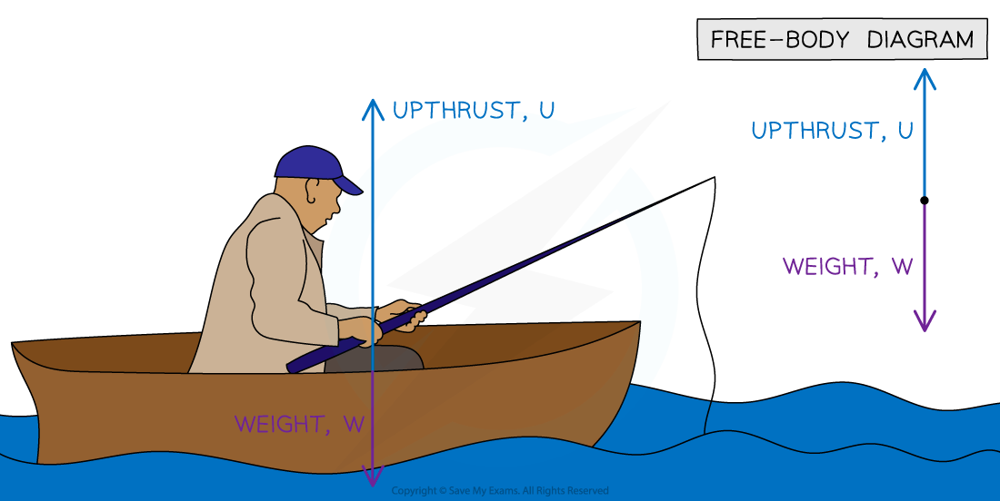
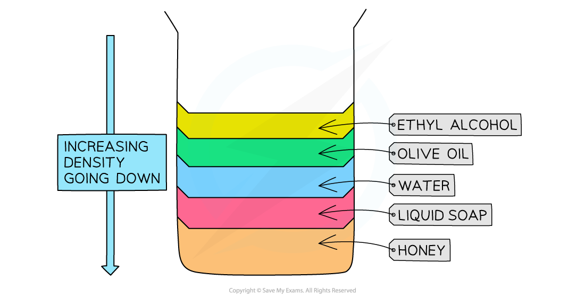

# Floating

## Floating objects

> **Spec point** — `spcpt_WPjKWd2PgMMt8v2g` · Determine whether an object floats based on density data

## Floating objects

### Density and floating

- Whether an object **floats **or **sinks **depends on the **relative densities** of the object and the fluid it is submerged in

- **Upthrust **is a **force **that **pushes **upwards on an object submerged in a **fluid**
- Upthrust always acts in the **opposite direction** to the object's **weight **force

  - This is how objects float

- The size of the upthrust force depends on:

  - the **density** of the fluid
  - the **volume** of fluid that is displaced (which is equal to the volume of the object that is submerged)
- The **denser** the liquid, the **greater** the force of upthrust exerted on the object

#### Upthrust and weight forces on a boat

*An object will float if the force of upthrust is equal to the force of weight*

### Factors affecting floating and sinking

- The factors affecting floating and sinking are:

  - upthrust
  - density
- If the force of **upthrust **on an object is:

  - **equal** to the object’s **weight**, then the object will **float**
  - **less than** the object’s **weight**, then the object will **sink**

- If the **density **of the **object **is:

  - **greater than** the density of the **fluid**, then the object will **sink**
  - **less than **the density of the **fluid**, then the object will **float**
- If the density of the object is greater than the density of the fluid, the object can never displace enough fluid to create an upthrust that will equal its weight (and therefore it sinks)

*Objects which are less dense than water will float in water, and those that are more dense will sink*

- A polystyrene block will **float** in water

  - This is because polystyrene has a density of 0.05 g/cm3 which is **much less** than the density of water (1.0 g/cm3)
- A wooden block will be partially submerged but will still **float**

  - This is because the density of a wooden block (0.9 g/cm3) is **slightly less** than the density of water
- An iron block will **sink**

  - This is because iron has a density (7.9 g/cm3) that is **much higher** than the density of water

> **Worked Example**
> Potassium is an alkali metal that reacts with oxygen and water. Potassium is therefore stored in containers filled with mineral oil. The potassium must sink in the mineral oil to ensure it has no contact with any air in the container.
> 
> A science teacher has four different mineral oils in which they could store their potassium. Potassium has a density of 0.862 g/cm3.
> 
> Which mineral oil should the teacher choose?
> 
> **A:** White mineral oil, $ρ=0.864g/\mathrm{cm}^{3}$
> 
> **B:** Paraffin oil, $ρ=0.890g/\mathrm{cm}^{3}$
> 
> **C: **Liquid paraffin, $ρ=0.825g/\mathrm{cm}^{3}$
> 
> **D:** Food grade mineral oil, $ρ=0.880g/\mathrm{cm}^{3}$
> 
> [1]
> 
> **Answer: C**
> 
> - An object will sink in a fluid if the density of the object is greater than the density of the fluid
> - Therefore, for the potassium to sink, the density of the oil must be less than the density of the potassium
> - Liquid paraffin is less dense than potassium $0.825g/\mathrm{cm}^{3}<0.862g/\mathrm{cm}^{3}$
> - The only oil which is less dense than potassium is **C ****[1 mark]**

> **Exam Hint**
> The main thing to remember is that **density is mass per unit volume**. You need to be able to determine whether an object floats based on density data, while upthrust is supporting context.
> 
> In physics, mass is almost always measured in kg. But density is often given in g/cm3, so make sure to double check the units provided

## Floating liquids

> **Spec point** — `spcpt_CmXcMSFpxbH2K8Ff` · Determine whether one liquid will float on another liquid based on density data given that the liquids do not mix

## Floating liquids

### Extended Tier Only

- A liquid with a lower density will float on a liquid with a higher density if the liquids do not mix

*Lower density liquids float on higher density liquids as long as the liquids do not mix*

> **Worked Example**
> Liquid A has a density of 0.76 g/cm3 and liquid B has a density of 0.93 g/cm3.
> 
> If the two liquids do not mix, which liquid will float on top of the other?
> 
> [1]
> 
> **Answer:**
> 
> **Step 1: List the known quantities**
> 
> - Liquid A = 0.76 g/cm3 
> - Liquid B = 0.93 g/cm3
> 
> **Step 2: Determine which liquid has the lower density**
> 
> - The liquid with the lower density will float on top of the liquid with the higher density
> - 0.76 is less than 0.93
> - Therefore, liquid A has the lower density
> 
> **Step 3: State your answer**
> 
> - **Liquid A** will float on top of liquid B **[1 mark]**
