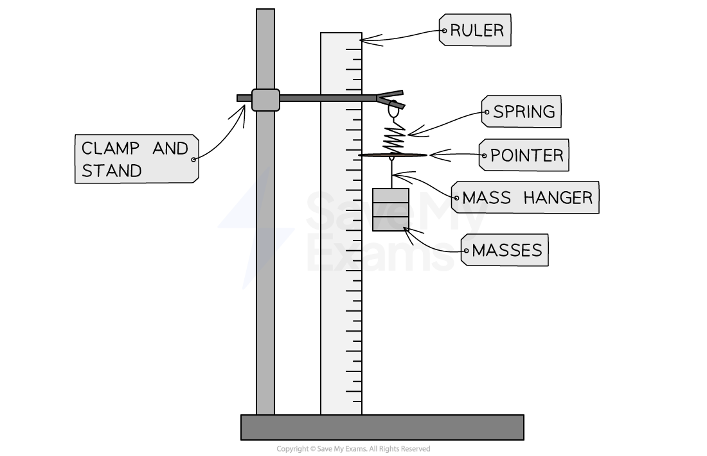

# Investigating Force & Extension

## Investigating springs

> **Spec point** — `spcpt_pD3BKxMRw8hYRJ8t` · Sketch, plot and interpret load–extension graphs for an elastic solid and describe the associated experimental procedures

## Investigating springs

### Aim of the experiment

- The aim of this experiment is to investigate the relationship between the load applied to a spring and its extension

### Variables

- ***Independent variable*** = Load, $L$(The force applied, $F$, to the spring is referred to as the load)
- ***Dependent variable*** = Extension, $e$
- Control variables:

  - The same spring throughout (so the spring constant, $k$, does not change)
  - The same reference point on the spring for every reading

### Equipment

#### Equipment list

| **Equipment** | **Purpose** |
|---|---|
| Clamp stand, boss and clamp | To apply an upward force on the spring |
| Ruler | To measure the extension of the spring |
| Spring | The elastic object being investigated; its extension is measured |
| 6 × 100 g masses | To apply a downward force on the spring |
| 100 g mass hanger | To hold the additional masses |
| Pointer | To mark the bottom of the spring against the ruler scale and reduce parallax error |

- Resolution of measuring equipment:

  - Ruler = 1 mm

### Method

#### Equipment for investigating the extension of a spring

*Fixing the ruler to the clamp stand will reduce movement in the ruler and, therefore, reduce errors in measurement*

1. Align the pointer to a value on the ruler with no mass added to the spring, and record this initial length of the spring
2. Add the 100 g mass hanger onto the spring
3. Record the mass (in kg) and position (in cm) from the ruler now that the spring has extended
4. Add another 100 g to the mass hanger
5. Record the new mass and position from the ruler now that the spring has extended further
6. Repeat this process until all masses have been added
7. The masses are then removed and the entire process is repeated again until it has been carried out a total of three times, and an average length is calculated
8. Calculate the difference between the average length at each load and the original length of the spring to get the extension of the spring

#### Example results table

| Mass / kg | Load / N | Length 1 / m | Length 2 / m | Length 3 / m | Average length / m | Extension / m |
|---|---|---|---|---|---|---|
| 0 |   |   |   |   |   |   |
| 0.1 |   |   |   |   |   |   |
| 0.2 |   |   |   |   |   |   |
| 0.3 |   |   |   |   |   |   |
| 0.4 |   |   |   |   |   |   |
| 0.5 |   |   |   |   |   |   |
| 0.6 |   |   |   |   |   |   |

***A suitable table of results must contain space for the calculations of load and extension***

### Analysis of results

- The load, $L$, added to the spring is the weight exerted on the mass
- The weight is calculated using the equation:

$W=mg$

- Where:

  - $W$ = weight, measured in newtons (N)
  - $m$ = mass, measured in kilograms (kg)
  - $g$ = gravitational field strength, measured in newtons per kilogram (N/kg)
- Therefore, multiply each mass by gravitational field strength, g = 9.8 N/kg, to calculate the load, $L$
- The extension of the spring is calculated using the equation:

$e=l-l_{0}$

- Where

  - $e$ = extension, measured in metres (m)
  - $l$ = average length of the spring with the load attached, measured in metres (m)
  - $l_{0}$ = original (unstretched) length of the spring when there were no masses, measured in metres (m)

1. Plot a graph of load $L$ (y-axis) against extension $e$ (x-axis), starting both axes at the origin
2. Draw the best-fit straight line
3. If the graph has a linear region (is a straight line), then the load is proportional to the extension in this region
4. Check that the spring has not gone past its ***limit of proportionality***, otherwise it has been stretched too far and will no longer obey this relationship

#### Example load-extension graph

*The graph is a straight line that goes through the origin, which shows that the extension of the spring is directly proportional to the load applied (Hooke's law)*

> **Exam Hint**
> If a question gives you a graph or table, check whether the axis or column is length or extension before you read a value off it.
> 
> You should be able to sketch the expected shape of a load–extension graph without plotting data: a straight line through the origin, curving away above the limit of proportionality. The point where the line stops being straight is the limit of proportionality.
> 
> Note that the elastic limit, where the deformation becomes permanent, is not a syllabus learning objective. It should not be confused with the limit of proportionality.

### Evaluating the experiment

- *Systematic errors:*

  - Make sure the measurements on the ruler are taken at eye level to avoid **parallax error**
  - Make sure the measurements are taken from the same point on the bottom of the spring every time
  - Check the ruler is vertical with its zero aligned to the pointer's starting position
- *Random errors:*

  - Wait a few seconds for the mass to become stationary after it is added, before taking the readings for its length

### Safety considerations

- Wear **goggles **during this experiment in case the spring snaps
- **Stand up** while carrying out the experiment, and make sure no feet are directly under the masses
- Place a mat or a soft material below the masses to prevent any **damage **in case they fall
- Use a **G clamp** to secure the clamp stand to the desk so that the clamp and masses do not fall over

  - As well as this, place each mass carefully on the hanger and do not pull the spring so hard that it breaks or pulls the apparatus over

> **Exam Hint**
> Remember, the extension measures how much the object has stretched by and can be found by subtracting the original length from each of the subsequent lengths.
> 
> A common mistake is to calculate the increase in length instead of the total extension. If each of your extensions is roughly the same, then you might have made this mistake.
> 
> This proportional relationship is Hooke's law. You may be asked to state it, so learn the full wording: the extension of an elastic object is proportional to the load applied, up to the limit of proportionality. Saying only that 'extension increases with load' will not earn the mark.

## Investigating force and extension

> **Spec point** — `spcpt_NVVPSy3ZF55kg5S9` · nan

##
